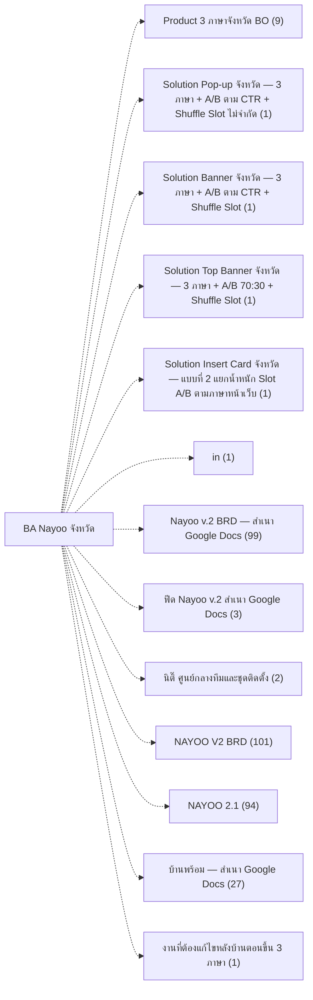
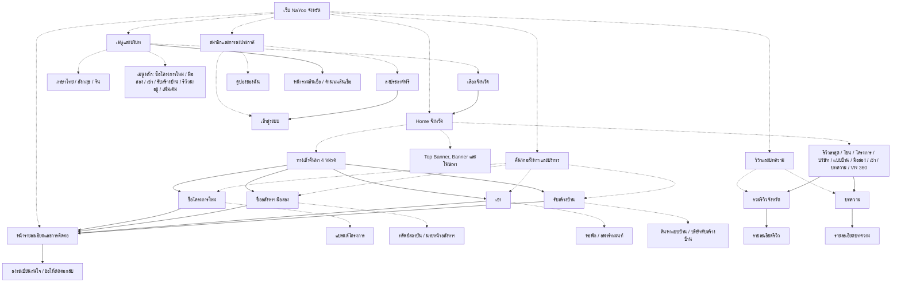

> ตรวจโครงสร้างเอกสารที่เผยแพร่และเข้าถึงได้ใน Collection Solution วันที่ 20 พฤศจิกายน 2569 เวลา 15:23 น. (ไทย) ใต้ [BA Nayoo จังหวัด](https://wiki.infonayoo.co/doc/ba-nayoo-nWwn1gqMmz) พบ **341 หน้า** (ไม่รวมหน้าแม่ BA และหน้าแผนผังนี้) ผังนี้แสดงความสัมพันธ์หน้าแม่–ลูกตาม Wiki ปัจจุบัน

## ภาพรวมหมวดเอกสาร

| หมวดใต้ BA Nayoo จังหวัด | จำนวนหน้า (รวมหน้าแม่หมวด) |
|--------------------------|---------------------------:|
| [Product 3 ภาษาจังหวัด BO](https://wiki.infonayoo.co/doc/product-3-bo-AKj5hljBnV) | 9                          |
| [Solution Pop-up จังหวัด — 3 ภาษา + A/B ตาม CTR + Shuffle Slot ไม่จำกัด](https://wiki.infonayoo.co/doc/solution-pop-up-3-ab-ctr-shuffle-slot-OIULEZeCv3) | 1                          |
| [Solution Banner จังหวัด — 3 ภาษา + A/B ตาม CTR + Shuffle Slot](https://wiki.infonayoo.co/doc/solution-banner-3-ab-ctr-shuffle-slot-wU9RYIkYJt) | 1                          |
| [Solution Top Banner จังหวัด — 3 ภาษา + A/B 70:30 + Shuffle Slot](https://wiki.infonayoo.co/doc/solution-top-banner-3-ab-7030-shuffle-slot-MKZCVcJPBC) | 1                          |
| [Solution Insert Card จังหวัด — แบบที่ 2 แยกน้ำหนัก Slot A/B ตามภาษาหน้าเว็บ](https://wiki.infonayoo.co/doc/solution-insert-card-2-slot-ab-PWUz9WeLSd) | 1                          |
| [in](https://wiki.infonayoo.co/doc/in-5wtLVG2NiJ) | 1                          |
| [Nayoo v.2 BRD — สำเนา Google Docs](https://wiki.infonayoo.co/doc/nayoo-v2-brd-google-docs-SggCvgHltC) | 99                         |
| [ฟีด Nayoo v.2 สำเนา Google Docs](https://wiki.infonayoo.co/doc/nayoo-v2-google-docs-CEnsldy7GM) | 3                          |
| [นิติ๊ ศูนย์กลางทีมและชุดติดตั้ง](https://wiki.infonayoo.co/doc/4liz4li04liv4li04lmkioc4qoc4uec4mec4ouc5joc4gec4pec4suc4hc4lc4tec4oec5gec4pec4soc4iuc4uoc4loc4lec4toc4loc4lec4sec5iec4hw-MPUp4fY0PL) | 2                          |
| [NAYOO V2 BRD](https://wiki.infonayoo.co/doc/nayoo-v2-brd-c7nSpvc6nJ) | 101                        |
| [NAYOO 2.1](https://wiki.infonayoo.co/doc/nayoo-21-OBsTAazwZ7) | 94                         |
| [บ้านพร้อม — สำเนา Google Docs](https://wiki.infonayoo.co/doc/google-docs-NyvfScZ7Cw) | 27                         |
| [งานที่ต้องแก้ไขหลังบ้านตอนขึ้น 3 ภาษา](https://wiki.infonayoo.co/doc/3-BE93ygYpE1) | 1                          |
| **รวม**                  | **341**                    |

## แผนผังหมวดหลัก

เส้นประในผังหมายถึงตำแหน่งหน้าแม่–ลูกใน Wiki จำนวนในวงเล็บนับหน้าแม่หมวดด้วย

## แผนผังสมองของเว็บ NaYoo จังหวัด

ผังนี้จัดกลุ่ม **หน้าที่และทางเดินของผู้ใช้เว็บจังหวัด** ตามเอกสาร BA ไม่ใช่ผังหน้าแม่–ลูกของ Wiki ด้านล่าง เส้นทึบหมายถึงทางไปหน้าหรือขั้นตอนที่เอกสารระบุ; เส้นประหมายถึงการจัดกลุ่มหน้าหรือองค์ประกอบเพื่ออ่านภาพรวม

**เส้นทางหลักที่ตรวจจากข้อกำหนด**

| จุดเริ่ม | ทางไป |
|----------|-------|
| เลือกจังหวัดใน navbar | เปลี่ยนบริบทเป็นเว็บจังหวัด; เมนูค้นหาและรีวิวแสดงข้อมูลจังหวัดที่เลือกตาม [navbar rev 3](https://wiki.infonayoo.co/doc/navbar-kB8i0O0qdM) |
| ปุ่มค้นหา 4 หมวดบน Home จังหวัด | ไปหน้าค้นหาโครงการใหม่, มือสอง, เช่า หรือบริษัทรับสร้างบ้านของจังหวัด ตาม [Home จังหวัด rev 8 — EP-02](https://wiki.infonayoo.co/doc/home-izC2SB1Mml) |
| การ์ด/ผลค้นหา | เข้าหน้ารายละเอียดใบประกาศหรือโปรไฟล์ที่เกี่ยวข้อง; จากหน้ารายละเอียดมีทางลงทะเบียนสนใจ ตาม [หน้ารายละเอียดใบประกาศ rev 7 — EP-01](https://wiki.infonayoo.co/doc/4lir4liz4lmj4liy4lij4liy4lii4lil4liw4lma4lit4li14lii4liu4lmd4lia4lib4lij4liw4lib4liy4lio-eOviDIb06v) |
| เมนูรีวิวน่าอยู่ / เพิ่มเติม | ไปรีวิวจังหวัด; เมนูเพิ่มเติมมีบทความ สินเชื่อ คูปองของฉัน และสมัครนายหน้า ตาม [navbar rev 3](https://wiki.infonayoo.co/doc/navbar-kB8i0O0qdM) |
| ลงประกาศฟรี | เปิด modal เข้าสู่ระบบตาม [navbar rev 3](https://wiki.infonayoo.co/doc/navbar-kB8i0O0qdM) |

**ขอบเขต:** เป็นผังจาก Requirement ของเว็บจังหวัดและเมนูที่ระบุในเอกสาร ยังไม่ใช่ผลตรวจหน้าเว็บจริง ส่วน “บทความ” ในข้อกำหนด navbar ระบุปลายทางเป็นหน้ารวมทุกจังหวัด แม้ผู้ใช้อยู่ในบริบทจังหวัด จึงให้เป็นหมวดเนื้อหาโดยไม่วาดว่าเป็นบทความเฉพาะจังหวัด

## ทะเบียนหน้าแม่–ลูกปัจจุบัน

แต่ละรายการลิงก์ไปยังหน้า Wiki จริง การเยื้องแสดงโครงสร้างเอกสาร ไม่ได้ยืนยันว่ามีลิงก์อ้างอิงในเนื้อหา หรือยืนยันว่ากฎของทุกหน้ายังใช้งานในระบบ

### Product 3 ภาษาจังหวัด BO

* [Product 3 ภาษาจังหวัด BO](https://wiki.infonayoo.co/doc/product-3-bo-AKj5hljBnV)
  * [Solution Insert Card จังหวัด — แบบที่ 1 รวมน้ำหนัก Slot A/B ทุกภาษา](https://wiki.infonayoo.co/doc/solution-insert-card-1-slot-ab-H0anr0lTIV)
    * [Backoffice มือ 1](https://wiki.infonayoo.co/doc/backoffice-1-X8XW32R1Vp)
  * [Solution Pop-up จังหวัด — แบบที่ 1 รวม 3 ภาษาและทุกอุปกรณ์](https://wiki.infonayoo.co/doc/solution-pop-up-1-3-CJekA4JZ5p)
    * [backoffice](https://wiki.infonayoo.co/doc/backoffice-vL7KLT2MMo)
  * [Solution Banner จังหวัด — แบบที่ 1 รวม 3 ภาษาและทุกอุปกรณ์](https://wiki.infonayoo.co/doc/solution-banner-1-3-N5gcvKmTN0)
    * [backoffice](https://wiki.infonayoo.co/doc/backoffice-s489P1zu5B)
  * [Solution Top Banner จังหวัด — แบบที่ 1 รวม 3 ภาษาและทุกอุปกรณ์](https://wiki.infonayoo.co/doc/solution-top-banner-1-3-EagRo1AqPY)
    * [backoffice](https://wiki.infonayoo.co/doc/backoffice-b3VcLtUS2T)

### Solution Pop-up จังหวัด — 3 ภาษา + A/B ตาม CTR + Shuffle Slot ไม่จำกัด

* [Solution Pop-up จังหวัด — 3 ภาษา + A/B ตาม CTR + Shuffle Slot ไม่จำกัด](https://wiki.infonayoo.co/doc/solution-pop-up-3-ab-ctr-shuffle-slot-OIULEZeCv3)

### Solution Banner จังหวัด — 3 ภาษา + A/B ตาม CTR + Shuffle Slot

* [Solution Banner จังหวัด — 3 ภาษา + A/B ตาม CTR + Shuffle Slot](https://wiki.infonayoo.co/doc/solution-banner-3-ab-ctr-shuffle-slot-wU9RYIkYJt)

### Solution Top Banner จังหวัด — 3 ภาษา + A/B 70:30 + Shuffle Slot

* [Solution Top Banner จังหวัด — 3 ภาษา + A/B 70:30 + Shuffle Slot](https://wiki.infonayoo.co/doc/solution-top-banner-3-ab-7030-shuffle-slot-MKZCVcJPBC)

### Solution Insert Card จังหวัด — แบบที่ 2 แยกน้ำหนัก Slot A/B ตามภาษาหน้าเว็บ

* [Solution Insert Card จังหวัด — แบบที่ 2 แยกน้ำหนัก Slot A/B ตามภาษาหน้าเว็บ](https://wiki.infonayoo.co/doc/solution-insert-card-2-slot-ab-PWUz9WeLSd)

### in

* [in](https://wiki.infonayoo.co/doc/in-5wtLVG2NiJ)

### Nayoo v.2 BRD — สำเนา Google Docs

* [Nayoo v.2 BRD — สำเนา Google Docs](https://wiki.infonayoo.co/doc/nayoo-v2-brd-google-docs-SggCvgHltC)
  * [สิ่งที่รอแก้ไข](https://wiki.infonayoo.co/doc/4liq4li04lmi4lih4lix4li14lmi4lij4lit4lmb4lib4lmj4lme4lic-L3dJBCiVn9)
  * [Product](https://wiki.infonayoo.co/doc/product-HTG0EyK4Aj)
    * [Ranking Model](https://wiki.infonayoo.co/doc/ranking-model-AfPi1cb34o)
    * [Top Banner](https://wiki.infonayoo.co/doc/top-banner-ZL1NOVBGVt)
    * [Banner](https://wiki.infonayoo.co/doc/banner-jymUKViVbH)
    * [Coming Soon](https://wiki.infonayoo.co/doc/coming-soon-L7zAJ2kDgd)
    * [Super Top Ads](https://wiki.infonayoo.co/doc/super-top-ads-pQVVOiQ9Hm)
    * [Top Ads](https://wiki.infonayoo.co/doc/top-ads-jXneWjTmoK)
    * [Logo แบรนด์โครงการ](https://wiki.infonayoo.co/doc/logo-7THKmMbuli)
    * [Insert Card](https://wiki.infonayoo.co/doc/insert-card-pWnARZEJvz)
    * [บริษัทรับสร้างบ้านชั้นนำ](https://wiki.infonayoo.co/doc/4lia4lij4li04lip4lix4lix4lij4lix4lia4liq4lij4lmj4liy4lih4lia4lmj4liy4liz4lik4lix4lmj4liz4liz4liz-mX8hlktJgN)
    * [โครงการใกล้เคียง](https://wiki.infonayoo.co/doc/4lmc4lie4lij4lih4lib4liy4lij4lmd4lib4lil4lmj4lma4lie4li14lii4lih-uSgHt6Qa6A)
    * [รับสร้างบ้าน (Product)](https://wiki.infonayoo.co/doc/product-cood1bWD9S)
    * [Insert Card (Demo)](https://wiki.infonayoo.co/doc/insert-card-demo-i6Kyz9xRux)
  * [log-in register BO](https://wiki.infonayoo.co/doc/log-in-register-bo-nG1L2cUet5)
  * [MS BO NPA](https://wiki.infonayoo.co/doc/ms-bo-npa-B1giknjdPI)
  * [MS BO รับสร้างบ้าน](https://wiki.infonayoo.co/doc/ms-bo-6W8cGFTqQx)
  * [MS BO มือ 1](https://wiki.infonayoo.co/doc/ms-bo-1-aTAaaSzcfz)
  * [MS ผู้ใช้งาน](https://wiki.infonayoo.co/doc/ms-vgLOTvQVrm)
  * [MS console NPA](https://wiki.infonayoo.co/doc/ms-console-npa-I0h111YT9u)
    * [จัดการแอดมิน NPA](https://wiki.infonayoo.co/doc/npa-ILWwreGwqc)
  * [MS console รับสร้างบ้าน](https://wiki.infonayoo.co/doc/ms-console-WnPlrcxjfx)
    * [จัดการแอดมินรับสร้างบ้าน](https://wiki.infonayoo.co/doc/4lii4lix4liu4lib4liy4lij4lmb4lit4liu4lih4li04liz4lij4lix4lia4liq4lij4lmj4liy4lih4lia4lmj4liy4liz-W6LuavAV4R)
  * [MS console มือ 1](https://wiki.infonayoo.co/doc/ms-console-1-Pui100VxZe)
    * [จัดการแอดมิน มือ 1](https://wiki.infonayoo.co/doc/1-LLfoMhidFT)
  * [website nayoo](https://wiki.infonayoo.co/doc/website-nayoo-Lyr3pHeVcx)
    * [navbar](https://wiki.infonayoo.co/doc/navbar-kB8i0O0qdM)
    * [register B2B](https://wiki.infonayoo.co/doc/register-b2b-bZCLa4Fec1)
    * [log-in B2B](https://wiki.infonayoo.co/doc/log-in-b2b-5vwHkV4MM1)
    * [Register B2C](https://wiki.infonayoo.co/doc/register-b2c-xDCGaEZUBn)
    * [log-in B2C](https://wiki.infonayoo.co/doc/log-in-b2c-NP8cUxFAyr)
    * [Account Linking](https://wiki.infonayoo.co/doc/account-linking-5ftrpNNTXh)
  * [logic สถิติใบประกาศ](https://wiki.infonayoo.co/doc/logic-ENLTA3RijK)
  * [ranking มือ 1](https://wiki.infonayoo.co/doc/ranking-1-1RFyfVYlAG)
  * [ลงใบประกาศ backoffice](https://wiki.infonayoo.co/doc/backoffice-NlhotFXfDz)
    * [มือ 1](https://wiki.infonayoo.co/doc/1-uXpBz7wUKo)
    * [มือ 2 BO](https://wiki.infonayoo.co/doc/2-bo-3eNaxXNM2w)
    * [รับสร้างบ้าน](https://wiki.infonayoo.co/doc/4lij4lix4lia4liq4lij4lmj4liy4lih4lia4lmj4liy4liz-gZ5qbAk7hv)
    * [เจ้าของหอพัก BO](https://wiki.infonayoo.co/doc/bo-yW8FCg3Dal)
    * [NPA BO](https://wiki.infonayoo.co/doc/npa-bo-ESLvv5OAGL)
  * [ลงใบประกาศ console](https://wiki.infonayoo.co/doc/console-ocjuJeieiR)
    * [ลงใบประกาศมือ1](https://wiki.infonayoo.co/doc/1-68lBzn3ay2)
    * [ลงใบประกาศมือ2](https://wiki.infonayoo.co/doc/2-c1LFdyg1xW)
    * [ลงประกาศนายหน้า](https://wiki.infonayoo.co/doc/4lil4lih4lib4lij4liw4lib4liy4lio4liz4liy4lii4lir4liz4lmj4liy-i0dIsxsHbG)
    * [ลงใบประกาศเจ้าของหอพัก](https://wiki.infonayoo.co/doc/4lil4lih4lmd4lia4lib4lij4liw4lib4liy4lio4lma4lii4lmj4liy4lic4lit4lih4lir4lit4lie4lix4lib-8tidxoNKW3)
    * [ลงใบประกาศรับสร้างบ้าน](https://wiki.infonayoo.co/doc/4lil4lih4lmd4lia4lib4lij4liw4lib4liy4lio4lij4lix4lia4liq4lij4lmj4liy4lih4lia4lmj4liy4liz-DaN6elAY1G)
    * [ลงใบประกาศ NPA](https://wiki.infonayoo.co/doc/npa-V21cGHMYHW)
  * [ใบประกาศ v.2](https://wiki.infonayoo.co/doc/v2-ev6UOL7hgp)
    * [โครงการ](https://wiki.infonayoo.co/doc/4lmc4lie4lij4lih4lib4liy4lij-7e1vUb3cnX)
    * [โครงการพรีเมี่ยม](https://wiki.infonayoo.co/doc/4lmc4lie4lij4lih4lib4liy4lij4lie4lij4li14lma4lih4li14lmi4lii4lih-DALCNnovfK)
    * [นายหน้า](https://wiki.infonayoo.co/doc/4liz4liy4lii4lir4liz4lmj4liy-0yq4u5QI3M)
    * [มือสอง](https://wiki.infonayoo.co/doc/4lih4li34lit4liq4lit4lih-sp95ZWtvJw)
      * [เจ้าของหอพัก](https://wiki.infonayoo.co/doc/4lma4lii4lmj4liy4lic4lit4lih4lir4lit4lie4lix4lib-n0d87htV4T)
    * [แบบบ้านธรรมดา](https://wiki.infonayoo.co/doc/4lmb4lia4lia4lia4lmj4liy4liz4liy4lij4lij4lih4liu4liy-Dq7rYD4wzd)
    * [แบบบ้านพรีเมี่ยม](https://wiki.infonayoo.co/doc/4lmb4lia4lia4lia4lmj4liy4liz4lie4lij4li14lma4lih4li14lmi4lii4lih-v4Gif98Y4w)
    * [โครงการเปิดตัวใหม่](https://wiki.infonayoo.co/doc/4lmc4lie4lij4lih4lib4liy4lij4lma4lib4li04liu4liv4lix4lin4lmd4lir4lih4lmi-4vP4bXGhK5)
    * [โครงการเฟดใหม่](https://wiki.infonayoo.co/doc/4lmc4lie4lij4lih4lib4liy4lij4lma4lif4liu4lmd4lir4lih4lmi-8yt2T7ZMly)
    * [NOTE](https://wiki.infonayoo.co/doc/note-KhDP4L19Hb)
  * [จัดการใบประกาศ console](https://wiki.infonayoo.co/doc/console-3bdj5lEfjV)
  * [จัดการใบประกาศมือ 1](https://wiki.infonayoo.co/doc/1-xaFZCeKezb)
    * [จัดการใบประกาศรับสร้างบ้าน](https://wiki.infonayoo.co/doc/4lii4lix4liu4lib4liy4lij4lmd4lia4lib4lij4liw4lib4liy4lio4lij4lix4lia4liq4lij4lmj4liy4lih4lia4lmj4liy4liz-uwnfrJnBo7)
    * [จัดการใบประกาศมือสอง](https://wiki.infonayoo.co/doc/4lii4lix4liu4lib4liy4lij4lmd4lia4lib4lij4liw4lib4liy4lio4lih4li34lit4liq4lit4lih-1TjjhsBXUB)
  * [จัดการใบประกาศ BO](https://wiki.infonayoo.co/doc/bo-F0ud0tkcYp)
    * [โครงการมือ 1](https://wiki.infonayoo.co/doc/1-GsEAUplU39)
    * [มือสองbo](https://wiki.infonayoo.co/doc/bo-CSFSFolTUh)
    * [หอพักBO](https://wiki.infonayoo.co/doc/bo-q1WBsSTStz)
    * [รับสร้างบ้าน bo](https://wiki.infonayoo.co/doc/bo-3enaA9uZFj)
    * [NPAฺฺBO](https://wiki.infonayoo.co/doc/npabo-fyBlsXSBBi)
  * [ระบบ auto approve](https://wiki.infonayoo.co/doc/auto-approve-Svzajs7ni0)
    * [โครงการมือ1](https://wiki.infonayoo.co/doc/1-Tx33aglZJG)
    * [มือ2 มีปรับ apporve](https://wiki.infonayoo.co/doc/2-apporve-9EaNBtCKg8)
    * [หอพัก/อภาร์ทเมนต์](https://wiki.infonayoo.co/doc/4lir4lit4lie4lix4liblc4rec4ooc4suc4oc5joc4lc5goc4oec4mec4lec5ja-glhS4xFsLc)
    * [รับสร้างบ้าน.](https://wiki.infonayoo.co/doc/4lij4lix4lia4liq4lij4lmj4liy4lih4lia4lmj4liy4lizlg-cPC6C7R4Sf)
    * [ทรัพย์สถาบัน](https://wiki.infonayoo.co/doc/4lix4lij4lix4lie4lii4lmm4liq4liw4liy4lia4lix4liz-23xgqRl1uz)
  * [หน้ารวมสินเชื่อ v.2](https://wiki.infonayoo.co/doc/v2-bbUJOpA1vr)
  * [บทความ](https://wiki.infonayoo.co/doc/4lia4lix4lie4lin4liy4lih-gfiEuOXfAM)
    * [บทความ รวมจังหวัด](https://wiki.infonayoo.co/doc/4lia4lix4lie4lin4liy4lihioc4oc4pc4oec4ioc4sec4hc4qc4pc4sec4la-dWhPDMVzfr)
  * [กระดาษทด ด้านล่างไม่เอา](https://wiki.infonayoo.co/doc/4lib4lij4liw4liu4liy4lip4lix4liuioc4loc5iec4suc4mec4pec5ioc4suc4hc5hoc4oec5ioc5goc4rec4sg-Zqla5tlWyU)
    * [คะแนนใบประกาศรับสร้างบ้าน](https://wiki.infonayoo.co/doc/4lie4liw4lmb4liz4liz4lmd4lia4lib4lij4liw4lib4liy4lio4lij4lix4lia4liq4lij4lmj4liy4lih4lia4lmj4liy4liz-sGFGo347VC)
    * [คะแนนใบประกาศโครงการมือ 1](https://wiki.infonayoo.co/doc/1-6Tqd0e3Aj5)
    * [คะแนนน่าอยู่ของมือสองใหม่](https://wiki.infonayoo.co/doc/4lie4liw4lmb4liz4liz4liz4lmi4liy4lit4lii4li54lmi4lic4lit4lih4lih4li34lit4liq4lit4lih4lmd4lir4lih4lmi-Glwz1NJ7M8)
    * [คะแนนใบประกาศเจ้าของหอพักใหม่](https://wiki.infonayoo.co/doc/4lie4liw4lmb4liz4liz4lmd4lia4lib4lij4liw4lib4liy4lio4lma4lii4lmj4liy4lic4lit4lih4lir4lit4lie4lix4lib4lmd4lir4lih4lmi-a71NSxpk57)
    * [Edit profile มือ 1](https://wiki.infonayoo.co/doc/edit-profile-1-WvU8Ap5ds5)
    * [Edit Profile ทั่วไป](https://wiki.infonayoo.co/doc/edit-profile-yK0A6Kqw3I)
    * [Edit profile นายหน้า](https://wiki.infonayoo.co/doc/edit-profile-wv6F9Asi8u)
      * [new apporve ใบประกาศ](https://wiki.infonayoo.co/doc/new-apporve-OG6n4MRD6t)
    * [Edit profile รับสร้างบ้าน](https://wiki.infonayoo.co/doc/edit-profile-znZFoin3yR)
    * [จัดการสิทธิ์แม่ลูก](https://wiki.infonayoo.co/doc/4lii4lix4liu4lib4liy4lij4liq4li04lix4liy4li04lmm4lmb4lih4lmi4lil4li54lib-nZS2LpfGQk)
    * [จัดการบริษัทมือ 1](https://wiki.infonayoo.co/doc/1-otWN2lagcY)
      * [Role การสมัครสมาชิก](https://wiki.infonayoo.co/doc/role-y74JHdXPAQ)
      * [จัดการบริษัทนายหน้า](https://wiki.infonayoo.co/doc/4lii4lix4liu4lib4liy4lij4lia4lij4li04lip4lix4lix4liz4liy4lii4lir4liz4lmj4liy-ob6GonHDlJ)
    * [จัดการบริษัทรับสร้างบ้าน](https://wiki.infonayoo.co/doc/4lii4lix4liu4lib4liy4lij4lia4lij4li04lip4lix4lix4lij4lix4lia4liq4lij4lmj4liy4lih4lia4lmj4liy4liz-YaGCWNroh7)
    * [การ approve ใบประกาศ](https://wiki.infonayoo.co/doc/approve-HGgEZX0MUx)
  * [การดันใบประกาศ](https://wiki.infonayoo.co/doc/4lib4liy4lij4liu4lix4liz4lmd4lia4lib4lij4liw4lib4liy4lio-UFGoLjnlgd)
  * [console มือ1 not yet](https://wiki.infonayoo.co/doc/console-1-not-yet-YD5YjC7bOI)
  * [console เจ้าของหอพัก not yet](https://wiki.infonayoo.co/doc/console-not-yet-DbaIZSSmOc)
  * [consoleมือ2  not yet](https://wiki.infonayoo.co/doc/console2-not-yet-s46iHeXRLN)
  * [จัดการผลงาน](https://wiki.infonayoo.co/doc/4lii4lix4liu4lib4liy4lij4lic4lil4lih4liy4liz-F3KnsgwpC5)

### ฟีด Nayoo v.2 สำเนา Google Docs

* [ฟีด Nayoo v.2 สำเนา Google Docs](https://wiki.infonayoo.co/doc/nayoo-v2-google-docs-CEnsldy7GM)
  * [ลงฟีด CS โปรไฟล์รับสร้างบ้าน](https://wiki.infonayoo.co/doc/cs-jt1UCuc2Hc)
  * [ลงฟีด CS จัดการมือ 1](https://wiki.infonayoo.co/doc/cs-1-7vGsGExq9z)

### นิติ๊ ศูนย์กลางทีมและชุดติดตั้ง

* [นิติ๊ ศูนย์กลางทีมและชุดติดตั้ง](https://wiki.infonayoo.co/doc/4liz4li04liv4li04lmkioc4qoc4uec4mec4ouc5joc4gec4pec4suc4hc4lc4tec4oec5gec4pec4soc4iuc4uoc4loc4lec4toc4loc4lec4sec5iec4hw-MPUp4fY0PL)
  * [สมอง Wiki น่าอยู่ — แผนที่เอกสารและต้นฉบับ](https://wiki.infonayoo.co/doc/wiki-e9PNcNeKvD)

### NAYOO V2 BRD

* [NAYOO V2 BRD](https://wiki.infonayoo.co/doc/nayoo-v2-brd-c7nSpvc6nJ)
  * [bo เฟดใหม่](https://wiki.infonayoo.co/doc/bo-UaHsP9GTGi)
  * [ใบประกาศเฟดใหม่](https://wiki.infonayoo.co/doc/4lmd4lia4lib4lij4liw4lib4liy4lio4lma4lif4liu4lmd4lir4lih4lmi-1efeZLFsdG)
  * [เมนูแฮมเบอร์เกอร์](https://wiki.infonayoo.co/doc/4lma4lih4liz4li54lmb4liu4lih4lma4lia4lit4lij4lmm4lma4lib4lit4lij4lmm-SOQrzTGD7x)
  * [รายชื่อ console](https://wiki.infonayoo.co/doc/console-m3vEY6xbJL)
    * [โครงการ](https://wiki.infonayoo.co/doc/4lmc4lie4lij4lih4lib4liy4lij-IViDR2B3RB)
    * [มือสอง](https://wiki.infonayoo.co/doc/4lih4li34lit4liq4lit4lih-fwvLHtZXpf)
    * [นายหน้า](https://wiki.infonayoo.co/doc/4liz4liy4lii4lir4liz4lmj4liy-G7TdeE8d5Y)
    * [รับสร้างบ้าน-](https://wiki.infonayoo.co/doc/4lij4lix4lia4liq4lij4lmj4liy4lih4lia4lmj4liy4lizlq-NH4fEPqpWv)
    * [NPA ทรัพยฺสถาบัน](https://wiki.infonayoo.co/doc/npa-zYTVLJ1ML8)
    * [line ลูกค้า](https://wiki.infonayoo.co/doc/line-VJlYvt4ZnR)
  * [ฟีเจอร์ notification](https://wiki.infonayoo.co/doc/notification-lLynSOgiyM)
  * [สถิติใบประกาศ](https://wiki.infonayoo.co/doc/4liq4liw4li04liv4li04lmd4lia4lib4lij4liw4lib4liy4lio-IW8eZojRLv)
    * [สถิติใบประกาศ แบบบ้าน](https://wiki.infonayoo.co/doc/4liq4liw4li04liv4li04lmd4lia4lib4lij4liw4lib4liy4lioioc5gec4muc4muc4muc5iec4suc4mq-scNuVh75e1)
    * [สถิติใบประกาศ นายหน้า](https://wiki.infonayoo.co/doc/4liq4liw4li04liv4li04lmd4lia4lib4lij4liw4lib4liy4lioioc4mec4suc4ouc4qc4mec5iec4sg-ZrxQuNtD4p)
    * [สถิติใบประกาศหอพัก](https://wiki.infonayoo.co/doc/4liq4liw4li04liv4li04lmd4lia4lib4lij4liw4lib4liy4lio4lir4lit4lie4lix4lib-9m17NXeQzb)
    * [สถิติใบประกาศมือ 2](https://wiki.infonayoo.co/doc/2-C0VxANF43A)
    * [สถิติใบประกาศมือ 1](https://wiki.infonayoo.co/doc/1-JduXMjpnfL)
    * [สถิติใบประกาศ NPA](https://wiki.infonayoo.co/doc/npa-u2CO1Tq5RG)
  * [หน้าค้นหา จังหวัด](https://wiki.infonayoo.co/doc/4lir4liz4lmj4liy4lie4lmj4liz4lir4liyioc4ioc4sec4hc4qc4pc4sec4la-gfWq84w5di)
    * [ค้นหาบริษัทรับสร้างบ้าน จังหวัด](https://wiki.infonayoo.co/doc/4lie4lmj4liz4lir4liy4lia4lij4li04lip4lix4lix4lij4lix4lia4liq4lij4lmj4liy4lih4lia4lmj4liy4lizioc4ioc4sec4hc4qc4pc4sec4la-EtHvZSve1T)
    * [ค้นหาแบบบ้าน จังหวัด](https://wiki.infonayoo.co/doc/4lie4lmj4liz4lir4liy4lmb4lia4lia4lia4lmj4liy4lizioc4ioc4sec4hc4qc4pc4sec4la-1gOVKax2b9)
    * [ค้นหาเช่า จังหวัด](https://wiki.infonayoo.co/doc/4lie4lmj4liz4lir4liy4lma4lik4lmi4liyioc4ioc4sec4hc4qc4pc4sec4la-M0cdYFjquk)
    * [ค้นหาทรัพย์สถาบัน](https://wiki.infonayoo.co/doc/4lie4lmj4liz4lir4liy4lix4lij4lix4lie4lii4lmm4liq4liw4liy4lia4lix4liz-HSvMVUthZh)
    * [ค้นหาตัวแทนอสังหาฯ](https://wiki.infonayoo.co/doc/4lie4lmj4liz4lir4liy4liv4lix4lin4lmb4lix4liz4lit4liq4lix4lih4lir4liy4liv-NNzQQRExLS)
    * [ค้นหามือ 2 จังหวัด](https://wiki.infonayoo.co/doc/2-r1p9RJpVR5)
    * [ค้นหาแบรนด์โครงการ จังหวัด](https://wiki.infonayoo.co/doc/4lie4lmj4liz4lir4liy4lmb4lia4lij4liz4liu4lmm4lmc4lie4lij4lih4lib4liy4lijioc4ioc4sec4hc4qc4pc4sec4la-oPfZe9ainh)
    * [ค้นหามือ 1 จังหวัด](https://wiki.infonayoo.co/doc/1-sY1y6gIUNZ)
  * [ฟีเจอร์ฺ FAQ](https://wiki.infonayoo.co/doc/faq-XzvahUzUsL)
  * [ฟีเจอร์ hook](https://wiki.infonayoo.co/doc/hook-X7X0YDe3xK)
  * [ฟีเจอร์ดันใบประกาศ](https://wiki.infonayoo.co/doc/4lif4li14lma4lii4lit4lij4lmm4liu4lix4liz4lmd4lia4lib4lij4liw4lib4liy4lio-14ZkPYwBmX)
  * [Home](https://wiki.infonayoo.co/doc/home-KuQ2GkF2ry)
    * [Home จังหวัด](https://wiki.infonayoo.co/doc/home-izC2SB1Mml)
    * [Home Center](https://wiki.infonayoo.co/doc/home-center-dORIq9JLYz)
  * [Profile User view](https://wiki.infonayoo.co/doc/profile-user-view-9y8wklLNWe)
    * [มือ 1](https://wiki.infonayoo.co/doc/1-dfQ1NpYY3v)
    * [NPA](https://wiki.infonayoo.co/doc/npa-oE68BeZQEP)
    * [รับสร้างบ้าน](https://wiki.infonayoo.co/doc/4lij4lix4lia4liq4lij4lmj4liy4lih4lia4lmj4liy4liz-WDBXypd7s3)
  * [Filter](https://wiki.infonayoo.co/doc/filter-cL1CLaemFP)
    * [ฟีลเตอร์มือ 1 center](https://wiki.infonayoo.co/doc/1-center-WfbNemPwvp)
    * [แบบบ้าน](https://wiki.infonayoo.co/doc/4lmb4lia4lia4lia4lmj4liy4liz-7ahWCAo8dw)
    * [มือ1](https://wiki.infonayoo.co/doc/1-D2cerBvy7O)
    * [Profile รับสร้างบ้าน](https://wiki.infonayoo.co/doc/profile-dKQQ5kWXuv)
    * [เช่า](https://wiki.infonayoo.co/doc/4lma4lik4lmi4liy-Ozl1RQOHoY)
    * [มือ 2](https://wiki.infonayoo.co/doc/2-wxtrrGPT4h)
    * [ฟีลเตอรืมือ 2 center](https://wiki.infonayoo.co/doc/2-center-TfxAXGfcbM)
    * [ฟีลเตอร์ เช่า center](https://wiki.infonayoo.co/doc/center-AlOrkzOcPT)
    * [ฟีลเตอร์แบบบ้าน center](https://wiki.infonayoo.co/doc/center-9nTLhvbJPv)
    * [ฟีลเตอร์ profile รับสร้าง center](https://wiki.infonayoo.co/doc/profile-center-WKxPxjfnUi)
  * [บทความ](https://wiki.infonayoo.co/doc/4lia4lix4lie4lin4liy4lih-XjB0Lf1nkz)
    * [รวมบทความ จังหวัด](https://wiki.infonayoo.co/doc/4lij4lin4lih4lia4lix4lie4lin4liy4lihioc4ioc4sec4hc4qc4pc4sec4la-VMk7l85ZQx)
    * [รวมบทความ center](https://wiki.infonayoo.co/doc/center-TGnxchnNXD)
  * [รายละเอียดบทความ](https://wiki.infonayoo.co/doc/4lij4liy4lii4lil4liw4lma4lit4li14lii4liu4lia4lix4lie4lin4liy4lih-yiAC96ctJU)
  * [รีวิว](https://wiki.infonayoo.co/doc/4lij4li14lin4li04lin-Arh8UxGspl)
    * [รวมรีวิว1 จังหวัด](https://wiki.infonayoo.co/doc/1-8ZLP1cZEld)
    * [รวมรีวิว2 จังหวัด](https://wiki.infonayoo.co/doc/2-uCmc4REiYD)
    * [รายละเอียดรีวิว](https://wiki.infonayoo.co/doc/4lij4liy4lii4lil4liw4lma4lit4li14lii4liu4lij4li14lin4li04lin-wNArlBEXRa)
    * [รวมรีวิว center](https://wiki.infonayoo.co/doc/center-8NK2RB4qDo)
  * [Product  BO](https://wiki.infonayoo.co/doc/product-bo-ByqEts3fDo)
    * [Top ads รับสร้างบ้าน](https://wiki.infonayoo.co/doc/top-ads-KXem76b4j3)
    * [จัดการ ads แบรนด์โครงการ](https://wiki.infonayoo.co/doc/ads-b0HXath69I)
    * [รับสร้างบ้านชั้นนำ](https://wiki.infonayoo.co/doc/4lij4lix4lia4liq4lij4lmj4liy4lih4lia4lmj4liy4liz4lik4lix4lmj4liz4liz4liz-zJDXcfl4EM)
    * [Top ads มือ 1 2 เช่า](https://wiki.infonayoo.co/doc/top-ads-1-2-9f7BVBAWwt)
    * [ฺBanner](https://wiki.infonayoo.co/doc/banner-EbAa9QvPMK)
    * [Top banner](https://wiki.infonayoo.co/doc/top-banner-FJY5i3cWnq)
    * [Pop up](https://wiki.infonayoo.co/doc/pop-up-gzGyTsZnty)
    * [Super top ads](https://wiki.infonayoo.co/doc/super-top-ads-Zlavn0PReg)
    * [VR 360 แบรนด์โครงการ](https://wiki.infonayoo.co/doc/vr-360-VgL1mVEJLV)
    * [vr รับสร้างบ้าน](https://wiki.infonayoo.co/doc/vr-d0ss9rd4jZ)
    * [BO ปักหมุดรีวิวมือ1](https://wiki.infonayoo.co/doc/bo-1-dRT71P3OCf)
    * [ฺBO ปักหมุดรีวิวมือสอง](https://wiki.infonayoo.co/doc/bo-Oh5tVvAbyw)
    * [BO ปักหมุดรับสร้างบ้าน](https://wiki.infonayoo.co/doc/bo-KJQIX5fPTI)
    * [BO review](https://wiki.infonayoo.co/doc/bo-review-VM7O9GcFqe)
    * [ใบประกาศพรีเมี่ยม 1](https://wiki.infonayoo.co/doc/1-KbSIJKoFgn)
    * [ใบประกาศพรีรับสร้าง](https://wiki.infonayoo.co/doc/4lmd4lia4lib4lij4liw4lib4liy4lio4lie4lij4li14lij4lix4lia4liq4lij4lmj4liy4lih-juH8PoisfO)
    * [pop up ติดตาม](https://wiki.infonayoo.co/doc/pop-up-pl1IS26LPz)
    * [แถบสื่อสาร](https://wiki.infonayoo.co/doc/4lmb4liw4lia4liq4li34lmi4lit4liq4liy4lij-e7koSUWmg8)
    * [เอกสารและการรับรอง](https://wiki.infonayoo.co/doc/4lma4lit4lib4liq4liy4lij4lmb4lil4liw4lib4liy4lij4lij4lix4lia4lij4lit4lih-yTawMHJkhA)
    * [ปักหมุดนายหน้า](https://wiki.infonayoo.co/doc/4lib4lix4lib4lir4lih4li44liu4liz4liy4lii4lir4liz4lmj4liy-WUVXbwOXOH)
    * [Top ads นายหน้า](https://wiki.infonayoo.co/doc/top-ads-nmc5e9K6K0)
    * [หน้าลงทะเบียน](https://wiki.infonayoo.co/doc/4lir4liz4lmj4liy4lil4lih4lix4liw4lma4lia4li14lii4liz-0NcA6YZsFd)
    * [Insert card](https://wiki.infonayoo.co/doc/insert-card-8bZkRHJL5l)
      * [Backofficeมือ 1](https://wiki.infonayoo.co/doc/backoffice-1-DYC7vLtW0i)
      * [Console มือ 1](https://wiki.infonayoo.co/doc/console-1-h6w4mCrgWC)
      * [backoffice น่าอยุ่](https://wiki.infonayoo.co/doc/backoffice-assMzSRNZV)
      * [backoffce อื่นๆ](https://wiki.infonayoo.co/doc/backoffce-JkH8Yr7WjB)
      * [backoffice รับสร้างบ้าน](https://wiki.infonayoo.co/doc/backoffice-NAQ9DH8fTX)
      * [Console รับสร้างบ้าน](https://wiki.infonayoo.co/doc/console-yGLRA8cc1P)
      * [การแสดงผล inset card](https://wiki.infonayoo.co/doc/inset-card-ZfqMSI7wmp)
  * [Product เปิดใหม่ เฟดใหม่](https://wiki.infonayoo.co/doc/product-Pg71nuN4Of)
    * [ฺBo เปิดใหม่](https://wiki.infonayoo.co/doc/bo-Fp8IjO1QcZ)
    * [ใบประกาศเปิดใหม่่](https://wiki.infonayoo.co/doc/4lmd4lia4lib4lij4liw4lib4liy4lio4lma4lib4li04liu4lmd4lir4lih4lmi4lmi-ftJ5wafZZT)
  * [บันทึกประกาศและประวัติ](https://wiki.infonayoo.co/doc/4lia4lix4liz4lix4li24lib4lib4lij4liw4lib4liy4lio4lmb4lil4liw4lib4lij4liw4lin4lix4liv4li0-Ly0K9ZVMdR)
  * [กราฟฟิค v.2](https://wiki.infonayoo.co/doc/v2-B6oXft5QUh)
  * [หน้าสรุปผลข้อมูล](https://wiki.infonayoo.co/doc/4lir4liz4lmj4liy4liq4lij4li44lib4lic4lil4lic4lmj4lit4lih4li54lil-Vw2hfJVAnb)
  * [ฟีด 2.1](https://wiki.infonayoo.co/doc/21-Fv7DAcT3vx)
  * [ไลน์ 2.1](https://wiki.infonayoo.co/doc/21-uxgx11Qh2e)
  * [Tab 47](https://wiki.infonayoo.co/doc/tab-47-54ChNGgMQf)
    * [Copy of BO review](https://wiki.infonayoo.co/doc/copy-of-bo-review-e4s3W5nhr0)
    * [กระดาษทด](https://wiki.infonayoo.co/doc/4lib4lij4liw4liu4liy4lip4lix4liu-fM2nROAE3a)
  * [VR 360 รับสร้างบ้าน](https://wiki.infonayoo.co/doc/vr-360-53WvBpvD0G)

### NAYOO 2.1

* [NAYOO 2.1](https://wiki.infonayoo.co/doc/nayoo-21-OBsTAazwZ7)
  * [Requirement ประชุม](https://wiki.infonayoo.co/doc/requirement-frGhaE2mba)
    * [event online landing page](https://wiki.infonayoo.co/doc/event-online-landing-page-0YXvNZRfUY)
      * [แก้ไข แคมเปญ landing page 2.1](https://wiki.infonayoo.co/doc/landing-page-21-S0enBdfXGh)
    * [backoffice event online](https://wiki.infonayoo.co/doc/backoffice-event-online-f6bD0nRGOZ)
      * [แก้ไขแคมเปญ 2.2](https://wiki.infonayoo.co/doc/22-PJCPyYEGeL)
    * [หน้าHome จังหวัด](https://wiki.infonayoo.co/doc/home-zvqXFbZxwH)
      * [EP- change](https://wiki.infonayoo.co/doc/ep-change-ab2LaeyD3b)
      * [เสิร์ชมือ 1ใบประกาศและหน้าเสิร์ชโปรไฟล์](https://wiki.infonayoo.co/doc/1-mLZFQhgGg7)
      * [แก้ไข เสิร์ชมือ 1](https://wiki.infonayoo.co/doc/1-s4PUn4ERv7)
      * [เสิร์ชมือใบประกาศมือ 2](https://wiki.infonayoo.co/doc/2-12kmB2EgVo)
      * [แก้ไขมือสอง](https://wiki.infonayoo.co/doc/4lmb4lib4lmj4lme4lic4lih4li34lit4liq4lit4lih-KApNL3dmSM)
      * [เสิร์ชเช่า](https://wiki.infonayoo.co/doc/4lma4liq4li04lij4lmm4lik4lma4lik4lmi4liy-UQJODgpDoJ)
      * [เสิร์ชแบบบ้าน บริษัท](https://wiki.infonayoo.co/doc/4lma4liq4li04lij4lmm4lik4lmb4lia4lia4lia4lmj4liy4lizioc4muc4oc4toc4qec4sec4lw-V4sa0adPvp)
      * [ใบประกาศมือ 1](https://wiki.infonayoo.co/doc/1-LzF4pfBE8I)
      * [แก้ไขใบประกาศมือ 1](https://wiki.infonayoo.co/doc/1-8S6hHurTf3)
      * [ใบประกาศมือ 2](https://wiki.infonayoo.co/doc/2-EqqA6Edn0F)
      * [แก้ไขใบประกาศมือ2](https://wiki.infonayoo.co/doc/2-ERTxO81mRk)
      * [ใบประกาศแบบบ้าน](https://wiki.infonayoo.co/doc/4lmd4lia4lib4lij4liw4lib4liy4lio4lmb4lia4lia4lia4lmj4liy4liz-5jZweQbEn4)
      * [แก้ไขแบบบ้าน](https://wiki.infonayoo.co/doc/4lmb4lib4lmj4lme4lic4lmb4lia4lia4lia4lmj4liy4liz-fIMzXv7OLN)
      * [ใบประกาศเช่า](https://wiki.infonayoo.co/doc/4lmd4lia4lib4lij4liw4lib4liy4lio4lma4lik4lmi4liy-yruuIK3JCm)
      * [บริษัทรับสร้างบ้าน](https://wiki.infonayoo.co/doc/4lia4lij4li04lip4lix4lix4lij4lix4lia4liq4lij4lmj4liy4lih4lia4lmj4liy4liz-2QYU8rwZwo)
      * [แก้ไขรับส้ร้างบ้าน](https://wiki.infonayoo.co/doc/4lmb4lib4lmj4lme4lic4lij4lix4lia4liq4lmj4lij4lmj4liy4lih4lia4lmj4liy4liz-LO2R8Erseb)
      * [แบรนด์โครงการ](https://wiki.infonayoo.co/doc/4lmb4lia4lij4liz4liu4lmm4lmc4lie4lij4lih4lib4liy4lij-i0cGz0ur4q)
      * [ใบประกาศที่ไม่เข้าร่วม](https://wiki.infonayoo.co/doc/4lmd4lia4lib4lij4liw4lib4liy4lio4lix4li14lmi4lme4lih4lmi4lma4lic4lmj4liy4lij4lmi4lin4lih-h4StvecWPz)
      * [ใบประกาศพรีเมี่ยม](https://wiki.infonayoo.co/doc/4lmd4lia4lib4lij4liw4lib4liy4lio4lie4lij4li14lma4lih4li14lmi4lii4lih-V0pvVOiJni)
      * [ใบประกาศหมวดหมู่ที่ไม่เข้าร่วม](https://wiki.infonayoo.co/doc/4lmd4lia4lib4lij4liw4lib4liy4lio4lir4lih4lin4liu4lir4lih4li54lmi4lix4li14lmi4lme4lih4lmi4lma4lic4lmj4liy4lij4lmi4lin4lih-PTAiaEqFsK)
      * [การส่งรายชื่ออีเว้นท์](https://wiki.infonayoo.co/doc/4lib4liy4lij4liq4lmi4lih4lij4liy4lii4lik4li34lmi4lit4lit4li14lma4lin4lmj4liz4lix4lmm-qH614ClU2C)
      * [console video โปร](https://wiki.infonayoo.co/doc/console-video-FsxsbjdE1n)
      * [เฟดใหม่](https://wiki.infonayoo.co/doc/4lma4lif4liu4lmd4lir4lih4lmi-c9DeIxpa5L)
      * [เปิดใหม่](https://wiki.infonayoo.co/doc/4lma4lib4li04liu4lmd4lir4lih4lmi-rb9zmH20H1)
    * [เฟด 2](https://wiki.infonayoo.co/doc/2-WL03sXfcMv)
  * [ฟีลเตอร์ v2.1 แคมเปญและwalk-in](https://wiki.infonayoo.co/doc/v21-walk-in-OGx37czrhQ)
  * [รายชื่อแคมเปญใหม่](https://wiki.infonayoo.co/doc/4lij4liy4lii4lik4li34lmi4lit4lmb4lie4lih4lma4lib4lin4lmd4lir4lih4lmi-CCQZ7zDNHK)
  * [ประชุม wallk-in](https://wiki.infonayoo.co/doc/wallk-in-BpgYk4Fe3y)
    * [EP- change -](https://wiki.infonayoo.co/doc/ep-change-eU1Rptw9RS)
    * [แคมเปญ walk-in](https://wiki.infonayoo.co/doc/walk-in-yOWMIUbPc2)
    * [backoffice walk in](https://wiki.infonayoo.co/doc/backoffice-walk-in-VQzekRa5vL)
    * [console เพิ่มคูปอง](https://wiki.infonayoo.co/doc/console-uHBV71Kug4)
    * [หน้ารายละเอียดใบประกาศ](https://wiki.infonayoo.co/doc/4lir4liz4lmj4liy4lij4liy4lii4lil4liw4lma4lit4li14lii4liu4lmd4lia4lib4lij4liw4lib4liy4lio-eOviDIb06v)
    * [คูปองของฉัน](https://wiki.infonayoo.co/doc/4lie4li54lib4lit4lih4lic4lit4lih4lij4lix4liz-KjjaSM0ZCT)
    * [การส่งรายชื่อ walk-in](https://wiki.infonayoo.co/doc/walk-in-aX6ankXAHc)
    * [บริษัทรับสร้างบ้าน.](https://wiki.infonayoo.co/doc/4lia4lij4li04lip4lix4lix4lij4lix4lia4liq4lij4lmj4liy4lih4lia4lmj4liy4lizlg-GDAVkVoogX)
    * [QR](https://wiki.infonayoo.co/doc/qr-bV3l5vnQqy)
    * [การแสดงผลการ์ดwak-in](https://wiki.infonayoo.co/doc/wak-in-MbZySpOxrv)
    * [การส่ง sms](https://wiki.infonayoo.co/doc/sms-QMM1PCMsNS)
    * [เฟดใหม่ walk-in](https://wiki.infonayoo.co/doc/walk-in-afGZ6ZyX0R)
    * [เปิดใหม่ walk-in](https://wiki.infonayoo.co/doc/walk-in-Or1Y519H5Y)
  * [รายชื่อ console](https://wiki.infonayoo.co/doc/console-3zjJhjZKrC)
    * [โครงการ](https://wiki.infonayoo.co/doc/4lmc4lie4lij4lih4lib4liy4lij-xcvaxCbW1W)
    * [ใบประกาศมือสอง](https://wiki.infonayoo.co/doc/4lmd4lia4lib4lij4liw4lib4liy4lio4lih4li34lit4liq4lit4lih-TaglfywQ2o)
    * [นายหน้า](https://wiki.infonayoo.co/doc/4liz4liy4lii4lir4liz4lmj4liy-2hJ6VJdjTX)
    * [NPA](https://wiki.infonayoo.co/doc/npa-HNIbcc9WqW)
  * [รายชื่อ BO v2.0](https://wiki.infonayoo.co/doc/bo-v20-CuZJcuEkc6)
    * [มือ 1](https://wiki.infonayoo.co/doc/1-JaaZtBqufy)
    * [มือสอง](https://wiki.infonayoo.co/doc/4lih4li34lit4liq4lit4lih-9JxbVWPcYE)
    * [รับสร้างบ้าน.](https://wiki.infonayoo.co/doc/4lij4lix4lia4liq4lij4lmj4liy4lih4lia4lmj4liy4lizlg-GVC2qOU7aE)
    * [อื่นๆ](https://wiki.infonayoo.co/doc/4lit4li34lmi4liz4lmg-ow3QcfDn82)
  * [ระบบ insert card  update](https://wiki.infonayoo.co/doc/insert-card-update-tLi39bhzge)
    * [bo มือ 1](https://wiki.infonayoo.co/doc/bo-1-tHi9PXdHb3)
    * [cs มือ 1](https://wiki.infonayoo.co/doc/cs-1-HZFqkj3Pm1)
    * [bo น่าอยู่](https://wiki.infonayoo.co/doc/bo-qQGz40ngK7)
    * [bo รับสร้างบ้าน](https://wiki.infonayoo.co/doc/bo-I3VyYCgbDn)
    * [bo อื่นๆ](https://wiki.infonayoo.co/doc/bo-4Uc2s3Koun)
    * [cs รับสร้างบ้าน](https://wiki.infonayoo.co/doc/cs-yiFe8U8WQy)
    * [การแสดงผลฝั่งหน้าอยู่](https://wiki.infonayoo.co/doc/4lib4liy4lij4lmb4liq4liu4lih4lic4lil4lid4lix4lmi4lih4lir4liz4lmj4liy4lit4lii4li54lmi-O6d8y0vtfF)
  * [ระบบ BO พรีเมี่ยม อัพเดท 27/10/2569](https://wiki.infonayoo.co/doc/bo-27102569-G1ztLLMez9)
    * [POP UP พรีเมี่ยม](https://wiki.infonayoo.co/doc/pop-up-YxhZhUf0NR)
    * [ใบประกาศมือ 1 พรีเมี่ยม.](https://wiki.infonayoo.co/doc/1-gfeqTxe1Q0)
    * [ใบประกาศรับสร้างบ้านพรีเมี่ยม](https://wiki.infonayoo.co/doc/4lmd4lia4lib4lij4liw4lib4liy4lio4lij4lix4lia4liq4lij4lmj4liy4lih4lia4lmj4liy4liz4lie4lij4li14lma4lih4li14lmi4lii4lih-zzzRcbboee)
    * [โปรไฟล์พรีเมี่ยมมือ1](https://wiki.infonayoo.co/doc/1-XB3JuGWKom)
    * [โปรไฟล์พรี่เมี่ยม รับสร้าง](https://wiki.infonayoo.co/doc/4lmc4lib4lij4lme4lif4lil4lmm4lie4lij4li14lmi4lma4lih4li14lmi4lii4lihioc4oc4sec4muc4quc4oc5iec4suc4hw-ZiM9WnIkyP)
    * [รายชื่อผู้สนใจ](https://wiki.infonayoo.co/doc/4lij4liy4lii4lik4li34lmi4lit4lic4li54lmj4liq4liz4lmd4lii-gD2DcjVFtf)
    * [full report](https://wiki.infonayoo.co/doc/full-report-qgmnUJfp4T)
    * [การเปิดพรีเมี่ยม](https://wiki.infonayoo.co/doc/4lib4liy4lij4lma4lib4li04liu4lie4lij4li14lma4lih4li14lmi4lii4lih-GxfFmzVp9I)
    * [เฟดใหม่พรีเมี่ยม แคมเปญ](https://wiki.infonayoo.co/doc/4lma4lif4liu4lmd4lir4lih4lmi4lie4lij4li14lma4lih4li14lmi4lii4lihioc5gec4hoc4oec5goc4mc4jq-wTKIIS1Sjx)
    * [เปิดใหม่พรีเมี่ยม แคมเปญ](https://wiki.infonayoo.co/doc/4lma4lib4li04liu4lmd4lir4lih4lmi4lie4lij4li14lma4lih4li14lmi4lii4lihioc5gec4hoc4oec5goc4mc4jq-y6fhKpWFUP)
    * [เฟดพรีเมี่ยม walk-in](https://wiki.infonayoo.co/doc/walk-in-er5FevrH6F)
    * [เปิดพรีเมี่ยม walk-in](https://wiki.infonayoo.co/doc/walk-in-oUyopUhDyL)
  * [Feed 2.1](https://wiki.infonayoo.co/doc/feed-21-QAOO2333O8)
    * [โครงการมือ 1](https://wiki.infonayoo.co/doc/1-EhJ20a4GRE)
    * [รับสร้างบ้าน](https://wiki.infonayoo.co/doc/4lij4lix4lia4liq4lij4lmj4liy4lih4lia4lmj4liy4liz-GMh2uaDXu0)
  * [Top ads นายหน้า](https://wiki.infonayoo.co/doc/top-ads-cuElZGvia1)
  * [ปักหมุดติดดาวนายหน้า](https://wiki.infonayoo.co/doc/4lib4lix4lib4lir4lih4li44liu4liv4li04liu4liu4liy4lin4liz4liy4lii4lir4liz4lmj4liy-w5Ssgwuv2b)
  * [หน้าใบประกาศ ปรับปรุงคำ](https://wiki.infonayoo.co/doc/4lir4liz4lmj4liy4lmd4lia4lib4lij4liw4lib4liy4lioioc4mc4oc4sec4muc4mc4oc4uoc4hc4hoc4sw-GuPjAc1xf5)
  * [แก้ไขใบประกาศมือ 2](https://wiki.infonayoo.co/doc/2-guFKFBK7mv)
  * [Line 2.1](https://wiki.infonayoo.co/doc/line-21-tejxoDhjqN)
  * [Notification](https://wiki.infonayoo.co/doc/notification-EKbDnkcqh9)
  * [จัดการคูปอง/โค้ด/ใบประกาศ ที่เพิ่มในโปรพาร์ทเนอร์](https://wiki.infonayoo.co/doc/4lii4lix4liu4lib4liy4lij4lie4li54lib4lit4lihlc5guc4hoc5iec4lcguypgujrgujvgukpguldguihgullgukgg4lix4li14lmi4lma4lie4li04lmi4lih4lmd4liz4lmc4lib4lij4lie4liy4lij4lmm4lix4lma4liz4lit4lij4lmm-UD2avnXtXM)
  * [การเพิ่มใบประกาศที่เข้าร่วมพาร์ทเนอร์](https://wiki.infonayoo.co/doc/4lib4liy4lij4lma4lie4li04lmi4lih4lmd4lia4lib4lij4liw4lib4liy4lio4lix4li14lmi4lma4lic4lmj4liy4lij4lmi4lin4lih4lie4liy4lij4lmm4lix4lma4liz4lit4lij4lmm-fs4rTGcyum)
  * [bo เปิดใหม่ new ver](https://wiki.infonayoo.co/doc/bo-new-ver-pKBXPd7dSD)
  * [bo เฟดใหม่ new ver](https://wiki.infonayoo.co/doc/bo-new-ver-WRsWxwHtbM)
  * [เฟดใหม่ new](https://wiki.infonayoo.co/doc/new-zjcgfTGpUR)
  * [เปิดใหม่ new](https://wiki.infonayoo.co/doc/new-W7TfgFbQht)

### บ้านพร้อม — สำเนา Google Docs

* [บ้านพร้อม — สำเนา Google Docs](https://wiki.infonayoo.co/doc/google-docs-NyvfScZ7Cw)
  * [requirement ทรัพย์ดี](https://wiki.infonayoo.co/doc/requirement-w3ObNn5wI7)
    * [การแสดงผลทรัพย์เด็ด](https://wiki.infonayoo.co/doc/4lib4liy4lij4lmb4liq4liu4lih4lic4lil4lix4lij4lix4lie4lii4lmm4lma4liu4lmh4liu-MidMdL4eyr)
    * [Backoffice ทรัพย์เด็ดคัดพิเศษ](https://wiki.infonayoo.co/doc/backoffice-fOYwajNEju)
      * [สร้างใบมาสเตอร์ BO](https://wiki.infonayoo.co/doc/bo-NdEAnWXcNb)
      * [จัดการมาสเตอร์ BO](https://wiki.infonayoo.co/doc/bo-QL7Gdncpck)
    * [จัดการใบประกาศ CS](https://wiki.infonayoo.co/doc/cs-OAVAvmBvNQ)
    * [auto approve ใบประกาศ](https://wiki.infonayoo.co/doc/auto-approve-Ac5hgl7M1I)
    * [รายชื่อ ฺBO มือสอง](https://wiki.infonayoo.co/doc/bo-HAoduVu3HD)
    * [รายชื่อ CS มือสอง](https://wiki.infonayoo.co/doc/cs-iDemlS6l0r)
    * [สถิติใบประกาศมือ 2 CS](https://wiki.infonayoo.co/doc/2-cs-9ChrJtlwhX)
    * [สร้างใบประกาศ console](https://wiki.infonayoo.co/doc/console-KaCTs4pOru)
      * [แสดงผลเฟด 1](https://wiki.infonayoo.co/doc/1-GSW8j6BYIh)
        * [ฟีลเตอร์](https://wiki.infonayoo.co/doc/4lif4li14lil4lma4liv4lit4lij4lmm-ANAZ3ePPrm)
      * [แสดงผลเฟด 2](https://wiki.infonayoo.co/doc/2-jpcaeKuRrP)
    * [สร้างใบโคลน bo](https://wiki.infonayoo.co/doc/bo-f4LgWAifD3)
    * [ัจัดการใบโคลน BO](https://wiki.infonayoo.co/doc/bo-VMni2MssCp)
  * [ระบบจัดการสัญญา](https://wiki.infonayoo.co/doc/4lij4liw4lia4lia4lii4lix4liu4lib4liy4lij4liq4lix4lin4lin4liy-OZdx3aEnau)
    * [จัดการนายหน้า](https://wiki.infonayoo.co/doc/4lii4lix4liu4lib4liy4lij4liz4liy4lii4lir4liz4lmj4liy-w2yBu04Iek)
    * [สร้างใบประกาศ Bo](https://wiki.infonayoo.co/doc/bo-9nBMOCcgvO)
    * [สร้างมือ 2  cs](https://wiki.infonayoo.co/doc/2-cs-WJjva0aFO1)
    * [จัดการประกาศ CS](https://wiki.infonayoo.co/doc/cs-GwnqXgiSSE)
    * [ระบบจัดการเอกสาร](https://wiki.infonayoo.co/doc/4lij4liw4lia4lia4lii4lix4liu4lib4liy4lij4lma4lit4lib4liq4liy4lij-L68mWIssfr)
    * [จัดการใบประกาศ bo ต่ออายุ](https://wiki.infonayoo.co/doc/bo-batBOJieyj)
    * [แก้ไข auto apporve](https://wiki.infonayoo.co/doc/auto-apporve-lap1yOy886)
  * [requirement แก้ไขใบประกาศ](https://wiki.infonayoo.co/doc/requirement-bV1KogToDV)
  * [ระบบจัดใบประกาศ cs](https://wiki.infonayoo.co/doc/cs-VRsuRdm9rN)

### งานที่ต้องแก้ไขหลังบ้านตอนขึ้น 3 ภาษา

* [งานที่ต้องแก้ไขหลังบ้านตอนขึ้น 3 ภาษา](https://wiki.infonayoo.co/doc/3-BE93ygYpE1)

## จุดเชื่อมกับ NaYoo Center ที่ยืนยันจากลิงก์

* [insert card 3 ภาษา](https://wiki.infonayoo.co/doc/insert-card-3-y3Zp0zHyHV) ในชุด Center ระบุลิงก์ “ประยุกต์ Flow ตรวจภาพจาก” ไปยัง [backoffice](https://wiki.infonayoo.co/doc/backoffice-b3VcLtUS2T) ใต้ [Solution Top Banner จังหวัด — แบบที่ 1 รวม 3 ภาษาและทุกอุปกรณ์](https://wiki.infonayoo.co/doc/solution-top-banner-1-3-EagRo1AqPY) ตาม [ผัง Center รอบ 20 พฤศจิกายน 2569](https://wiki.infonayoo.co/doc/nayoo-center-RGVcdh4hfS) ความเชื่อมนี้เป็นลิงก์อ้างอิงในเนื้อหา แยกจากเส้นหน้าแม่–ลูกข้างต้น

## ขอบเขตการตรวจ

* นับจากต้นไม้เอกสารที่เผยแพร่และเข้าถึงได้ใน Collection Solution ณ เวลาตรวจ ไม่รวม Draft/Archived และไม่อ่านกฎภายในทุกหน้า
* ชื่อหน้าที่ซ้ำกันยังเป็นคนละ documentId จึงรักษาตำแหน่งของแต่ละหน้าตามหน้าแม่จริง
* ผังนี้ไม่ได้ทดสอบพฤติกรรมระบบจริง และไม่ได้ตรวจภาพหรือไฟล์แนบที่ฝังในเอกสาร