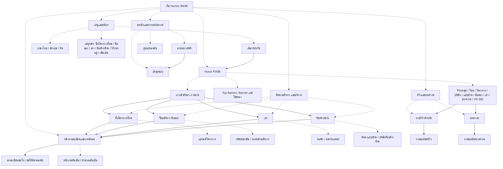

## แผนผังสมองของเว็บ NaYoo จังหวัด

ผังนี้จัดกลุ่ม **หน้าที่และทางเดินของผู้ใช้เว็บจังหวัด** ตามเอกสาร BA เส้นทึบหมายถึงทางไปหน้าหรือขั้นตอนที่เอกสารระบุ; เส้นประหมายถึงการจัดกลุ่มหน้าหรือองค์ประกอบเพื่ออ่านภาพรวม

**เส้นทางหลักที่ตรวจจากข้อกำหนด**

| จุดเริ่ม | ทางไป |
|----------|-------|
| เลือกจังหวัดใน navbar | เปลี่ยนบริบทเป็นเว็บจังหวัด; เมนูค้นหาและรีวิวแสดงข้อมูลจังหวัดที่เลือกตาม [navbar rev 3](https://wiki.infonayoo.co/doc/navbar-kB8i0O0qdM) |
| ปุ่มค้นหา 4 หมวดบน Home จังหวัด | ไปหน้าค้นหาโครงการใหม่, มือสอง, เช่า หรือบริษัทรับสร้างบ้านของจังหวัด ตาม [Home จังหวัด rev 8 — EP-02](https://wiki.infonayoo.co/doc/home-izC2SB1Mml) |
| การ์ด/ผลค้นหา | เข้าหน้ารายละเอียดใบประกาศหรือโปรไฟล์ที่เกี่ยวข้อง; จากหน้ารายละเอียดมีทางลงทะเบียนสนใจ ตาม [หน้ารายละเอียดใบประกาศ rev 7 — EP-01](https://wiki.infonayoo.co/doc/4lir4liz4lmj4liy4lij4liy4lii4lil4liw4lma4lit4li14lii4liu4lmd4lia4lib4lij4liw4lib4liy4lio-eOviDIb06v) |
| เมนูรีวิวน่าอยู่ / เพิ่มเติม | ไปรีวิวจังหวัด; เมนูเพิ่มเติมมีบทความ สินเชื่อ คูปองของฉัน และสมัครนายหน้า ตาม [navbar rev 3](https://wiki.infonayoo.co/doc/navbar-kB8i0O0qdM) |
| ลงประกาศฟรี | เปิด modal เข้าสู่ระบบตาม [navbar rev 3](https://wiki.infonayoo.co/doc/navbar-kB8i0O0qdM) |

**ขอบเขต:** เป็นผังจาก Requirement ของเว็บจังหวัดและเมนูที่ระบุในเอกสาร ยังไม่ใช่ผลตรวจหน้าเว็บจริง ส่วน “บทความ” ในข้อกำหนด navbar ระบุปลายทางเป็นหน้ารวมทุกจังหวัด แม้ผู้ใช้อยู่ในบริบทจังหวัด จึงให้เป็นหมวดเนื้อหาโดยไม่วาดว่าเป็นบทความเฉพาะจังหวัด

ดู [ทะเบียนและผังเชื่อมโยงเอกสาร BA Nayoo จังหวัด](https://wiki.infonayoo.co/doc/nayoo-3j1c87gnhD) สำหรับโครงสร้างหน้า Wiki ทั้งหมด