> **อัปเดตรอบวันที่ 13 พฤศจิกายน 2569 เวลา 15:05 น. (ไทย)** ตรวจเอกสารที่เผยแพร่ใต้ [BA Nayoo center](https://wiki.infonayoo.co/doc/ba-nayoo-center-e1cHjjfPTD) ได้ **71 หน้า** ดูทะเบียนและผังปัจจุบันด้านล่าง เก็บฐานเปรียบเทียบรอบ 11–12 พฤศจิกายน และประวัติเดือนตุลาคมไว้ในหน้านี้

## ทะเบียนและแผนผังปัจจุบัน

เทียบกับทะเบียนวันที่ 12 พฤศจิกายน 2569 โดยใช้ documentId เดิม พบครบ **71 หน้า** มี **4 หน้าที่ revision หรือเวลาอัปเดตเปลี่ยน** และ **67 หน้าคงเดิม** ชื่อและหน้าแม่ตรงกับทะเบียนเดิม ไม่มีหน้าเพิ่มหรือหายจากขอบเขต Center ที่นับ

**เอกสารที่เปลี่ยนรอบ 13 พฤศจิกายน** [Top ads มือสอง](https://wiki.infonayoo.co/doc/top-ads-3nMBAGxInJ) 28 → 31 · [Top ads เช่า](https://wiki.infonayoo.co/doc/top-ads-DmtrQp02OU) 21 → 23 · [VR 360 หน้า home และ search มือ1](https://wiki.infonayoo.co/doc/vr-360-home-search-1-OV27N9gsgs) 15 → 20 · [ฟีลเตอร์เช่า center](https://wiki.infonayoo.co/doc/center-oaOAG5Tr7J) 58 → 70

**ฐานเปรียบเทียบรอบ 12 พฤศจิกายน** เทียบกับทะเบียนวันที่ 11 พฤศจิกายน 2569 โดยใช้ documentId เดิม พบครบ 71 หน้า มี 6 หน้าที่ revision หรือเวลาอัปเดตเปลี่ยน และ 65 หน้าคงเดิม ชื่อและหน้าแม่ของทั้ง 71 หน้าตรงกับทะเบียนเดิม รอบนี้ไม่มีหน้าเพิ่มหรือหายจากขอบเขตที่นับ ยอดนี้ไม่นับหน้าแม่ BA และหน้าแผนผังนี้

**ฐานเปรียบเทียบรอบ 11 พฤศจิกายน** เทียบกับทะเบียน 69 หน้าของวันที่ 28 ตุลาคม โดยใช้ documentId เดิม พบต่อเนื่อง 67 หน้า ในจำนวนนี้ 35 หน้ามี revision หรือเวลาอัปเดตเปลี่ยน และ 32 หน้าคงเดิม เพิ่มในทะเบียน 4 หน้า และเปิดลิงก์เดิมไม่ได้ 2 หน้า รวมปัจจุบัน 71 หน้า ยอดนี้นับเฉพาะหน้าลูกหลานที่เผยแพร่และเข้าถึงได้ ยกเว้นหน้าแม่ BA และหน้าแผนผังที่กำลังอ่าน

**รายการที่เพิ่มในรอบ 11 พฤศจิกายน** [ฟีลเตอร์ใหม่](https://wiki.infonayoo.co/doc/4lif4li14lil4lma4liv4lit4lij4lmm4lmd4lir4lih4lmi-wBolAcEdse) · [โปรไฟล์นายหน้า center](https://wiki.infonayoo.co/doc/center-jzA1eqlIai) · [logic facebook และ Line](https://wiki.infonayoo.co/doc/logic-facebook-line-SzphnOw0U8) · [แบบบ้าน center](https://wiki.infonayoo.co/doc/center-TXFVgbtVL1) ส่วน [หน้าการแสดงผล center](https://wiki.infonayoo.co/doc/center-2Ht8ADd55j) ใช้ documentId เดิมของหน้าที่ทะเบียนเคยเรียกว่า “center”

### กฎที่เกี่ยวกับการแสดงผล

| จุดที่ผู้ใช้เห็น | กฎในเอกสารที่เปิดตรวจรอบนี้ | ต้นทาง |
|------------------|-----------------------------|--------|
| บทความบน Home และหน้าเสิร์ช | กรองหมวดก่อน คัดล่าสุดไม่เกิน 5 เรื่องต่อจังหวัด และ 5 เรื่องของส่วนกลาง แล้วรวมมา Shuffle เพื่อแสดงสูงสุด 5 การ์ดต่อ Section บทความกลาง + จังหวัดเข้าชุดส่วนกลางเพียงครั้งเดียว แม้แสดงที่เว็บจังหวัดด้วย เมื่อกดการ์ดให้ไปหน้ารายละเอียดในแท็บเดิม | [บทความหน้าเสิร์ชและ home](https://wiki.infonayoo.co/doc/home-OkZG8eRp8L) |
| หน้ารวมบทความ    | กลางและกลาง + จังหวัดแสดงเป็นบทความกลาง ส่วนจังหวัดอย่างเดียวแสดงเป็นบทความจังหวัด เรียงตามวันที่อัปเดตล่าสุด สูงสุด 24 บทความต่อหน้า เมื่อมี 25 เรื่องจึงแบ่งเป็น 24 + 1 เมื่อกดการ์ดให้ไปหน้ารายละเอียดในแท็บเดิม โดยคงบริบทกลางหรือแสดงจังหวัดตามประเภทการ์ด | [บทความ center](https://wiki.infonayoo.co/doc/center-b6TBBBZwwG) |
| Banner Center เมื่อกดเปลี่ยนหน้า | เมื่อเงื่อนไขเดิม ให้คงสมาชิกชุดของหน้าปลายทาง ทุกจุดวางใช้สมาชิกชุดเดียวกัน แล้ว Shuffle ลำดับแยกตามจุด | [Banner 3 ภาษา](https://wiki.infonayoo.co/doc/banner-3-Xfb8HGQLZJ) |
| Pop-up Center เมื่อกดเปลี่ยนหน้าและเปิดแท็บใหม่ | กดเปลี่ยนหน้าในบริบทเดิมให้คงคิวและภาพ ส่วนแท็บใหม่จัดคิวและตรวจประวัติของแท็บนั้นเอง | [pop up 3 ภาษา](https://wiki.infonayoo.co/doc/pop-up-3-rQNm3x0i3g) |
| ผลงานและโปรโมชั่นบริษัทรับสร้างบ้านบนการ์ด Super | เลือกจังหวัดที่มีสิทธิ์ของบริษัทที่ได้แสดง แล้วใช้ผลงานของจังหวัดนั้นสูงสุด 2 รายการ หากมีเพียงหนึ่งผลงานให้แสดงหนึ่ง โปรโมชั่นใช้ภาพลำดับแรกที่แสดงได้ของบริษัท Center เท่านั้น | [super top ads โปรไฟล์รับสร้างบ้าน](https://wiki.infonayoo.co/doc/super-top-ads-LWetddeWvj) |

**รอยืนยันสำหรับ Dev และ QA** เงื่อนไขเริ่มค้นหาชื่อบทความยังให้ผลต่างกันเมื่อพิมพ์ตัวแรก ข้อความหลักระบุ “มากกว่า 1 ตัวอักษร” แต่ ART-AC-14 และ ART-AC-15 ให้เริ่มตั้งแต่ 1 ตัวอักษร [ดูเงื่อนไขและ AC ในหน้ารวมบทความ](https://wiki.infonayoo.co/doc/center-b6TBBBZwwG)

### ผังตัวอย่างจากลิงก์ที่พบจริง

เส้นทึบแสดงลิงก์ที่ต้นทางเขียนถึงปลายทาง เส้นประแสดงตำแหน่งหน้าแม่–ลูกใน Wiki ทะเบียนถัดไปแสดงความสัมพันธ์ของทั้ง 71 หน้า

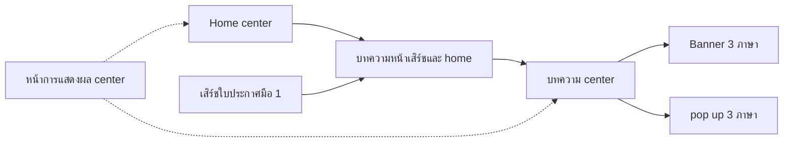

### ทะเบียนเอกสารปัจจุบัน 71 หน้า

เลขรายการคงตามทะเบียน 28 ตุลาคม รายการใหม่ต่อจากเลข 69 คอลัมน์ “อ้างถึง” ระบุเลขหน้าปลายทางของลิงก์ Wiki ที่ยืนยันได้ พบ **182 คู่ต้นทาง–ปลายทาง** แบ่งเป็นในชุด 165 คู่และนอกชุด 17 คู่ แต่ละคู่นับครั้งเดียวต่อหน้าต้นทาง รหัส R ใช้กับหน้าปลายทางนอกชุด เวลาอัปเดตในตารางเป็น UTC

| เลข | เอกสาร | Revision | อัปเดต (UTC) | หน้าแม่ | อ้างถึง | documentId |
|----:|--------|---------:|--------------|---------|---------|------------|
| 2   | [Profile รับสร้างบ้าน](https://wiki.infonayoo.co/doc/profile-KbhAodiJR8) | 456      | 2026-10-30T03:39:02.930Z | ราก     | 5, 30, 40, 72, R1, R4 | a06a21e6-e898-4fb3-998b-e6eca58ccfa4 |
| 3   | [Profile รับสร้างบ้านแคมเปญ](https://wiki.infonayoo.co/doc/profile-9XacfDUslO) | 91       | 2026-10-27T16:23:44.554Z | 2       | R1      | e5de29cc-666f-4240-b949-a37f78418012 |
| 4   | [Pop up พรีเมี่ยม](https://wiki.infonayoo.co/doc/pop-up-SWDUcx3PIX) | 13       | 2026-10-27T15:51:06.301Z | 2       | —       | cd92b2f6-cc32-425e-9746-36747450545c |
| 5   | [Profile พรีเมี่ยม จังหวัด](https://wiki.infonayoo.co/doc/profile-GPemBun2Nk) | 18       | 2026-10-28T08:07:50.202Z | 2       | —       | acb4fd5c-f59b-4fda-9405-53537f8a4437 |
| 6   | [Profile NPA](https://wiki.infonayoo.co/doc/profile-npa-zdf2PKNBuS) | 295      | 2026-10-31T13:26:02.634Z | ราก     | 40, 72, R1 | 6cdfe6e3-b57c-4f6d-85db-97bddb9fd229 |
| 7   | [Profile แบรนด์โครงการ center และจังหวัด](https://wiki.infonayoo.co/doc/profile-center-6g04cncJeD) | 684      | 2026-11-03T09:29:52.758Z | ราก     | 8, 17, 40, 72, R1, R4, R5, R6, R7 | 37e35927-23db-4c68-9000-fabf6ece401b |
| 8   | [Profile  แคมเปญ](https://wiki.infonayoo.co/doc/profile-MJIQLyOzX5) | 183      | 2026-10-27T16:44:15.031Z | 7       | R1      | 4825342a-ef1b-4547-a32f-fd10ad64098a |
| 9   | [Pop up พรีเมี่ยม](https://wiki.infonayoo.co/doc/pop-up-vEZRjm9Dqo) | 25       | 2026-10-28T01:46:44.896Z | 7       | —       | a74f93a9-2269-4e33-8556-94eed82b0dcc |
| 10  | [Profile พรีเมี่ยม จังหวัด](https://wiki.infonayoo.co/doc/profile-b1uHYw2ZNs) | 26       | 2026-10-28T08:07:44.202Z | 7       | —       | 1eb0de29-2ad9-4f71-b382-460ec1e228ec |
| 11  | [Test case](https://wiki.infonayoo.co/doc/test-case-p6I4oOfDfK) | 10       | 2026-10-26T06:15:21.258Z | ราก     | —       | 8bfc81ec-d8f0-487b-aab4-198c3c8b1e58 |
| 12  | [Nayoo center](https://wiki.infonayoo.co/doc/nayoo-center-4cXI5iIqEz) | 4        | 2026-10-21T03:27:46.003Z | ราก     | —       | 8f146bc4-d1a8-40c5-a735-a40218cc140e |
| 13  | [NaYoo Center — สำเนา Google Docs](https://wiki.infonayoo.co/doc/nayoo-center-google-docs-TgnvhEW4iL) | 59       | 2026-10-25T15:28:12.474Z | 12      | 14, 15, 16, 17, 18, 19, 20, 21, 22, 23, 24, 25, 26, 27, 28, 29, 30, 31, 32, 33, 34, 35, 36, 37, 38, 41, 42, 43, 44, 45, 46, 47, 48, 49, 50, 51, 52, 53, 54, 55, 56, 57, 59, 61, 62, 63, 64, 65, 66, 67, 68, 69 | 03ee8450-6ffd-49ee-bb41-e53fcd09f793 |
| 14  | [ฟีเจอร์ดันใบประกาศ center](https://wiki.infonayoo.co/doc/center-d1LCfKeJ4j) | 8        | 2026-10-21T05:44:33.776Z | 13      | —       | 94467e9d-4735-4cce-a8ea-ca06c3486a3f |
| 15  | [Super top ads ใบประกาศมือ 1 (ยังไม่ทำเปิดใหม่ เฟดใหม่ใน super top ads)](https://wiki.infonayoo.co/doc/super-top-ads-1-super-top-ads-hnIfTiipkr) | 53       | 2026-11-06T03:57:20.413Z | 13      | 40      | 1fb21f44-6a84-40ea-85f6-3c016fb6c220 |
| 16  | [backoffice  (เฟดใหม่เปิดใหม่ ยังไม่ทำในเฟดนี้)](https://wiki.infonayoo.co/doc/backoffice-moQWnIyVlW) | 7        | 2026-10-28T05:11:30.495Z | 15      | —       | c2097200-bcc5-4c09-b92b-615777c33a4a |
| 17  | [Top ads ใบประกาศมือ 1 center](https://wiki.infonayoo.co/doc/top-ads-1-center-dQCeUGbben) | 43       | 2026-11-06T09:13:29.543Z | 13      | 40      | 82462738-21fa-4d87-b838-2929fee7dd0e |
| 18  | [BO](https://wiki.infonayoo.co/doc/bo-BvCHRTvvlF) | 5        | 2026-10-21T05:51:22.511Z | 17      | —       | 753ed968-7d29-4d81-af3c-2c61e2d96057 |
| 19  | [Top ads แบรนด์โครงการ](https://wiki.infonayoo.co/doc/top-ads-DluNExpq9h) | 37       | 2026-11-12T06:40:06.938Z | 13      | 40      | 2052c74e-a262-4312-bf4d-a889f7ad0b35 |
| 20  | [super top ads โปรไฟล์รับสร้างบ้าน](https://wiki.infonayoo.co/doc/super-top-ads-LWetddeWvj) | 84       | 2026-11-07T06:28:39.383Z | 13      | 31, 40  | 5d7dfb87-5705-4df5-8827-02107d88a7f0 |
| 21  | [Top ads โปรไฟล์บริษัทรับสร้าง.](https://wiki.infonayoo.co/doc/top-ads-jMtLqWirU7) | 30       | 2026-11-05T10:31:37.163Z | 20      | 40      | 9baea319-3d76-417f-bcaa-6b42627978d5 |
| 22  | [บริษัทชั้นนำ](https://wiki.infonayoo.co/doc/4lia4lij4li04lip4lix4lix4lik4lix4lmj4liz4liz4liz-an2e3xuj8C) | 26       | 2026-10-30T05:13:26.395Z | 20      | 40      | b5b00118-7fef-4543-8233-258c2db67792 |
| 23  | [Top ads โปรไฟล์ NPA](https://wiki.infonayoo.co/doc/top-ads-npa-p9AlvCY7wE) | 19       | 2026-11-05T10:31:40.245Z | 13      | —       | a3004394-08d3-464b-9462-c9dd710e0856 |
| 24  | [Top ads โปรไฟล์นายหน้า](https://wiki.infonayoo.co/doc/top-ads-KLgI7zPPLf) | 25       | 2026-11-05T10:31:41.937Z | 13      | —       | 8e8d703a-021a-46ee-8d2d-626bfa27f505 |
| 25  | [Top ads มือสอง](https://wiki.infonayoo.co/doc/top-ads-3nMBAGxInJ) | 31       | 2026-11-13T02:54:17.480Z | 13      | 40      | 16a28db6-482e-4d9b-96d2-848e21db90f9 |
| 26  | [Top ads เช่า](https://wiki.infonayoo.co/doc/top-ads-DmtrQp02OU) | 23       | 2026-11-13T02:59:46.830Z | 13      | 40      | c089f2f4-9644-4859-997c-e07d0fdc7969 |
| 27  | [pop up 3 ภาษา](https://wiki.infonayoo.co/doc/pop-up-3-rQNm3x0i3g) | 65       | 2026-11-06T09:19:23.544Z | 13      | —       | 0ca236dc-73e6-461c-a0be-5b6c52f70e86 |
| 28  | [Banner 3 ภาษา](https://wiki.infonayoo.co/doc/banner-3-Xfb8HGQLZJ) | 90       | 2026-11-06T02:39:03.866Z | 13      | —       | 307b9d15-506a-4d2e-8c45-e70f35da21d9 |
| 29  | [Top banner 3 ภาษา](https://wiki.infonayoo.co/doc/top-banner-3-RMsWHHfjZs) | 33       | 2026-11-05T15:34:48.023Z | 13      | —       | d1fff299-876f-48eb-ab49-4877c2367ffc |
| 30  | [Top Ads แบบบ้าน Center](https://wiki.infonayoo.co/doc/top-ads-center-EVGRrK5Tnk) | 41       | 2026-11-05T15:19:08.594Z | 13      | 40      | 96fc4257-a104-4006-bb28-2f4d93bab286 |
| 31  | [insert card 3 ภาษา](https://wiki.infonayoo.co/doc/insert-card-3-y3Zp0zHyHV) | 38       | 2026-11-06T06:33:10.396Z | 13      | —       | a439e945-99c8-4628-9028-706e202784af |
| 32  | [การแสดงผล](https://wiki.infonayoo.co/doc/4lib4liy4lij4lmb4liq4liu4lih4lic4lil-KtcluN5j4E) | 9        | 2026-10-21T06:03:07.157Z | 31      | —       | 77ecd1c9-d13d-4e95-b235-46888213ffc2 |
| 33  | [Logo brand.](https://wiki.infonayoo.co/doc/logo-brand-kSSuJ22HFf) | 27       | 2026-11-06T06:31:39.788Z | 13      | —       | 81f45a87-5447-49f0-8be1-c4cc73b3b664 |
| 34  | [VR 360 หน้า home และ search มือ1](https://wiki.infonayoo.co/doc/vr-360-home-search-1-OV27N9gsgs) | 20       | 2026-11-13T03:07:42.254Z | 13      | —       | 6f939573-7744-438b-b0af-0922fbcfdf25 |
| 35  | [VR 360 หน้าเสิร์ชแบบบ้าน. โปรไฟล์บริษัท (ยังไม่ทำในเฟดนี้)](https://wiki.infonayoo.co/doc/vr-360-Gocz4JPXhI) | 16       | 2026-10-21T06:04:06.887Z | 13      | —       | 0666b11f-039c-41e3-826f-6c94505c5140 |
| 36  | [coming soon](https://wiki.infonayoo.co/doc/coming-soon-eGk3f6Sjwg) | 33       | 2026-11-05T15:30:45.962Z | 13      | 40      | ed8de3ab-a271-4ff3-a76f-4372ddc21f65 |
| 37  | [บทความหน้าเสิร์ชและ home](https://wiki.infonayoo.co/doc/home-OkZG8eRp8L) | 54       | 2026-11-12T06:50:59.093Z | 13      | 42      | 141011fa-fd1e-49ce-8ffc-be944262c2b3 |
| 38  | [หน้าการแสดงผล center](https://wiki.infonayoo.co/doc/center-2Ht8ADd55j) | 12       | 2026-11-11T07:35:18.903Z | 13      | —       | ce06d1db-657b-46c0-a9cf-38e48b045260 |
| 39  | [กรอบการ์ดแคมเปญ](https://wiki.infonayoo.co/doc/4lib4lij4lit4lia4lib4liy4lij4lmm4liu4lmb4lie4lih4lma4lib4lin-mAAcsS2We8) | 11       | 2026-10-27T09:28:25.240Z | 38      | 45, 46, 47, 51, 52, 53 | 293ddc6e-4bc8-45d3-b1db-a9e7cec1bc2a |
| 40  | [ยอดการเข้าชมโปรไฟล์และใบประกาศ](https://wiki.infonayoo.co/doc/4lii4lit4liu4lib4liy4lij4lma4lic4lmj4liy4lik4lih4lmc4lib4lij4lme4lif4lil4lmm4lmb4lil4liw4lmd4lia4lib4lij4liw4lib4liy4lio-udmuILqnFI) | 48       | 2026-10-28T05:35:37.949Z | 38      | —       | dfebebbf-6fb5-40e7-b101-7b40259d080a |
| 41  | [Home center](https://wiki.infonayoo.co/doc/home-center-t7SreuzwYL) | 35       | 2026-11-09T04:20:30.586Z | 38      | 37, 44  | 5870fb28-0c64-4c91-8aaf-73d72367e416 |
| 42  | [บทความ center](https://wiki.infonayoo.co/doc/center-b6TBBBZwwG) | 40       | 2026-11-12T06:49:14.341Z | 38      | 27, 28  | 04d2fc7c-c150-4fff-aece-829171d0d3f9 |
| 43  | [บทความกลาง หน้ารายละเอียด](https://wiki.infonayoo.co/doc/4lia4lix4lie4lin4liy4lih4lib4lil4liy4lihioc4qc4mec5iec4suc4oc4suc4ouc4pec4soc5goc4rec4tec4ouc4la-h5aIeMINxr) | 80       | 2026-11-12T06:49:47.636Z | 42      | 17, 22, 29, 30, 33, 37, 42, 72, R1, R8 | 4760de11-b6d4-4c9f-8dc8-40f4e3c17a0a |
| 44  | [รีวิว center](https://wiki.infonayoo.co/doc/center-ImQRmnN7gk) | 21       | 2026-10-21T06:05:08.587Z | 38      | 27, 28  | b3c3217b-1da9-405f-aed3-4709e9163ed4 |
| 45  | [เสิร์ชใบประกาศมือ 1](https://wiki.infonayoo.co/doc/1-kphu5dqP8c) | 39       | 2026-10-21T06:44:15.128Z | 38      | 15, 17, 27, 28, 29, 31, 33, 34, 36, 37, 40, 61 | a18efd04-2f98-4f4f-a013-5875de1c8838 |
| 46  | [เสิร์ชใบประกาศมือ 2](https://wiki.infonayoo.co/doc/2-Yqb2hwToah) | 30       | 2026-10-21T06:05:19.693Z | 38      | 25, 28, 29, 31, 33, 62 | 6e3b3e35-adf6-4dc8-aa44-ca9c87d4f29f |
| 47  | [เสิร์ชเช่า](https://wiki.infonayoo.co/doc/4lma4liq4li04lij4lmm4lik4lma4lik4lmi4liy-L85cLhtgXI) | 35       | 2026-10-21T06:07:12.752Z | 38      | 26, 28, 29, 31, 33, 40, 63 | 27eb415b-442b-4078-b074-12c5b268a2b4 |
| 48  | [เสิร์ชแบรนด์โครงการ](https://wiki.infonayoo.co/doc/4lma4liq4li04lij4lmm4lik4lmb4lia4lij4liz4liu4lmm4lmc4lie4lij4lih4lib4liy4lij-RyAmecvVcK) | 32       | 2026-11-05T06:54:03.965Z | 38      | 19, 27, 29 | c15ad8d4-6913-4852-88d2-250a68485fec |
| 49  | [เสิร์ช NPA](https://wiki.infonayoo.co/doc/npa-aryY8kMHuD) | 22       | 2026-10-21T06:07:21.669Z | 38      | 23, 29, 40 | 4beef3f6-acfc-4460-86c8-52743f0140d3 |
| 50  | [เสิร์ชนายหน้า](https://wiki.infonayoo.co/doc/4lma4liq4li04lij4lmm4lik4liz4liy4lii4lir4liz4lmj4liy-FW8N6UMal2) | 23       | 2026-10-21T06:07:26.312Z | 38      | 27, 28, 29, 31 | b452a6ce-6fad-4e75-aaa2-7cc8b1390b38 |
| 51  | [เสิร์ชหอพัก](https://wiki.infonayoo.co/doc/4lma4liq4li04lij4lmm4lik4lir4lit4lie4lix4lib-soAxdiLAtw) | 18       | 2026-10-21T06:07:30.361Z | 38      | 26, 28, 29, 31, 33, 63 | 918b1122-35e3-4c27-bb9b-3c3feaffa94e |
| 52  | [หน้าเสิร์ชโปรไฟล์รับสร้างบ้าน](https://wiki.infonayoo.co/doc/4lir4liz4lmj4liy4lma4liq4li04lij4lmm4lik4lmc4lib4lij4lme4lif4lil4lmm4lij4lix4lia4liq4lij4lmj4liy4lih4lia4lmj4liy4liz-iAFDfGL91e) | 25       | 2026-10-21T06:07:46.083Z | 38      | 20, 21, 22, 27, 28, 29, 31, 35, 64 | 8d01f313-75e3-4037-b546-6680628e2c9f |
| 53  | [หน้าเสิร์ชแบบบ้าน](https://wiki.infonayoo.co/doc/4lir4liz4lmj4liy4lma4liq4li04lij4lmm4lik4lmb4lia4lia4lia4lmj4liy4liz-Lc7tsn9mZw) | 30       | 2026-11-06T06:44:08.653Z | 38      | 22, 27, 28, 29, 30, 31, 35, 65 | 30b60eec-23b9-464c-b515-1f4a612ae8ac |
| 54  | [คำนวณสินเชื่อ center](https://wiki.infonayoo.co/doc/center-o2aajyb8PI) | 44       | 2026-11-06T07:21:53.328Z | 38      | 28      | 1d5bd1d3-62f7-4467-b19f-da696a293da6 |
| 55  | [ฟีลเตอร์จังหวัดและ center](https://wiki.infonayoo.co/doc/center-U8sPlpkmhz) | 9        | 2026-10-21T06:08:00.046Z | 38      | —       | 84b15030-9d08-44a3-ae01-15572e16d26e |
| 56  | [search navbar center](https://wiki.infonayoo.co/doc/search-navbar-center-ZStRhGqPqu) | 204      | 2026-11-12T04:24:32.722Z | 38      | —       | be713a3d-8dca-491f-aa39-1cd9295904ce |
| 57  | [navbar center](https://wiki.infonayoo.co/doc/navbar-center-15nWSzHsoO) | 49       | 2026-11-12T04:18:54.679Z | 38      | —       | 014f4261-ab98-409b-8992-c89d6eb2bf01 |
| 59  | [ฟีลเตอร์ center](https://wiki.infonayoo.co/doc/center-d4iG1kQHf0) | 8        | 2026-10-08T07:48:59.376Z | 13      | —       | 4acbd064-3f43-4998-bebd-3adcc7bd9186 |
| 60  | [ฟีลเตอร์ที่ตั้ง](https://wiki.infonayoo.co/doc/4lif4li14lil4lma4liv4lit4lij4lmm4lix4li14lmi4liv4lix4lmj4lih-I2uV7dFFDU) | 39       | 2026-11-10T03:43:00.589Z | 59      | —       | 5336f820-7f0b-46d7-9a97-c94ebb329cc1 |
| 61  | [ฟีลเตอร์มือ 1 center](https://wiki.infonayoo.co/doc/1-center-KPSpLhAHmD) | 154      | 2026-11-10T03:42:00.232Z | 59      | —       | e3aab96f-e8b1-4bfb-b0f7-2415989b292b |
| 62  | [ฟีลเตอร์มือ 2 center](https://wiki.infonayoo.co/doc/2-center-SDvQFUdXVZ) | 62       | 2026-11-02T07:11:09.712Z | 59      | —       | dc363e01-cabf-4fee-88fc-f378d2311ec3 |
| 63  | [ฟีลเตอร์เช่า center](https://wiki.infonayoo.co/doc/center-oaOAG5Tr7J) | 70       | 2026-11-13T06:20:19.974Z | 59      | —       | 3cf88c5f-fe35-4585-bf0f-b533c6d9bb05 |
| 64  | [ฟีลเตอร์เสิร์ชรับสร้างบ้าน](https://wiki.infonayoo.co/doc/4lif4li14lil4lma4liv4lit4lij4lmm4lma4liq4li04lij4lmm4lik4lij4lix4lia4liq4lij4lmj4liy4lih4lia4lmj4liy4liz-ObV1A0VDN8) | 63       | 2026-11-05T04:26:07.631Z | 59      | —       | 2eede110-e2b0-42c2-8b76-213b9cf1aaec |
| 65  | [ฟีลเตอร์แบบบ้าน](https://wiki.infonayoo.co/doc/4lif4li14lil4lma4liv4lit4lij4lmm4lmb4lia4lia4lia4lmj4liy4liz-8jbe8IELTg) | 74       | 2026-11-05T04:50:32.509Z | 59      | —       | ff6ebd91-c284-46c2-8d9c-452d141c10e6 |
| 66  | [ลงทะเบียนในแกลเลอรีใบประกาศ](https://wiki.infonayoo.co/doc/4lil4lih4lix4liw4lma4lia4li14lii4liz4lmd4liz4lmb4lib4lil4lma4lil4lit4lij4li14lmd4lia4lib4lij4liw4lib4liy4lio-8f3N2CCPed) | 11       | 2026-10-26T10:11:56.612Z | 13      | —       | d3063971-8560-45c7-bed1-f8b842863621 |
| 67  | [Tab 38](https://wiki.infonayoo.co/doc/tab-38-xSkaCS75hX) | 15       | 2026-10-26T10:12:05.812Z | 13      | —       | efdd4676-3b68-499e-9e9b-6540bd0028cb |
| 68  | [Tab 51](https://wiki.infonayoo.co/doc/tab-51-yidSOd55ml) | 5        | 2026-10-26T10:12:17.210Z | 13      | —       | c173f97c-8d48-4f21-a62e-9b66129d47c4 |
| 69  | [ทรัพย์เด็ด center](https://wiki.infonayoo.co/doc/center-IASiuJ0Eqm) | 18       | 2026-10-26T10:12:21.360Z | 13      | —       | 82850f3b-efe4-4463-8e7e-64e373dea79f |
| 70  | [ฟีลเตอร์ใหม่](https://wiki.infonayoo.co/doc/4lif4li14lil4lma4liv4lit4lij4lmm4lmd4lir4lih4lmi-wBolAcEdse) | 27       | 2026-11-02T07:13:34.043Z | ราก     | 60      | 22b6eb7a-896d-4502-ac2f-57372bfbd343 |
| 71  | [โปรไฟล์นายหน้า center](https://wiki.infonayoo.co/doc/center-jzA1eqlIai) | 307      | 2026-11-01T06:34:39.130Z | ราก     | 6, 7, 40, 72, R1, R2 | c4a795a5-3237-45ca-adcf-3126a8dc8ead |
| 72  | [logic facebook และ Line](https://wiki.infonayoo.co/doc/logic-facebook-line-SzphnOw0U8) | 78       | 2026-11-03T06:02:47.747Z | ราก     | R1      | eaa66c90-8dc9-47b6-99e9-157a23938f75 |
| 73  | [แบบบ้าน center](https://wiki.infonayoo.co/doc/center-TXFVgbtVL1) | 414      | 2026-11-01T06:41:33.053Z | ราก     | 22, 28, 30, 31, 35, 40, 72, R1, R3 | cf8ca461-5cae-44a0-a0a5-8b319feddfaa |

หน้าแม่ “ราก” คือ [BA Nayoo center](https://wiki.infonayoo.co/doc/ba-nayoo-center-e1cHjjfPTD) (3fedb1a4-0d4a-47ec-a33f-2c0dc88808d2)

**ปลายทางนอกชุดที่มีลิงก์อ้างถึง**

* R1 [Logic การลงทะเบียนสนใจทั้งเว็บไซต์](https://wiki.infonayoo.co/doc/logic-Vwe2eSQcT8)
* R2 [Role การสมัครสมาชิก](https://wiki.infonayoo.co/doc/role-y74JHdXPAQ)
* R3 [ฟอร์มลงทะเบียนในรูปภาพ](https://wiki.infonayoo.co/doc/4lif4lit4lij4lmm4lih4lil4lih4lix4liw4lma4lia4li14lii4liz4lmd4liz4lij4li54lib4lig4liy4lie-yd4GdFuls4)
* R4 [ฟีด Nayoo v.2 สำเนา Google Docs](https://wiki.infonayoo.co/doc/nayoo-v2-google-docs-CEnsldy7GM)
* R5 [มือ1](https://wiki.infonayoo.co/doc/1-D2cerBvy7O)
* R6 [โปรไฟล์พรีเมี่ยมมือ1](https://wiki.infonayoo.co/doc/1-XB3JuGWKom)
* R7 [Ranking Model](https://wiki.infonayoo.co/doc/ranking-model-AfPi1cb34o)
* R8 [หน้าใบประกาศ ปรับปรุงคำ](https://wiki.infonayoo.co/doc/4lir4liz4lmj4liy4lmd4lia4lib4lij4liw4lib4liy4lioioc4mc4oc4sec4muc4mc4oc4uoc4hc4hoc4sw-GuPjAc1xf5)

### ลิงก์ที่ต้องติดตาม

| รายการเดิม | ผลตรวจรอบนี้ |
|------------|--------------|
| เลข 1 [Solution หน้า Detail แบบบ้าน Center จาก Figma](https://wiki.infonayoo.co/doc/solution-detail-center-figma-1fetBVfgTs) (0153a60b-7b94-4933-b88c-f95041c726d0) | เปิดด้วยลิงก์เดิมไม่ได้ และไม่พบ documentId ในต้นไม้เผยแพร่ที่ตรวจ |
| เลข 58 [แบบบ้าน center](https://wiki.infonayoo.co/doc/center-jMz0stwh2p) (009c089b-cd85-4cd7-be62-8d1eca7c5780) | เปิดด้วยลิงก์เดิมไม่ได้ และไม่พบ documentId ในต้นไม้เผยแพร่ที่ตรวจ |

ลิงก์ต่อไปนี้ยังปรากฏในเนื้อหาปัจจุบัน แต่เปิดปลายทางไม่ได้ จึงเก็บไว้ตรวจรอบหน้า

* จาก [ฟีลเตอร์ใหม่](https://wiki.infonayoo.co/doc/4lif4li14lil4lma4liv4lit4lij4lmm4lmd4lir4lih4lmi-wBolAcEdse) ไป [เอกสาร uRjbPLY6He](https://wiki.infonayoo.co/doc/pc-flow-uRjbPLY6He)
* จาก [NaYoo Center — สำเนา Google Docs](https://wiki.infonayoo.co/doc/nayoo-center-google-docs-TgnvhEW4iL) ไป [เอกสาร pm8zgU8F3x](https://wiki.infonayoo.co/doc/4lib4liy4lij4lmb4liq4liu4lih-pm8zgU8F3x)
* จาก [NaYoo Center — สำเนา Google Docs](https://wiki.infonayoo.co/doc/nayoo-center-google-docs-TgnvhEW4iL) ไป [เอกสาร dqfyVqSbBV](https://wiki.infonayoo.co/doc/top-ads-dqfyVqSbBV)
* จาก [NaYoo Center — สำเนา Google Docs](https://wiki.infonayoo.co/doc/nayoo-center-google-docs-TgnvhEW4iL) ไป [เอกสาร jMz0stwh2p](https://wiki.infonayoo.co/doc/center-jMz0stwh2p)
* จาก [Banner 3 ภาษา](https://wiki.infonayoo.co/doc/banner-3-Xfb8HGQLZJ) ไป [เอกสาร DyR6xbjlZ7](https://wiki.infonayoo.co/doc/solution-banner-center-DyR6xbjlZ7)

ลิงก์ Solution ที่เคยใช้อ้างอิงในงาน [บทความ Home Center](https://wiki.infonayoo.co/doc/solution-home-center-iQp5lB8EaF), [Banner Center](https://wiki.infonayoo.co/doc/solution-banner-center-shuffle-OgUOfq8Shc) และ [บทความฉบับเดิม](https://wiki.infonayoo.co/doc/lq-LNXZUOw0DI) เปิดไม่ได้ในรอบนี้ หน้าเนื้อหาที่ตรวจได้โดยตรงคือ [บทความหน้าเสิร์ชและ home](https://wiki.infonayoo.co/doc/home-OkZG8eRp8L), [Banner 3 ภาษา](https://wiki.infonayoo.co/doc/banner-3-Xfb8HGQLZJ) และ [บทความ center](https://wiki.infonayoo.co/doc/center-b6TBBBZwwG) ตามลำดับ ยังไม่ยืนยันว่าหน้าเหล่านี้ถูกย้ายหรือแทนที่กัน

**ขอบเขตการตรวจ** ตรวจรายการ Wiki ที่เข้าถึงได้ **534 หน้า** จากต้นไม้เอกสารทั้ง 3 Collection และรายการแบ่งหน้า โดย documentId และหน้าแม่ตรงกันทุกหน้า เทียบทะเบียน Center 71 หน้าตาม documentId ชื่อ หน้าแม่ revision และเวลาอัปเดต อ่านเนื้อหาปัจจุบันทั้ง 71 หน้าเพื่อสกัดลิงก์ (68 หน้ามีข้อความ อีก 3 หน้าเป็นหน้าหมวด) พบคู่ลิงก์อ้างอิงระหว่างหน้าคนละ ID **182 คู่ เท่าเดิมทุกคู่** แบ่งเป็นในชุด 165 คู่และนอกชุด 17 คู่ ตรวจเส้นตัวอย่างในผังกับลิงก์จริงและหน้าแม่แล้ว จึงคงผังเดิม โดยแยกเส้นอ้างอิงออกจากหน้าแม่–ลูก

รอบนี้ตรวจลิงก์ติดตาม 9 ปลายทางเดิมแล้วยังเปิดไม่ได้ คงลิงก์และ mapping เดิมไว้ พร้อมรักษาหน้าเดิม 2 รายการที่ไม่พบในต้นไม้เผยแพร่ รายการใหม่ที่อยู่นอกกลุ่ม Center จะรวมเมื่อมีหลักฐานหน้าแม่หรือลิงก์ที่เกี่ยวข้อง การตรวจนี้ครอบคลุมเอกสารเผยแพร่ที่บัญชีนี้เข้าถึงได้ และใช้ข้อมูล Wiki โดยไม่ได้ทดสอบระบบจริง

## ประวัติการตรวจเดือนตุลาคม 2569

> **ฐานความรู้ฉบับตรวจ 28 ตุลาคม 2569:** ดูหัวข้อ “ฐานความรู้ปัจจุบัน” ด้านล่างสำหรับทะเบียน 69 หน้าและกฎล่าสุด ส่วนแผนผัง/ทะเบียนที่ระบุ 19 ตุลาคม 2569 ต่อจากหมายเหตุนี้เป็นประวัติรอบเดิม 52 หน้า ไม่ใช่ยอดปัจจุบัน

แผนผังสำหรับไล่ว่า **หน้า Center แต่ละหน้าอ้างอิงเอกสารใดบ้าง** กดชื่อกล่องเพื่อเปิดเอกสาร Wiki ที่เกี่ยวข้อง หรือใช้ลิงก์ในทะเบียนท้ายหน้า

ตรวจลิงก์เมื่อ **19 ตุลาคม 2569** จาก [ชุด NaYoo Center — สำเนา Google Docs](https://wiki.infonayoo.co/doc/nayoo-center-google-docs-TgnvhEW4iL) รวม **52 หน้าเอกสาร** และหน้าสารบัญ 1 หน้า พบเส้นอ้างอิงระหว่างเอกสาร Center **78 คู่** ไม่นับลิงก์สารบัญ 52 รายการ

**วิธีอ่าน:** ลูกศรทึบ “อ้างอิง” = มีลิงก์ไปเอกสารนั้นจริงใน Wiki หรือมีลิงก์แท็บ Google Docs ที่จับคู่กับหน้า Wiki เดิมได้ด้วย tabId → documentId; ลูกศรประ “หน้าแม่–ลูก” = อยู่ใต้กันในโครงสร้าง Wiki ไม่ได้ยืนยันว่าเรียกใช้ฟังก์ชันกัน

เส้นโยงแสดงความสัมพันธ์ของเอกสาร ไม่ได้หมายถึงลำดับการทำงานของระบบหรือยืนยันว่าพัฒนาแล้ว ชื่อกล่องใช้ชื่อหน้า Wiki ปัจจุบัน ลิงก์ภายใน Wiki ที่ผู้ใช้จัดไว้เป็นหลักในการอ้างอิง

## 1) จุดเริ่มอ่าน

เริ่มที่หน้า Search ที่กำลังพัฒนา แล้วตามเส้นไปอ่านกฎ Ads, ตัวกรอง และองค์ประกอบร่วม ใช้ผังย่อยด้านล่างเพื่อดูรายละเอียดทุกเส้น

### ทางเข้าเอกสารหลัก

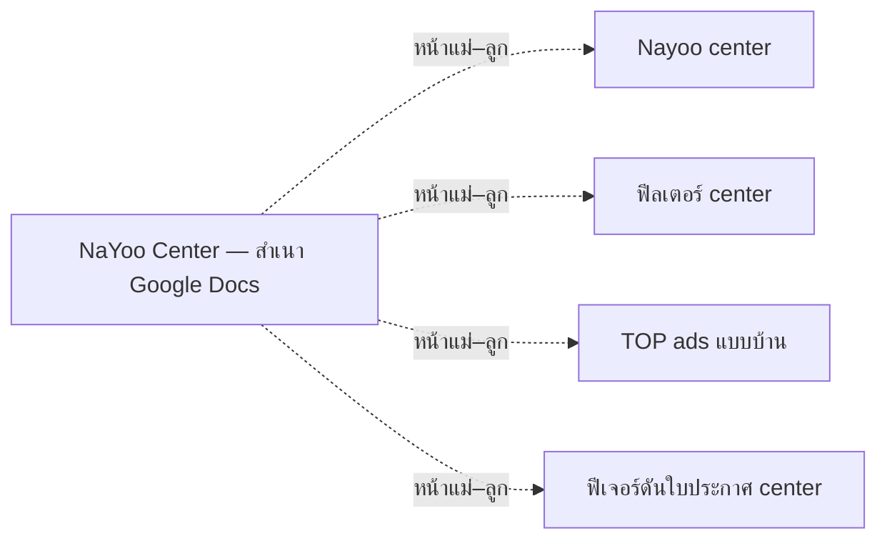

## 2) แบบบ้านและบริษัทรับสร้างบ้าน

### หน้าเสิร์ชแบบบ้าน

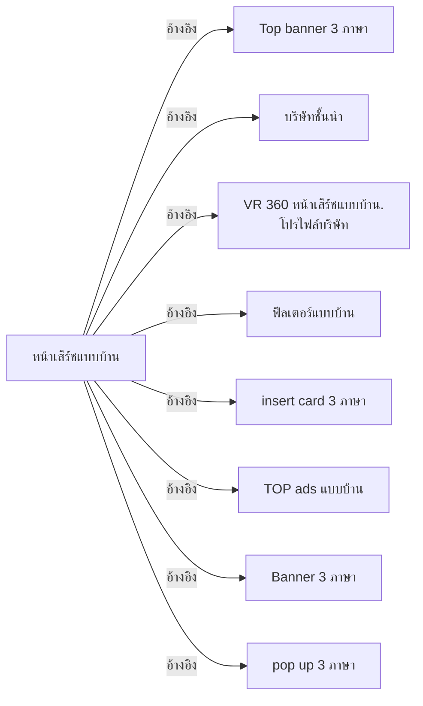

**จุดที่เกี่ยวกับการดัน:** เอกสาร TOP ads แบบบ้านอธิบายผลการดันต่อใบปกติของ Center ตามกฎ C31–C32 และ AC50–AC51 ส่วนสิทธิ์กดดันจากหน้า Center โดยตรงยังไม่ใช่ข้อสรุปจากการมีเส้นอ้างอิงนี้

### หน้าเสิร์ชโปรไฟล์รับสร้างบ้าน

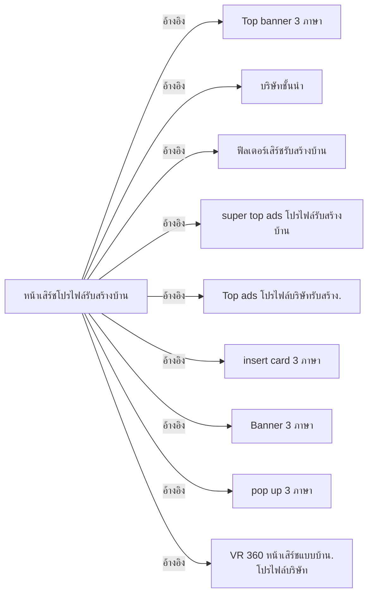

## 3) ค้นหาใบประกาศ

### โครงการใหม่ / มือ 1

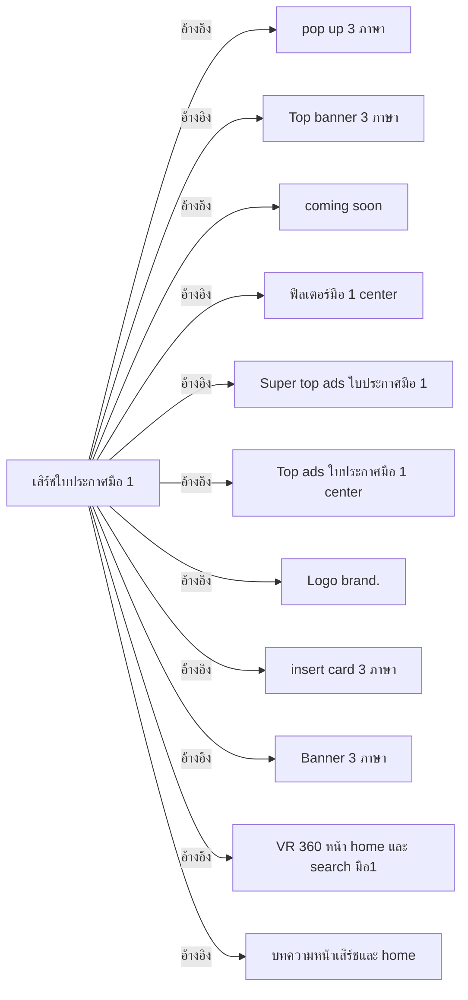

### มือสอง เช่า และหอพัก

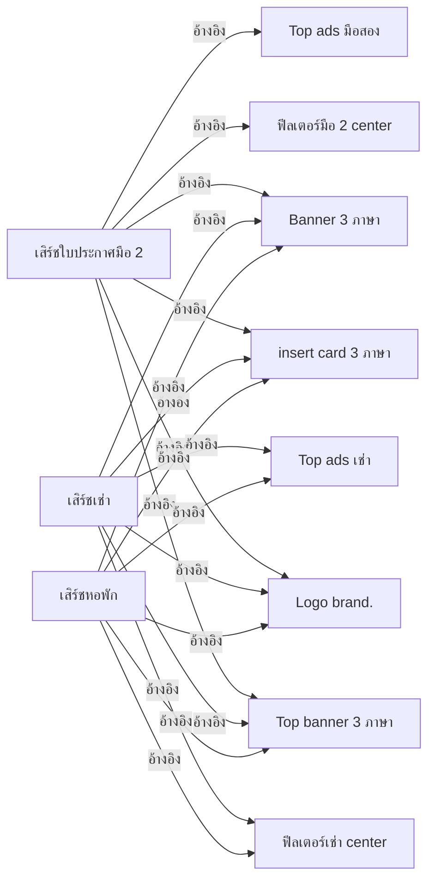

## 4) ค้นหาโปรไฟล์

### แบรนด์โครงการ NPA และนายหน้า

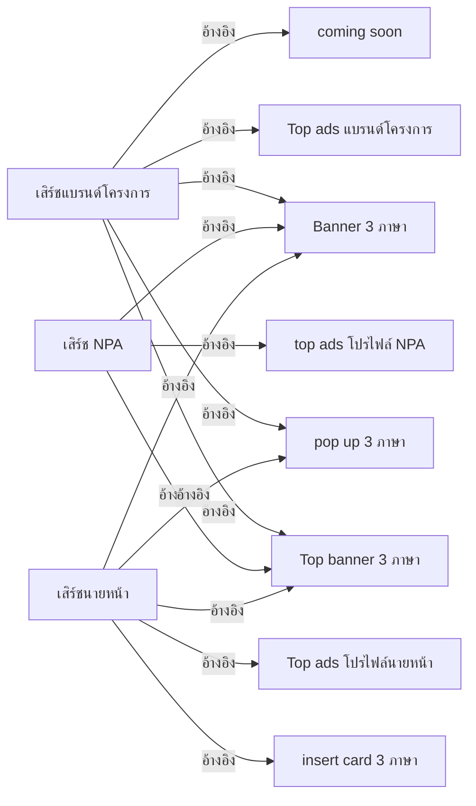

## 5) Home บทความ รีวิว และสินเชื่อ

### การอ้างอิงของหน้าเนื้อหา

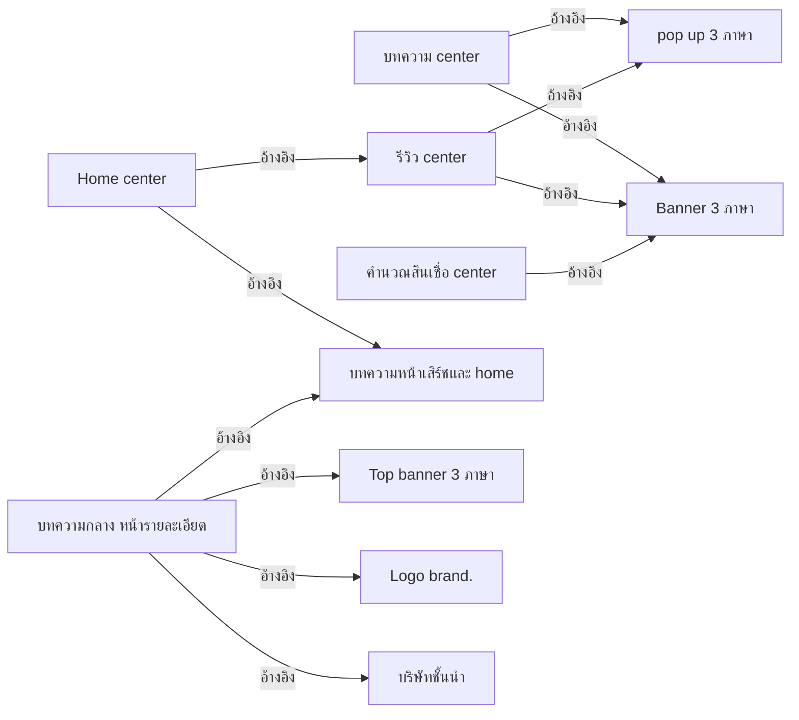

## 6) เส้นอ้างอิงระหว่างเอกสารกฎ

เส้นในผังนี้รวมลิงก์อ้างอิงต้นฉบับด้วย จึงบอกว่าเอกสารหนึ่งให้อ่านอีกฉบับประกอบ ไม่ใช่คำสั่งให้ใช้ทุกกฎของปลายทางแทนกฎเฉพาะ Center

### Ads / Insert / บทความ / VR

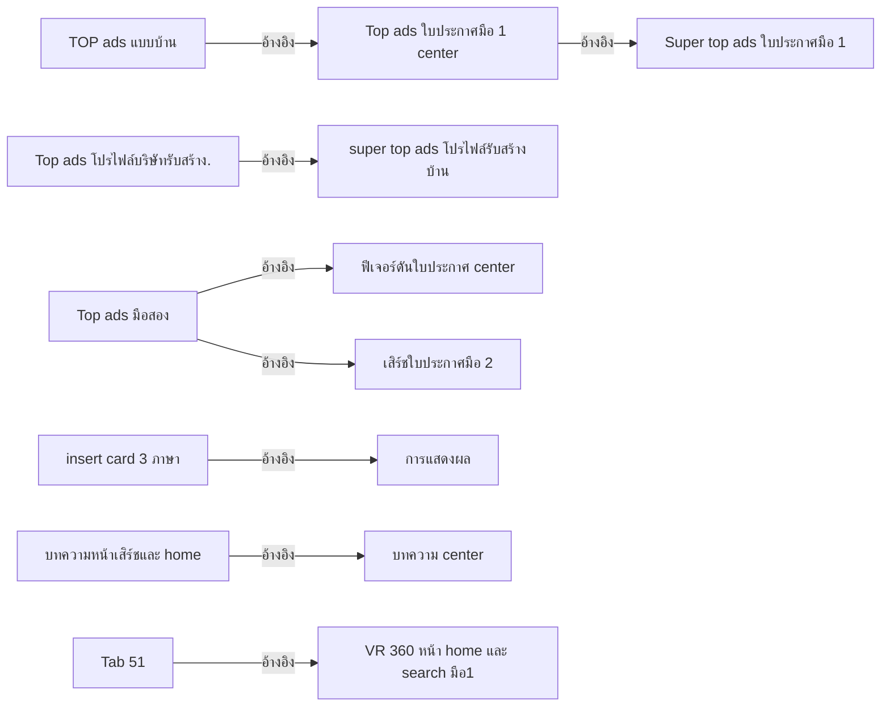

## 7) ตัวกรองและเอกสารประกอบ

ผังนี้ใช้เส้นประเพื่อแสดงโครงสร้างหน้าแม่–ลูกจริง เช่น เอกสาร BO อยู่ใต้เอกสาร Ads ไม่ได้เพิ่มเส้นว่า BO อ้างอิงกันเอง

### ตัวกรอง BO และการแสดงผล

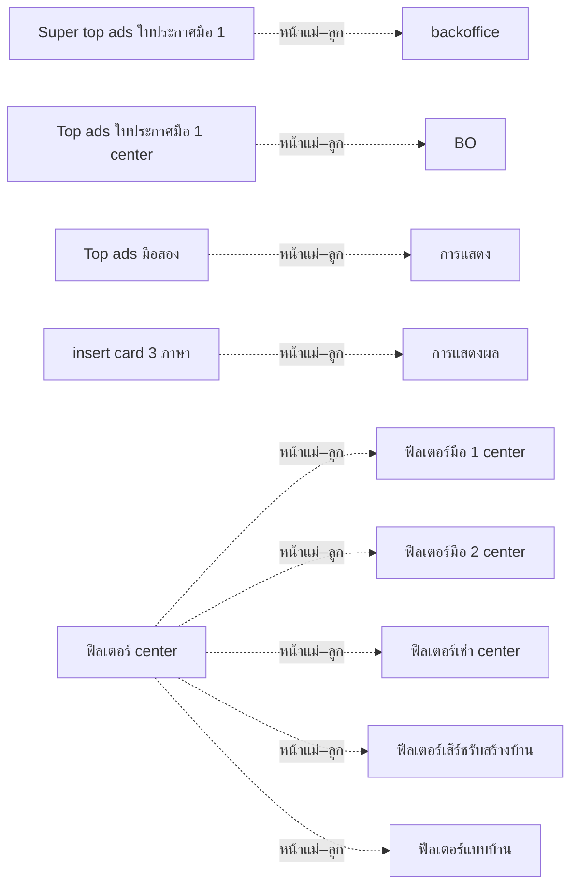

### หน้าอื่นที่ยังไม่มีเส้นอ้างอิงในผังก่อนหน้า

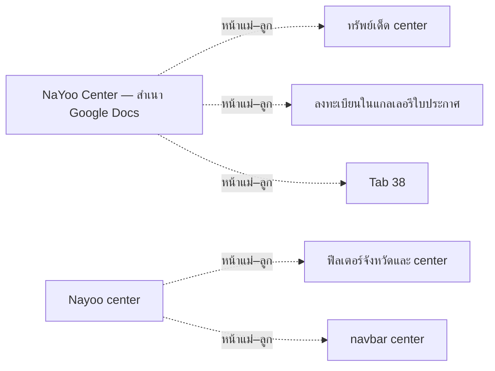

หน้าไม่มีเส้นอ้างอิงไม่ได้แปลว่าไม่มี Logic: “การแสดง” มีเนื้อหาว่าง ณ รอบที่อ่าน ส่วน “Tab 38” และหน้าอื่นให้เปิดตรวจจากชื่อเดิมในทะเบียน ไม่เปลี่ยนชื่อหรือเดาว่าเป็นเอกสารใด

## 8) ทะเบียนเอกสาร Center ครบ 52 หน้า

รหัส Dxx ใช้ค้นกล่องเดียวกันในผัง ชื่อและลิงก์ยึดหน้า Wiki ปัจจุบัน

| รหัส | เอกสาร Wiki | หน้าแม่ | อ้างอิงไปยัง Center |
|------|-------------|---------|---------------------|
| D01  | [ฟีเจอร์ดันใบประกาศ center](https://wiki.infonayoo.co/doc/center-d1LCfKeJ4j) | D00     | —                   |
| D02  | [Super top ads ใบประกาศมือ 1](https://wiki.infonayoo.co/doc/super-top-ads-1-hnIfTiipkr) | D00     | —                   |
| D03  | [backoffice](https://wiki.infonayoo.co/doc/backoffice-moQWnIyVlW) | D02     | —                   |
| D04  | [Top ads ใบประกาศมือ 1 center](https://wiki.infonayoo.co/doc/top-ads-1-center-dQCeUGbben) | D00     | D02                 |
| D05  | [BO](https://wiki.infonayoo.co/doc/bo-BvCHRTvvlF) | D04     | —                   |
| D06  | [Top ads แบรนด์โครงการ](https://wiki.infonayoo.co/doc/top-ads-DluNExpq9h) | D00     | —                   |
| D07  | [super top ads โปรไฟล์รับสร้างบ้าน](https://wiki.infonayoo.co/doc/super-top-ads-LWetddeWvj) | D00     | —                   |
| D08  | [Top ads โปรไฟล์บริษัทรับสร้าง.](https://wiki.infonayoo.co/doc/top-ads-jMtLqWirU7) | D07     | D07                 |
| D09  | [บริษัทชั้นนำ](https://wiki.infonayoo.co/doc/4lia4lij4li04lip4lix4lix4lik4lix4lmj4liz4liz4liz-an2e3xuj8C) | D07     | —                   |
| D10  | [top ads โปรไฟล์ NPA](https://wiki.infonayoo.co/doc/top-ads-npa-p9AlvCY7wE) | D00     | —                   |
| D11  | [Top ads โปรไฟล์นายหน้า](https://wiki.infonayoo.co/doc/top-ads-KLgI7zPPLf) | D00     | —                   |
| D12  | [Top ads มือสอง](https://wiki.infonayoo.co/doc/top-ads-3nMBAGxInJ) | D00     | D01, D32            |
| D13  | [การแสดง](https://wiki.infonayoo.co/doc/4lib4liy4lij4lmb4liq4liu4lih-pm8zgU8F3x) | D12     | —                   |
| D14  | [Top ads เช่า](https://wiki.infonayoo.co/doc/top-ads-DmtrQp02OU) | D00     | —                   |
| D15  | [pop up 3 ภาษา](https://wiki.infonayoo.co/doc/pop-up-3-rQNm3x0i3g) | D00     | —                   |
| D16  | [Banner 3 ภาษา](https://wiki.infonayoo.co/doc/banner-3-Xfb8HGQLZJ) | D00     | —                   |
| D17  | [Top banner 3 ภาษา](https://wiki.infonayoo.co/doc/top-banner-3-RMsWHHfjZs) | D00     | —                   |
| D18  | [TOP ads แบบบ้าน](https://wiki.infonayoo.co/doc/top-ads-dqfyVqSbBV) | D00     | D04                 |
| D19  | [insert card 3 ภาษา](https://wiki.infonayoo.co/doc/insert-card-3-y3Zp0zHyHV) | D00     | D20                 |
| D20  | [การแสดงผล](https://wiki.infonayoo.co/doc/4lib4liy4lij4lmb4liq4liu4lih4lic4lil-KtcluN5j4E) | D19     | —                   |
| D21  | [Logo brand.](https://wiki.infonayoo.co/doc/logo-brand-kSSuJ22HFf) | D00     | —                   |
| D22  | [VR 360 หน้า home และ search มือ1](https://wiki.infonayoo.co/doc/vr-360-home-search-1-OV27N9gsgs) | D00     | —                   |
| D23  | [VR 360 หน้าเสิร์ชแบบบ้าน. โปรไฟล์บริษัท](https://wiki.infonayoo.co/doc/vr-360-Gocz4JPXhI) | D00     | —                   |
| D24  | [coming soon](https://wiki.infonayoo.co/doc/coming-soon-eGk3f6Sjwg) | D00     | —                   |
| D25  | [บทความหน้าเสิร์ชและ home](https://wiki.infonayoo.co/doc/home-OkZG8eRp8L) | D00     | D29                 |
| D26  | [ทรัพย์เด็ด center](https://wiki.infonayoo.co/doc/center-IASiuJ0Eqm) | D00     | —                   |
| D27  | [Nayoo center](https://wiki.infonayoo.co/doc/nayoo-center-2Ht8ADd55j) | D00     | —                   |
| D28  | [Home center](https://wiki.infonayoo.co/doc/home-center-t7SreuzwYL) | D27     | D30, D25            |
| D29  | [บทความ center](https://wiki.infonayoo.co/doc/center-b6TBBBZwwG) | D27     | D16, D15            |
| D30  | [รีวิว center](https://wiki.infonayoo.co/doc/center-ImQRmnN7gk) | D27     | D16, D15            |
| D31  | [เสิร์ชใบประกาศมือ 1](https://wiki.infonayoo.co/doc/1-kphu5dqP8c) | D27     | D15, D17, D24, D45, D02, D04, D21, D19, D16, D22, D25 |
| D32  | [เสิร์ชใบประกาศมือ 2](https://wiki.infonayoo.co/doc/2-Yqb2hwToah) | D27     | D17, D46, D21, D19, D16, D12 |
| D33  | [เสิร์ชเช่า](https://wiki.infonayoo.co/doc/4lma4liq4li04lij4lmm4lik4lma4lik4lmi4liy-L85cLhtgXI) | D27     | D17, D47, D21, D19, D16, D14 |
| D34  | [เสิร์ชแบรนด์โครงการ](https://wiki.infonayoo.co/doc/4lma4liq4li04lij4lmm4lik4lmb4lia4lij4liz4liu4lmm4lmc4lie4lij4lih4lib4liy4lij-RyAmecvVcK) | D27     | D15, D17, D06, D16, D24 |
| D35  | [เสิร์ช NPA](https://wiki.infonayoo.co/doc/npa-aryY8kMHuD) | D27     | D17, D10, D16       |
| D36  | [เสิร์ชนายหน้า](https://wiki.infonayoo.co/doc/4lma4liq4li04lij4lmm4lik4liz4liy4lii4lir4liz4lmj4liy-FW8N6UMal2) | D27     | D17, D19, D16, D15, D11 |
| D37  | [เสิร์ชหอพัก](https://wiki.infonayoo.co/doc/4lma4liq4li04lij4lmm4lik4lir4lit4lie4lix4lib-soAxdiLAtw) | D27     | D17, D47, D21, D19, D16, D14 |
| D38  | [หน้าเสิร์ชโปรไฟล์รับสร้างบ้าน](https://wiki.infonayoo.co/doc/4lir4liz4lmj4liy4lma4liq4li04lij4lmm4lik4lmc4lib4lij4lme4lif4lil4lmm4lij4lix4lia4liq4lij4lmj4liy4lih4lia4lmj4liy4liz-iAFDfGL91e) | D27     | D17, D09, D48, D07, D08, D19, D16, D15, D23 |
| D39  | [หน้าเสิร์ชแบบบ้าน](https://wiki.infonayoo.co/doc/4lir4liz4lmj4liy4lma4liq4li04lij4lmm4lik4lmb4lia4lia4lia4lmj4liy4liz-Lc7tsn9mZw) | D27     | D17, D09, D23, D49, D19, D18, D16, D15 |
| D40  | [คำนวณสินเชื่อ center](https://wiki.infonayoo.co/doc/center-o2aajyb8PI) | D27     | D16                 |
| D41  | [ฟีลเตอร์จังหวัดและ center](https://wiki.infonayoo.co/doc/center-U8sPlpkmhz) | D27     | —                   |
| D42  | [บทความกลาง หน้ารายละเอียด](https://wiki.infonayoo.co/doc/4lia4lix4lie4lin4liy4lih4lib4lil4liy4lihioc4qc4mec5iec4suc4oc4suc4ouc4pec4soc5goc4rec4tec4ouc4la-h5aIeMINxr) | D27     | D17, D25, D21, D09  |
| D43  | [navbar center](https://wiki.infonayoo.co/doc/navbar-center-15nWSzHsoO) | D27     | —                   |
| D44  | [ฟีลเตอร์ center](https://wiki.infonayoo.co/doc/center-d4iG1kQHf0) | D00     | —                   |
| D45  | [ฟีลเตอร์มือ 1 center](https://wiki.infonayoo.co/doc/1-center-KPSpLhAHmD) | D44     | —                   |
| D46  | [ฟีลเตอร์มือ 2 center](https://wiki.infonayoo.co/doc/2-center-SDvQFUdXVZ) | D44     | —                   |
| D47  | [ฟีลเตอร์เช่า center](https://wiki.infonayoo.co/doc/center-oaOAG5Tr7J) | D44     | —                   |
| D48  | [ฟีลเตอร์เสิร์ชรับสร้างบ้าน](https://wiki.infonayoo.co/doc/4lif4li14lil4lma4liv4lit4lij4lmm4lma4liq4li04lij4lmm4lik4lij4lix4lia4liq4lij4lmj4liy4lih4lia4lmj4liy4liz-ObV1A0VDN8) | D44     | —                   |
| D49  | [ฟีลเตอร์แบบบ้าน](https://wiki.infonayoo.co/doc/4lif4li14lil4lma4liv4lit4lij4lmm4lmb4lia4lia4lia4lmj4liy4liz-8jbe8IELTg) | D44     | —                   |
| D50  | [ลงทะเบียนในแกลเลอรีใบประกาศ](https://wiki.infonayoo.co/doc/4lil4lih4lix4liw4lma4lia4li14lii4liz4lmd4liz4lmb4lib4lil4lma4lil4lit4lij4li14lmd4lia4lib4lij4liw4lib4liy4lio-8f3N2CCPed) | D00     | —                   |
| D51  | [Tab 38](https://wiki.infonayoo.co/doc/tab-38-xSkaCS75hX) | D00     | —                   |
| D52  | [Tab 51](https://wiki.infonayoo.co/doc/tab-51-yidSOd55ml) | D00     | D22                 |

D00 คือ [หน้าสารบัญ NaYoo Center](https://wiki.infonayoo.co/doc/nayoo-center-google-docs-TgnvhEW4iL) ทะเบียนนับ 52 หน้าไม่รวม D00

## 9) ลิงก์ที่ยังจับคู่กับหน้า Wiki ปัจจุบันไม่ได้

พบลิงก์อ้างอิงแท็บเดิม 3 จุด จึงคงลิงก์ต้นฉบับและแสดงรายการนี้แยกจากเส้นโยงที่ยืนยันแล้ว ไม่เดาจับคู่ไปยังหน้าใหม่และไม่แก้หน้าเอกสารเดิม

| จากเอกสาร Wiki | ลิงก์อ้างอิงเดิม | สถานะ |
|----------------|------------------|-------|
| [Top ads โปรไฟล์บริษัทรับสร้าง.](https://wiki.infonayoo.co/doc/top-ads-jMtLqWirU7) | [t.wfhiyxwopshc](https://docs.google.com/document/d/1O33sILX5ThieZiphydZt1g40IxKGKCsF_sgyev-vSCA/edit?tab=t.wfhiyxwopshc) | ยังไม่มีหน้าเป้าหมายในชุด Wiki ปัจจุบันที่ยืนยันด้วย mapping ได้ |
| [insert card 3 ภาษา](https://wiki.infonayoo.co/doc/insert-card-3-y3Zp0zHyHV) | [t.5pmpglcwvwto](https://docs.google.com/document/d/1O33sILX5ThieZiphydZt1g40IxKGKCsF_sgyev-vSCA/edit?tab=t.5pmpglcwvwto) | ยังไม่มีหน้าเป้าหมายในชุด Wiki ปัจจุบันที่ยืนยันด้วย mapping ได้ |
| [TOP ads แบบบ้าน](https://wiki.infonayoo.co/doc/top-ads-dqfyVqSbBV) | [t.qt1n1eemfzp5](https://docs.google.com/document/d/1O33sILX5ThieZiphydZt1g40IxKGKCsF_sgyev-vSCA/edit?tab=t.qt1n1eemfzp5) | ยังไม่มีหน้าเป้าหมายในชุด Wiki ปัจจุบันที่ยืนยันด้วย mapping ได้ |

## 10) เอกสารอ้างอิงนอกชุด Center

พบ Google Docs ภายนอก **17 ลิงก์เป้าหมาย** และ Figma **51 ลิงก์เป้าหมาย** แสดงขอบเขตไว้ที่นี่ โดยไม่ได้ไล่อ่านเนื้อหาของเอกสารหรือ Figma ภายนอกต่อจากทุกลิงก์

| ลำดับ | แหล่งอ้างอิงภายนอก | หน้า Center ที่อ้างถึง |
|-------|--------------------|------------------------|
| E01   | [เปิดเอกสาร · t.jpl10e71jymp](https://docs.google.com/document/d/1vkTt5j-xxEV60V2V-k0j--mNcPNaHZPwf1rSGHvtceM/edit?tab=t.jpl10e71jymp) | [ฟีเจอร์ดันใบประกาศ center](https://wiki.infonayoo.co/doc/center-d1LCfKeJ4j) |
| E02   | [เปิดเอกสาร · t.ljle6i8rwu80](https://docs.google.com/document/d/1pW6p3LuEyg3YnxmjnWcyADqYTYXfZziLy-ZutHJKLNw/edit?tab=t.ljle6i8rwu80) | [ฟีเจอร์ดันใบประกาศ center](https://wiki.infonayoo.co/doc/center-d1LCfKeJ4j), [TOP ads แบบบ้าน](https://wiki.infonayoo.co/doc/top-ads-dqfyVqSbBV) |
| E03   | [เปิดเอกสาร · t.szivshcaxpsm](https://docs.google.com/document/d/1pW6p3LuEyg3YnxmjnWcyADqYTYXfZziLy-ZutHJKLNw/edit?tab=t.szivshcaxpsm) | [Top ads มือสอง](https://wiki.infonayoo.co/doc/top-ads-3nMBAGxInJ), [TOP ads แบบบ้าน](https://wiki.infonayoo.co/doc/top-ads-dqfyVqSbBV) |
| E04   | [เปิดเอกสาร · t.x1qfqn9nqsge](https://docs.google.com/document/d/1pW6p3LuEyg3YnxmjnWcyADqYTYXfZziLy-ZutHJKLNw/edit?tab=t.x1qfqn9nqsge) | [Top ads มือสอง](https://wiki.infonayoo.co/doc/top-ads-3nMBAGxInJ) |
| E05   | [เปิดเอกสาร · t.6wkh8ia6ooit](https://docs.google.com/document/d/1pW6p3LuEyg3YnxmjnWcyADqYTYXfZziLy-ZutHJKLNw/edit?tab=t.6wkh8ia6ooit) | [บทความหน้าเสิร์ชและ home](https://wiki.infonayoo.co/doc/home-OkZG8eRp8L) |
| E06   | [เปิดเอกสาร · t.17n0xuyav5h1](https://docs.google.com/document/d/1UcUbzTxlLBqiYzL3AOw9swWUfh86aYp6gK90Ptd0_hw/edit?tab=t.17n0xuyav5h1) | [บทความกลาง หน้ารายละเอียด](https://wiki.infonayoo.co/doc/4lia4lix4lie4lin4liy4lih4lib4lil4liy4lihioc4qc4mec5iec4suc4oc4suc4ouc4pec4soc5goc4rec4tec4ouc4la-h5aIeMINxr) |
| E07   | [เปิดเอกสาร · t.vriotgg4t5cl\*\*](https://docs.google.com/document/d/1vkTt5j-xxEV60V2V-k0j--mNcPNaHZPwf1rSGHvtceM/edit?tab=t.vriotgg4t5cl\*\*) | [บทความกลาง หน้ารายละเอียด](https://wiki.infonayoo.co/doc/4lia4lix4lie4lin4liy4lih4lib4lil4liy4lihioc4qc4mec5iec4suc4oc4suc4ouc4pec4soc5goc4rec4tec4ouc4la-h5aIeMINxr) |
| E08   | [เปิดเอกสาร · t.vriotgg4t5cl](https://docs.google.com/document/d/1vkTt5j-xxEV60V2V-k0j--mNcPNaHZPwf1rSGHvtceM/edit?tab=t.vriotgg4t5cl) | [บทความกลาง หน้ารายละเอียด](https://wiki.infonayoo.co/doc/4lia4lix4lie4lin4liy4lih4lib4lil4liy4lihioc4qc4mec5iec4suc4oc4suc4ouc4pec4soc5goc4rec4tec4ouc4la-h5aIeMINxr) |
| E09   | [เปิดเอกสาร · t.a8gj8pcoq5ao\*\*](https://docs.google.com/document/d/1vkTt5j-xxEV60V2V-k0j--mNcPNaHZPwf1rSGHvtceM/edit?tab=t.a8gj8pcoq5ao\*\*) | [บทความกลาง หน้ารายละเอียด](https://wiki.infonayoo.co/doc/4lia4lix4lie4lin4liy4lih4lib4lil4liy4lihioc4qc4mec5iec4suc4oc4suc4ouc4pec4soc5goc4rec4tec4ouc4la-h5aIeMINxr) |
| E10   | [เปิดเอกสาร · t.a8gj8pcoq5ao](https://docs.google.com/document/d/1vkTt5j-xxEV60V2V-k0j--mNcPNaHZPwf1rSGHvtceM/edit?tab=t.a8gj8pcoq5ao) | [บทความกลาง หน้ารายละเอียด](https://wiki.infonayoo.co/doc/4lia4lix4lie4lin4liy4lih4lib4lil4liy4lihioc4qc4mec5iec4suc4oc4suc4ouc4pec4soc5goc4rec4tec4ouc4la-h5aIeMINxr) |
| E11   | [เปิดเอกสาร · t.fs2gpcaiom70\*\*](https://docs.google.com/document/d/1vkTt5j-xxEV60V2V-k0j--mNcPNaHZPwf1rSGHvtceM/edit?tab=t.fs2gpcaiom70\*\*) | [บทความกลาง หน้ารายละเอียด](https://wiki.infonayoo.co/doc/4lia4lix4lie4lin4liy4lih4lib4lil4liy4lihioc4qc4mec5iec4suc4oc4suc4ouc4pec4soc5goc4rec4tec4ouc4la-h5aIeMINxr) |
| E12   | [เปิดเอกสาร · t.fs2gpcaiom70](https://docs.google.com/document/d/1vkTt5j-xxEV60V2V-k0j--mNcPNaHZPwf1rSGHvtceM/edit?tab=t.fs2gpcaiom70) | [บทความกลาง หน้ารายละเอียด](https://wiki.infonayoo.co/doc/4lia4lix4lie4lin4liy4lih4lib4lil4liy4lihioc4qc4mec5iec4suc4oc4suc4ouc4pec4soc5goc4rec4tec4ouc4la-h5aIeMINxr) |
| E13   | [เปิดเอกสาร · t.e5mfzk18lvo0\*\*](https://docs.google.com/document/d/1vkTt5j-xxEV60V2V-k0j--mNcPNaHZPwf1rSGHvtceM/edit?tab=t.e5mfzk18lvo0\*\*) | [บทความกลาง หน้ารายละเอียด](https://wiki.infonayoo.co/doc/4lia4lix4lie4lin4liy4lih4lib4lil4liy4lihioc4qc4mec5iec4suc4oc4suc4ouc4pec4soc5goc4rec4tec4ouc4la-h5aIeMINxr) |
| E14   | [เปิดเอกสาร · t.e5mfzk18lvo0](https://docs.google.com/document/d/1vkTt5j-xxEV60V2V-k0j--mNcPNaHZPwf1rSGHvtceM/edit?tab=t.e5mfzk18lvo0) | [บทความกลาง หน้ารายละเอียด](https://wiki.infonayoo.co/doc/4lia4lix4lie4lin4liy4lih4lib4lil4liy4lihioc4qc4mec5iec4suc4oc4suc4ouc4pec4soc5goc4rec4tec4ouc4la-h5aIeMINxr) |
| E15   | [เปิดเอกสาร · t.t159697463rs\*\*](https://docs.google.com/document/d/1vkTt5j-xxEV60V2V-k0j--mNcPNaHZPwf1rSGHvtceM/edit?tab=t.t159697463rs\*\*) | [บทความกลาง หน้ารายละเอียด](https://wiki.infonayoo.co/doc/4lia4lix4lie4lin4liy4lih4lib4lil4liy4lihioc4qc4mec5iec4suc4oc4suc4ouc4pec4soc5goc4rec4tec4ouc4la-h5aIeMINxr) |
| E16   | [เปิดเอกสาร · t.t159697463rs](https://docs.google.com/document/d/1vkTt5j-xxEV60V2V-k0j--mNcPNaHZPwf1rSGHvtceM/edit?tab=t.t159697463rs) | [บทความกลาง หน้ารายละเอียด](https://wiki.infonayoo.co/doc/4lia4lix4lie4lin4liy4lih4lib4lil4liy4lihioc4qc4mec5iec4suc4oc4suc4ouc4pec4soc5goc4rec4tec4ouc4la-h5aIeMINxr) |
| E17   | [เปิดเอกสาร · t.e5mfzk18lvo\*\*](https://docs.google.com/document/d/1vkTt5j-xxEV60V2V-k0j--mNcPNaHZPwf1rSGHvtceM/edit?tab=t.e5mfzk18lvo\*\*) | [บทความกลาง หน้ารายละเอียด](https://wiki.infonayoo.co/doc/4lia4lix4lie4lin4liy4lih4lib4lil4liy4lihioc4qc4mec5iec4suc4oc4suc4ouc4pec4soc5goc4rec4tec4ouc4la-h5aIeMINxr) |

ลิงก์ Figma อยู่ในหน้าเอกสารต้นทางแต่ละหน้า เปิดจากทะเบียนได้ตามงานที่ต้องตรวจ ผังฉบับนี้สร้างเพื่อช่วยอ่านความเชื่อมโยง ไม่ได้แก้หรือแทนที่ข้อความ Logic ในเอกสารใด

## หลักฐานและขอบเขต

* อ่าน Wiki ทั้ง 52 หน้าและสารบัญ 1 หน้าในรอบเดียวกัน พร้อม revision และเวลาที่แก้ไขของแต่ละหน้า
* เส้นอ้างอิง 78 คู่มี URL และข้อความบริบทเก็บในหลักฐานของรอบนี้; เส้นหน้าแม่–ลูกตรวจจากโครงสร้าง collection ปัจจุบัน
* ลิงก์ที่เป็นชิปภายใน Wiki ใช้ปลายทางเดิม การจับคู่ลิงก์ Google Docs ใช้ทะเบียน tabId → Wiki documentId เฉพาะรายการที่ยังมีอยู่จริงในชุดปัจจุบัน
* วันตรวจ: 19 ตุลาคม 2569; หากเอกสารหรือลิงก์เปลี่ยนภายหลัง ต้องอ่านและปรับผังใหม่ก่อนอ้างว่าเป็นฉบับล่าสุด

## ฐานความรู้ปัจจุบัน — ตรวจ 28 ตุลาคม 2569

**ขอบเขต:** เอกสารที่อยู่ภายใต้ BA NaYoo Center และเข้าถึงได้ในรอบนี้ **69 หน้า** ไม่รวมหน้าฐานความรู้นี้ อ่านเนื้อหา Markdown ทั้ง 69 หน้าแล้ว และบันทึก documentId, revision, updatedAt, parent และเวลาอ่านแยกตามหน้าในทะเบียนด้านล่าง การอ่านข้อความยังไม่เท่ากับตรวจภาพแนบครบทุกภาพหรือทดสอบระบบจริง

**การใช้กฎ:** คำตัดสินล่าสุดของผู้ใช้มาก่อนข้อความเก่า; ตารางเฟสปัจจุบันมาก่อนคำอธิบายที่ระบุเฟสอนาคต; ข้อเสนอ/ร่าง/รายการรอ SEO ไม่ถือเป็นกฎยืนยัน คงเอกสารเดิมที่ไม่พบในรอบนี้ไว้ในประวัติ ไม่จับคู่เอกสารจากชื่ออย่างเดียว

### 1. Logic ที่ใช้เป็นฐานรอบนี้

| ขอบเขต / Flow | กฎที่ใช้อ้างอิง | สถานะ / เอกสารต้นทาง |
|---------------|-----------------|----------------------|
| เปลี่ยนขอบเขตการค้นหา | เฟสปัจจุบัน: Center → จังหวัด, จังหวัด A → จังหวัด B และจังหวัด → Center ล้างตัวกรองทั้งหมดกลับค่าเริ่มต้นของหน้าปลายทาง; ขอบเขตปลายทางยังเป็นจังหวัด/Center ที่เลือก อยู่ขอบเขตเดิมคงค่า | คำตัดสินผู้ใช้ล่าสุด + ตารางเฟสปัจจุบันใน [ฟีลเตอร์มือ 1 center](https://wiki.infonayoo.co/doc/1-center-KPSpLhAHmD) · r142, [Profile NPA](https://wiki.infonayoo.co/doc/profile-npa-zdf2PKNBuS) · r260 และหน้าฟิลเตอร์/โปรไฟล์แต่ละประเภท |
| Full Filter   | แก้ไขเป็นค่าร่างก่อน; นำไปใช้กับผลค้นหา ตัวเลือกด้านนอก และ URL เมื่อกด “ค้นหา” ไม่ใช้ค่าร่างที่ยังไม่ได้ยืนยัน | [ฟีลเตอร์มือ 1 center](https://wiki.infonayoo.co/doc/1-center-KPSpLhAHmD) · r142, [ฟีลเตอร์ที่ตั้ง](https://wiki.infonayoo.co/doc/4lif4li14lil4lma4liv4lit4lij4lmm4lix4li14lmi4liv4lix4lmj4lih-I2uV7dFFDU) · r31 |
| ตัวเลือกพิเศษในขอบเขตเดิม | Walk-in เป็นตัวอย่าง: หากขอบเขตนั้นมี Walk-in แต่ไม่มีบ้านเข้าร่วมขณะเลือกบ้าน + Walk-in ให้คงทั้งสองค่าและ “ไม่แสดงผลลัพธ์การค้นหา”; หากไม่มี Walk-in ในขอบเขตนั้นเลย ไม่แสดงตัวเลือก; ตอนเปลี่ยนขอบเขตใช้กฎล้างทั้งหมดก่อน | [Profile NPA](https://wiki.infonayoo.co/doc/profile-npa-zdf2PKNBuS) · r260, [Profile แบรนด์โครงการ center และจังหวัด](https://wiki.infonayoo.co/doc/profile-center-6g04cncJeD) · r635 |
| ข้อยกเว้นเสิร์ชบริษัทรับสร้างบ้าน Center | ไม่แสดงตัวเลือก Walk-in และแคมเปญในเฟสปัจจุบัน ห้ามนำข้อยกเว้นนี้ไปใช้กับแบบบ้านหรือโปรไฟล์โดยอัตโนมัติ | [ฟีลเตอร์เสิร์ชรับสร้างบ้าน](https://wiki.infonayoo.co/doc/4lif4li14lil4lma4liv4lit4lij4lmm4lma4liq4li04lij4lmm4lik4lij4lix4lia4liq4lij4lmj4liy4lih4lia4lmj4liy4liz-ObV1A0VDN8) · r53 |
| สถานะใบประกาศมือ 1 | เป็นฟิลเตอร์เลือกหลายค่า: OR ภายในกลุ่มสถานะ และ OR ภายในประเภททรัพย์; เชื่อมต่างกลุ่มด้วย AND; หนึ่งใบมีสถานะเดียวในขณะนั้น ตัวกรองด้านนอกและ Full Filter อ้างอิงค่าที่ใช้ค้นหาชุดเดียวกัน | [ฟีลเตอร์มือ 1 center](https://wiki.infonayoo.co/doc/1-center-KPSpLhAHmD) · r142 |
| เลขบนปุ่มตัวกรอง | จัดเรียงตามค่าเริ่มต้นนับ 1; บ้าน + คอนโดนับ 2; ไม่นับค่าซ้ำระหว่าง quick filter กับ Full Filter; ไม่ระบุ/ทั้งหมดไม่เพิ่มจำนวน; กลุ่มที่ตั้งและช่วงพื้นที่แต่ละกลุ่มนับ 1 เมื่อมีค่า ช่วงราคาบางหน้าเป็นข้อเสนอ ให้ตรวจสถานะในหน้าต้นทาง | คำตัดสินผู้ใช้ + เอกสารฟิลเตอร์ 5 หมวดในทะเบียน; ไม่ยกข้อความ “เสนอ” เป็นกฎยืนยัน |
| ที่ตั้งหลาย Layer | เฉพาะโซนยอดนิยม ตำบล และโซนในสถานศึกษา: Layer 1 เลือกหนึ่ง; Layer 2 เลือกหนึ่งและเลือกทุกคำตอบลูก; Layer 3 เลือกหลายได้ภายใต้ Layer 2 เดียว ยกเลิกลูกสุดท้ายเท่ากับยกเลิก Layer 2; ล้างข้อมูลกลับทั้งหมด ตัวเลือกที่เหลือเป็น Radio | [ฟีลเตอร์ที่ตั้ง](https://wiki.infonayoo.co/doc/4lif4li14lil4lma4liv4lit4lij4lmm4lix4li14lmi4liv4lix4lmj4lih-I2uV7dFFDU) · r31; รายการคำตอบ/รหัสจริงและการผูก SEO ยังรอยืนยัน |
| ข้อมูลโปรไฟล์และลีด | แยกข้อมูลบริษัท/แบรนด์/สถาบันเดียวกัน: Center รวมสาขาของตนเอง จังหวัดใช้สาขาจังหวัดนั้น การรับลีดจากหน้า Center ส่งส่วนกลาง จากหน้าจังหวัดส่งจังหวัดตามกฎของประเภทการลงทะเบียน; Section กับ Modal อาจมีผู้รับคนละขอบเขต ต้องอิง EP นั้น | [Profile รับสร้างบ้าน](https://wiki.infonayoo.co/doc/profile-KbhAodiJR8) · r354, [Profile แบรนด์โครงการ center และจังหวัด](https://wiki.infonayoo.co/doc/profile-center-6g04cncJeD) · r635, [Profile NPA](https://wiki.infonayoo.co/doc/profile-npa-zdf2PKNBuS) · r260 |
| ข้ามฟอร์ม / กันลีดซ้ำ | อายุข้ามฟอร์มภายในหน้าเดียวกัน 24 ชั่วโมง แยกจากกฎกันลีดซ้ำที่ตัดรอบ 00:00 น. ตามเวลาไทย; Walk-in / คูปอง / ลีดทั่วไปตรวจสัญญาข้อมูลของตนเอง ไม่รวมเป็นเหตุการณ์เดียว | โปรไฟล์และหน้าลูกแคมเปญในทะเบียน |
| โปรไฟล์ NPA แผนที่ | Center อัปโหลดแล้วสาขาดึงข้อมูลมาอัตโนมัติและสาขาแก้ไขได้; แยกข้อมูลที่สาขาแก้เองออกจากการแสดงบน Center | คำตัดสินผู้ใช้ที่เพิ่มใน [Profile NPA](https://wiki.infonayoo.co/doc/profile-npa-zdf2PKNBuS) · r260 |
| การสุ่ม / การแบ่งหน้า | วิดีโอ Shuffle เมื่อ Refresh; Top Ads แบบบ้าน Center เตรียมชุด Slot แล้วสุ่มใหม่เฉพาะ Refresh การเปลี่ยนหน้า/ฟิลเตอร์ไม่เริ่มสุ่มชุดใหม่; ไม่เหมารวมกฎนี้กับภาพปกสไลด์หรือ Banner ทุกประเภท | [Top Ads แบบบ้าน Center](https://wiki.infonayoo.co/doc/top-ads-center-EVGRrK5Tnk) · r20; วิดีโอตามหน้าลูกแคมเปญ |
| จำนวนการ์ด    | โปรไฟล์ 24 ใบต่อหน้าเป็นคนละพื้นที่กับกริดเสิร์ชแบบบ้าน Center รวมสูงสุด 36 ใบ ซึ่งนับ Top Ads + Insert Card + การ์ดปกติ; Top Ads เพดาน 20 ใบ; จำนวน Insert 6 เป็นเพียงตัวอย่าง | [Top Ads แบบบ้าน Center](https://wiki.infonayoo.co/doc/top-ads-center-EVGRrK5Tnk) · r20 และโปรไฟล์แต่ละประเภท |
| Top Ads แบบบ้าน Center | ตรวจ Slot ทุกจังหวัด หนึ่ง Slot สุ่มหนึ่งแบบบ้านจากสูงสุดห้าแบบใน Slot; NEW มาก่อนกลุ่มไม่มี NEW; การดันจังหวัดไม่เปลี่ยนลำดับ/เวลา/อายุ NEW บน Center | [Top Ads แบบบ้าน Center](https://wiki.infonayoo.co/doc/top-ads-center-EVGRrK5Tnk) · r20 |
| กรอบแคมเปญ Center | เสิร์ชบริษัทรับสร้างบ้าน: ตรวจสาขาของบริษัททุกจังหวัด; เสิร์ชแบบบ้าน: ตรวจจังหวัดของแบบบ้านนั้น หากมีอย่างน้อยหนึ่งที่ร่วมแคมเปญที่ใช้งาน ให้ใช้กรอบส่วนกลาง; มือ 1/มือ 2/เช่า/หอพักใช้กรอบจังหวัดของรายการตามตารางต้นทาง | [กรอบการ์ดแคมเปญ](https://wiki.infonayoo.co/doc/4lib4lij4lit4lia4lib4liy4lij4lmm4liu4lmb4lie4lih4lma4lib4lin-mAAcsS2We8) · r11 |
| ยอดชม         | แบบบ้านรหัสเดียวกันและนายหน้ารายเดียวกันใช้ยอดรวมเดียวกัน; แบรนด์/NPA/บริษัท: สาขาใช้ยอดสาขา Center รวมสาขาของตนเอง; ใบประกาศใช้ยอดของใบนั้น รูปแบบตัวเลขอิงกฎกลางและคำตัดสินล่าสุด ไม่ใช้ข้อความเก่าที่ตัด .0 | [ยอดการเข้าชมโปรไฟล์และใบประกาศ](https://wiki.infonayoo.co/doc/4lii4lit4liu4lib4liy4lij4lma4lic4lmj4liy4lik4lih4lmc4lib4lij4lme4lif4lil4lmm4lmb4lil4liw4lmd4lia4lib4lij4liw4lib4liy4lio-udmuILqnFI) · r48 |
| ฟีด / เฟสอนาคต | การแสดงโพสต์ 2 รายการและโหลดเพิ่ม 2 ตามตารางเฟสของโปรไฟล์ แยกจากฟังก์ชันปฏิสัมพันธ์ที่เลื่อนไปเฟสอนาคต; ไม่ตีความหัวข้อเก่า “ยังไม่ Dev” ว่าทุกส่วนถูกเลื่อน | โปรไฟล์รับสร้างบ้านและแบรนด์ฉบับปัจจุบัน |
| Navbar ค้นหา Center | หน้าตามทะเบียน 19 ประเภทใช้แท็บ “ที่ตั้ง” เริ่มต้น รองรับคำค้นต่างภาษาจากภาษาหน้า; ไม่ถือว่าค้นหาคำคล้ายมีสัญญารายละเอียดครบ หากยังระบุเป็น Logic ของ Dev | [search navbar center](https://wiki.infonayoo.co/doc/search-navbar-center-ZStRhGqPqu) · r50 |
| Solution Detail แบบบ้าน | แยกคำตัดสินผู้ใช้ / กฎ Wiki / ข้อเสนอในตัวเอกสาร ทุก Section ใน Solution ที่กำหนดเป็น Center คงขอบเขต Center; ข้อเสนอที่ยังรอตัดสินไม่ยกระดับเป็นกฎเพียงเพราะมีลิงก์ในทะเบียน | [Solution หน้า Detail แบบบ้าน Center จาก Figma](https://wiki.infonayoo.co/doc/solution-detail-center-figma-1fetBVfgTs) · r4, [แบบบ้าน center](https://wiki.infonayoo.co/doc/center-jMz0stwh2p) · r12 |

### 2. ทะเบียนปัจจุบันและความสัมพันธ์

ตรวจพบลิงก์ Wiki ที่จับคู่ documentId หรือ URL ของเอกสารได้ **156 คู่ต้นทาง–ปลายทางไม่ซ้ำ** จากข้อความ 69 หน้า ในจำนวนนี้ปลายทางอยู่ภายในชุด 69 หน้า **144 คู่** นับเฉพาะลิงก์จริงในเนื้อหา ไม่รวมการเดาความสัมพันธ์จากชื่อ ไม่ได้หมายถึง API contract หรือ dependency ของระบบที่พัฒนาแล้ว

ทะเบียนต่อไปนี้เก็บ parent ตามโครงสร้าง Wiki แยกจากลิงก์อ้างอิงในเนื้อหา; “เพิ่มในทะเบียน” หมายถึงไม่อยู่ในทะเบียน 52 หน้าของ 19 ต.ค. ไม่ได้ยืนยันวันสร้าง Business Logic

| ลำดับ | เอกสาร | documentId | revision | updatedAt (UTC) | อ่านข้อความ (UTC) | parentDocumentId | เทียบทะเบียนเดิม |
|-------|--------|------------|---------:|-----------------|-------------------|------------------|------------------|
| 1     | [Solution หน้า Detail แบบบ้าน Center จาก Figma](https://wiki.infonayoo.co/doc/solution-detail-center-figma-1fetBVfgTs) | 0153a60b-7b94-4933-b88c-f95041c726d0 | 4        | 2026-10-28T09:48:39.732Z | 2026-10-28T09:49:36.695Z | 3fedb1a4-0d4a-47ec-a33f-2c0dc88808d2 | เพิ่มในทะเบียน   |
| 2     | [Profile รับสร้างบ้าน](https://wiki.infonayoo.co/doc/profile-KbhAodiJR8) | a06a21e6-e898-4fb3-998b-e6eca58ccfa4 | 354      | 2026-10-28T09:23:41.831Z | 2026-10-28T09:49:36.698Z | 3fedb1a4-0d4a-47ec-a33f-2c0dc88808d2 | เพิ่มในทะเบียน   |
| 3     | [Profile รับสร้างบ้านแคมเปญ](https://wiki.infonayoo.co/doc/profile-9XacfDUslO) | e5de29cc-666f-4240-b949-a37f78418012 | 91       | 2026-10-27T16:23:44.554Z | 2026-10-28T09:49:36.698Z | a06a21e6-e898-4fb3-998b-e6eca58ccfa4 | เพิ่มในทะเบียน   |
| 4     | [Pop up พรีเมี่ยม](https://wiki.infonayoo.co/doc/pop-up-SWDUcx3PIX) | cd92b2f6-cc32-425e-9746-36747450545c | 13       | 2026-10-27T15:51:06.301Z | 2026-10-28T09:49:36.698Z | a06a21e6-e898-4fb3-998b-e6eca58ccfa4 | เพิ่มในทะเบียน   |
| 5     | [Profile พรีเมี่ยม จังหวัด](https://wiki.infonayoo.co/doc/profile-GPemBun2Nk) | acb4fd5c-f59b-4fda-9405-53537f8a4437 | 18       | 2026-10-28T08:07:50.202Z | 2026-10-28T09:49:36.698Z | a06a21e6-e898-4fb3-998b-e6eca58ccfa4 | เพิ่มในทะเบียน   |
| 6     | [Profile NPA](https://wiki.infonayoo.co/doc/profile-npa-zdf2PKNBuS) | 6cdfe6e3-b57c-4f6d-85db-97bddb9fd229 | 260      | 2026-10-28T09:01:57.637Z | 2026-10-28T09:49:36.698Z | 3fedb1a4-0d4a-47ec-a33f-2c0dc88808d2 | เพิ่มในทะเบียน   |
| 7     | [Profile แบรนด์โครงการ center และจังหวัด](https://wiki.infonayoo.co/doc/profile-center-6g04cncJeD) | 37e35927-23db-4c68-9000-fabf6ece401b | 635      | 2026-10-28T09:01:04.816Z | 2026-10-28T09:49:37.398Z | 3fedb1a4-0d4a-47ec-a33f-2c0dc88808d2 | เพิ่มในทะเบียน   |
| 8     | [Profile  แคมเปญ](https://wiki.infonayoo.co/doc/profile-MJIQLyOzX5) | 4825342a-ef1b-4547-a32f-fd10ad64098a | 183      | 2026-10-27T16:44:15.031Z | 2026-10-28T09:49:37.398Z | 37e35927-23db-4c68-9000-fabf6ece401b | เพิ่มในทะเบียน   |
| 9     | [Pop up พรีเมี่ยม](https://wiki.infonayoo.co/doc/pop-up-vEZRjm9Dqo) | a74f93a9-2269-4e33-8556-94eed82b0dcc | 25       | 2026-10-28T01:46:44.896Z | 2026-10-28T09:49:37.398Z | 37e35927-23db-4c68-9000-fabf6ece401b | เพิ่มในทะเบียน   |
| 10    | [Profile พรีเมี่ยม จังหวัด](https://wiki.infonayoo.co/doc/profile-b1uHYw2ZNs) | 1eb0de29-2ad9-4f71-b382-460ec1e228ec | 26       | 2026-10-28T08:07:44.202Z | 2026-10-28T09:49:37.398Z | 37e35927-23db-4c68-9000-fabf6ece401b | เพิ่มในทะเบียน   |
| 11    | [Test case](https://wiki.infonayoo.co/doc/test-case-p6I4oOfDfK) | 8bfc81ec-d8f0-487b-aab4-198c3c8b1e58 | 10       | 2026-10-26T06:15:21.258Z | 2026-10-28T09:49:37.398Z | 3fedb1a4-0d4a-47ec-a33f-2c0dc88808d2 | เพิ่มในทะเบียน   |
| 12    | [Nayoo center](https://wiki.infonayoo.co/doc/nayoo-center-4cXI5iIqEz) | 8f146bc4-d1a8-40c5-a735-a40218cc140e | 4        | 2026-10-21T03:27:46.003Z | 2026-10-28T09:49:37.398Z | 3fedb1a4-0d4a-47ec-a33f-2c0dc88808d2 | เพิ่มในทะเบียน   |
| 13    | [NaYoo Center — สำเนา Google Docs](https://wiki.infonayoo.co/doc/nayoo-center-google-docs-TgnvhEW4iL) | 03ee8450-6ffd-49ee-bb41-e53fcd09f793 | 59       | 2026-10-25T15:28:12.474Z | 2026-10-28T09:49:37.718Z | 8f146bc4-d1a8-40c5-a735-a40218cc140e | เพิ่มในทะเบียน   |
| 14    | [ฟีเจอร์ดันใบประกาศ center](https://wiki.infonayoo.co/doc/center-d1LCfKeJ4j) | 94467e9d-4735-4cce-a8ea-ca06c3486a3f | 8        | 2026-10-21T05:44:33.776Z | 2026-10-28T09:49:37.718Z | 03ee8450-6ffd-49ee-bb41-e53fcd09f793 | มีในทะเบียนเดิม  |
| 15    | [Super top ads ใบประกาศมือ 1 (ยังไม่ทำเปิดใหม่ เฟดใหม่ใน super top ads)](https://wiki.infonayoo.co/doc/super-top-ads-1-super-top-ads-hnIfTiipkr) | 1fb21f44-6a84-40ea-85f6-3c016fb6c220 | 37       | 2026-10-28T05:11:19.852Z | 2026-10-28T09:49:37.718Z | 03ee8450-6ffd-49ee-bb41-e53fcd09f793 | มีในทะเบียนเดิม  |
| 16    | [backoffice  (เฟดใหม่เปิดใหม่ ยังไม่ทำในเฟดนี้)](https://wiki.infonayoo.co/doc/backoffice-moQWnIyVlW) | c2097200-bcc5-4c09-b92b-615777c33a4a | 7        | 2026-10-28T05:11:30.495Z | 2026-10-28T09:49:37.718Z | 1fb21f44-6a84-40ea-85f6-3c016fb6c220 | มีในทะเบียนเดิม  |
| 17    | [Top ads ใบประกาศมือ 1 center](https://wiki.infonayoo.co/doc/top-ads-1-center-dQCeUGbben) | 82462738-21fa-4d87-b838-2929fee7dd0e | 26       | 2026-10-21T05:51:16.373Z | 2026-10-28T09:49:37.718Z | 03ee8450-6ffd-49ee-bb41-e53fcd09f793 | มีในทะเบียนเดิม  |
| 18    | [BO](https://wiki.infonayoo.co/doc/bo-BvCHRTvvlF) | 753ed968-7d29-4d81-af3c-2c61e2d96057 | 5        | 2026-10-21T05:51:22.511Z | 2026-10-28T09:49:37.718Z | 82462738-21fa-4d87-b838-2929fee7dd0e | มีในทะเบียนเดิม  |
| 19    | [Top ads แบรนด์โครงการ](https://wiki.infonayoo.co/doc/top-ads-DluNExpq9h) | 2052c74e-a262-4312-bf4d-a889f7ad0b35 | 19       | 2026-10-21T05:53:18.659Z | 2026-10-28T09:49:37.947Z | 03ee8450-6ffd-49ee-bb41-e53fcd09f793 | มีในทะเบียนเดิม  |
| 20    | [super top ads โปรไฟล์รับสร้างบ้าน](https://wiki.infonayoo.co/doc/super-top-ads-LWetddeWvj) | 5d7dfb87-5705-4df5-8827-02107d88a7f0 | 27       | 2026-10-21T05:53:27.764Z | 2026-10-28T09:49:37.947Z | 03ee8450-6ffd-49ee-bb41-e53fcd09f793 | มีในทะเบียนเดิม  |
| 21    | [Top ads โปรไฟล์บริษัทรับสร้าง.](https://wiki.infonayoo.co/doc/top-ads-jMtLqWirU7) | 9baea319-3d76-417f-bcaa-6b42627978d5 | 9        | 2026-10-21T05:54:01.114Z | 2026-10-28T09:49:37.947Z | 5d7dfb87-5705-4df5-8827-02107d88a7f0 | มีในทะเบียนเดิม  |
| 22    | [บริษัทชั้นนำ](https://wiki.infonayoo.co/doc/4lia4lij4li04lip4lix4lix4lik4lix4lmj4liz4liz4liz-an2e3xuj8C) | b5b00118-7fef-4543-8233-258c2db67792 | 16       | 2026-10-21T05:54:23.063Z | 2026-10-28T09:49:37.947Z | 5d7dfb87-5705-4df5-8827-02107d88a7f0 | มีในทะเบียนเดิม  |
| 23    | [Top ads โปรไฟล์ NPA](https://wiki.infonayoo.co/doc/top-ads-npa-p9AlvCY7wE) | a3004394-08d3-464b-9462-c9dd710e0856 | 10       | 2026-10-21T05:54:54.113Z | 2026-10-28T09:49:37.947Z | 03ee8450-6ffd-49ee-bb41-e53fcd09f793 | มีในทะเบียนเดิม  |
| 24    | [Top ads โปรไฟล์นายหน้า](https://wiki.infonayoo.co/doc/top-ads-KLgI7zPPLf) | 8e8d703a-021a-46ee-8d2d-626bfa27f505 | 10       | 2026-10-21T05:56:51.884Z | 2026-10-28T09:49:37.947Z | 03ee8450-6ffd-49ee-bb41-e53fcd09f793 | มีในทะเบียนเดิม  |
| 25    | [Top ads มือสอง](https://wiki.infonayoo.co/doc/top-ads-3nMBAGxInJ) | 16a28db6-482e-4d9b-96d2-848e21db90f9 | 21       | 2026-10-28T05:10:17.952Z | 2026-10-28T09:49:38.162Z | 03ee8450-6ffd-49ee-bb41-e53fcd09f793 | มีในทะเบียนเดิม  |
| 26    | [Top ads เช่า](https://wiki.infonayoo.co/doc/top-ads-DmtrQp02OU) | c089f2f4-9644-4859-997c-e07d0fdc7969 | 18       | 2026-10-21T06:00:27.057Z | 2026-10-28T09:49:38.162Z | 03ee8450-6ffd-49ee-bb41-e53fcd09f793 | มีในทะเบียนเดิม  |
| 27    | [pop up 3 ภาษา](https://wiki.infonayoo.co/doc/pop-up-3-rQNm3x0i3g) | 0ca236dc-73e6-461c-a0be-5b6c52f70e86 | 22       | 2026-10-21T06:01:44.581Z | 2026-10-28T09:49:38.162Z | 03ee8450-6ffd-49ee-bb41-e53fcd09f793 | มีในทะเบียนเดิม  |
| 28    | [Banner 3 ภาษา](https://wiki.infonayoo.co/doc/banner-3-Xfb8HGQLZJ) | 307b9d15-506a-4d2e-8c45-e70f35da21d9 | 25       | 2026-10-21T06:02:16.030Z | 2026-10-28T09:49:38.162Z | 03ee8450-6ffd-49ee-bb41-e53fcd09f793 | มีในทะเบียนเดิม  |
| 29    | [Top banner 3 ภาษา](https://wiki.infonayoo.co/doc/top-banner-3-RMsWHHfjZs) | d1fff299-876f-48eb-ab49-4877c2367ffc | 19       | 2026-10-21T06:02:30.510Z | 2026-10-28T09:49:38.162Z | 03ee8450-6ffd-49ee-bb41-e53fcd09f793 | มีในทะเบียนเดิม  |
| 30    | [Top Ads แบบบ้าน Center](https://wiki.infonayoo.co/doc/top-ads-center-EVGRrK5Tnk) | 96fc4257-a104-4006-bb28-2f4d93bab286 | 20       | 2026-10-21T06:02:56.636Z | 2026-10-28T09:49:38.162Z | 03ee8450-6ffd-49ee-bb41-e53fcd09f793 | เพิ่มในทะเบียน   |
| 31    | [insert card 3 ภาษา](https://wiki.infonayoo.co/doc/insert-card-3-y3Zp0zHyHV) | a439e945-99c8-4628-9028-706e202784af | 6        | 2026-10-21T06:03:01.742Z | 2026-10-28T09:49:38.477Z | 03ee8450-6ffd-49ee-bb41-e53fcd09f793 | มีในทะเบียนเดิม  |
| 32    | [การแสดงผล](https://wiki.infonayoo.co/doc/4lib4liy4lij4lmb4liq4liu4lih4lic4lil-KtcluN5j4E) | 77ecd1c9-d13d-4e95-b235-46888213ffc2 | 9        | 2026-10-21T06:03:07.157Z | 2026-10-28T09:49:38.477Z | a439e945-99c8-4628-9028-706e202784af | มีในทะเบียนเดิม  |
| 33    | [Logo brand.](https://wiki.infonayoo.co/doc/logo-brand-kSSuJ22HFf) | 81f45a87-5447-49f0-8be1-c4cc73b3b664 | 8        | 2026-10-21T06:03:32.181Z | 2026-10-28T09:49:38.477Z | 03ee8450-6ffd-49ee-bb41-e53fcd09f793 | มีในทะเบียนเดิม  |
| 34    | [VR 360 หน้า home และ search มือ1](https://wiki.infonayoo.co/doc/vr-360-home-search-1-OV27N9gsgs) | 6f939573-7744-438b-b0af-0922fbcfdf25 | 15       | 2026-10-21T06:04:01.833Z | 2026-10-28T09:49:38.477Z | 03ee8450-6ffd-49ee-bb41-e53fcd09f793 | มีในทะเบียนเดิม  |
| 35    | [VR 360 หน้าเสิร์ชแบบบ้าน. โปรไฟล์บริษัท (ยังไม่ทำในเฟดนี้)](https://wiki.infonayoo.co/doc/vr-360-Gocz4JPXhI) | 0666b11f-039c-41e3-826f-6c94505c5140 | 16       | 2026-10-21T06:04:06.887Z | 2026-10-28T09:49:38.477Z | 03ee8450-6ffd-49ee-bb41-e53fcd09f793 | มีในทะเบียนเดิม  |
| 36    | [coming soon](https://wiki.infonayoo.co/doc/coming-soon-eGk3f6Sjwg) | ed8de3ab-a271-4ff3-a76f-4372ddc21f65 | 22       | 2026-10-21T08:40:00.979Z | 2026-10-28T09:49:38.477Z | 03ee8450-6ffd-49ee-bb41-e53fcd09f793 | มีในทะเบียนเดิม  |
| 37    | [บทความหน้าเสิร์ชและ home](https://wiki.infonayoo.co/doc/home-OkZG8eRp8L) | 141011fa-fd1e-49ce-8ffc-be944262c2b3 | 25       | 2026-10-22T01:56:33.028Z | 2026-10-28T09:49:39.049Z | 03ee8450-6ffd-49ee-bb41-e53fcd09f793 | มีในทะเบียนเดิม  |
| 38    | [center](https://wiki.infonayoo.co/doc/center-2Ht8ADd55j) | ce06d1db-657b-46c0-a9cf-38e48b045260 | 10       | 2026-10-21T04:04:28.405Z | 2026-10-28T09:49:39.049Z | 03ee8450-6ffd-49ee-bb41-e53fcd09f793 | มีในทะเบียนเดิม  |
| 39    | [กรอบการ์ดแคมเปญ](https://wiki.infonayoo.co/doc/4lib4lij4lit4lia4lib4liy4lij4lmm4liu4lmb4lie4lih4lma4lib4lin-mAAcsS2We8) | 293ddc6e-4bc8-45d3-b1db-a9e7cec1bc2a | 11       | 2026-10-27T09:28:25.240Z | 2026-10-28T09:49:39.049Z | ce06d1db-657b-46c0-a9cf-38e48b045260 | เพิ่มในทะเบียน   |
| 40    | [ยอดการเข้าชมโปรไฟล์และใบประกาศ](https://wiki.infonayoo.co/doc/4lii4lit4liu4lib4liy4lij4lma4lic4lmj4liy4lik4lih4lmc4lib4lij4lme4lif4lil4lmm4lmb4lil4liw4lmd4lia4lib4lij4liw4lib4liy4lio-udmuILqnFI) | dfebebbf-6fb5-40e7-b101-7b40259d080a | 48       | 2026-10-28T05:35:37.949Z | 2026-10-28T09:49:39.049Z | ce06d1db-657b-46c0-a9cf-38e48b045260 | เพิ่มในทะเบียน   |
| 41    | [Home center](https://wiki.infonayoo.co/doc/home-center-t7SreuzwYL) | 5870fb28-0c64-4c91-8aaf-73d72367e416 | 26       | 2026-10-21T16:22:07.250Z | 2026-10-28T09:49:39.049Z | ce06d1db-657b-46c0-a9cf-38e48b045260 | มีในทะเบียนเดิม  |
| 42    | [บทความ center](https://wiki.infonayoo.co/doc/center-b6TBBBZwwG) | 04d2fc7c-c150-4fff-aece-829171d0d3f9 | 29       | 2026-10-22T01:57:00.315Z | 2026-10-28T09:49:39.049Z | ce06d1db-657b-46c0-a9cf-38e48b045260 | มีในทะเบียนเดิม  |
| 43    | [บทความกลาง หน้ารายละเอียด](https://wiki.infonayoo.co/doc/4lia4lix4lie4lin4liy4lih4lib4lil4liy4lihioc4qc4mec5iec4suc4oc4suc4ouc4pec4soc5goc4rec4tec4ouc4la-h5aIeMINxr) | 4760de11-b6d4-4c9f-8dc8-40f4e3c17a0a | 33       | 2026-10-21T06:05:02.969Z | 2026-10-28T09:49:39.879Z | 04d2fc7c-c150-4fff-aece-829171d0d3f9 | มีในทะเบียนเดิม  |
| 44    | [รีวิว center](https://wiki.infonayoo.co/doc/center-ImQRmnN7gk) | b3c3217b-1da9-405f-aed3-4709e9163ed4 | 21       | 2026-10-21T06:05:08.587Z | 2026-10-28T09:49:39.879Z | ce06d1db-657b-46c0-a9cf-38e48b045260 | มีในทะเบียนเดิม  |
| 45    | [เสิร์ชใบประกาศมือ 1](https://wiki.infonayoo.co/doc/1-kphu5dqP8c) | a18efd04-2f98-4f4f-a013-5875de1c8838 | 39       | 2026-10-21T06:44:15.128Z | 2026-10-28T09:49:39.879Z | ce06d1db-657b-46c0-a9cf-38e48b045260 | มีในทะเบียนเดิม  |
| 46    | [เสิร์ชใบประกาศมือ 2](https://wiki.infonayoo.co/doc/2-Yqb2hwToah) | 6e3b3e35-adf6-4dc8-aa44-ca9c87d4f29f | 30       | 2026-10-21T06:05:19.693Z | 2026-10-28T09:49:39.879Z | ce06d1db-657b-46c0-a9cf-38e48b045260 | มีในทะเบียนเดิม  |
| 47    | [เสิร์ชเช่า](https://wiki.infonayoo.co/doc/4lma4liq4li04lij4lmm4lik4lma4lik4lmi4liy-L85cLhtgXI) | 27eb415b-442b-4078-b074-12c5b268a2b4 | 35       | 2026-10-21T06:07:12.752Z | 2026-10-28T09:49:39.879Z | ce06d1db-657b-46c0-a9cf-38e48b045260 | มีในทะเบียนเดิม  |
| 48    | [เสิร์ชแบรนด์โครงการ](https://wiki.infonayoo.co/doc/4lma4liq4li04lij4lmm4lik4lmb4lia4lij4liz4liu4lmm4lmc4lie4lij4lih4lib4liy4lij-RyAmecvVcK) | c15ad8d4-6913-4852-88d2-250a68485fec | 23       | 2026-10-21T06:07:17.338Z | 2026-10-28T09:49:39.879Z | ce06d1db-657b-46c0-a9cf-38e48b045260 | มีในทะเบียนเดิม  |
| 49    | [เสิร์ช NPA](https://wiki.infonayoo.co/doc/npa-aryY8kMHuD) | 4beef3f6-acfc-4460-86c8-52743f0140d3 | 22       | 2026-10-21T06:07:21.669Z | 2026-10-28T09:49:40.504Z | ce06d1db-657b-46c0-a9cf-38e48b045260 | มีในทะเบียนเดิม  |
| 50    | [เสิร์ชนายหน้า](https://wiki.infonayoo.co/doc/4lma4liq4li04lij4lmm4lik4liz4liy4lii4lir4liz4lmj4liy-FW8N6UMal2) | b452a6ce-6fad-4e75-aaa2-7cc8b1390b38 | 23       | 2026-10-21T06:07:26.312Z | 2026-10-28T09:49:40.504Z | ce06d1db-657b-46c0-a9cf-38e48b045260 | มีในทะเบียนเดิม  |
| 51    | [เสิร์ชหอพัก](https://wiki.infonayoo.co/doc/4lma4liq4li04lij4lmm4lik4lir4lit4lie4lix4lib-soAxdiLAtw) | 918b1122-35e3-4c27-bb9b-3c3feaffa94e | 18       | 2026-10-21T06:07:30.361Z | 2026-10-28T09:49:40.504Z | ce06d1db-657b-46c0-a9cf-38e48b045260 | มีในทะเบียนเดิม  |
| 52    | [หน้าเสิร์ชโปรไฟล์รับสร้างบ้าน](https://wiki.infonayoo.co/doc/4lir4liz4lmj4liy4lma4liq4li04lij4lmm4lik4lmc4lib4lij4lme4lif4lil4lmm4lij4lix4lia4liq4lij4lmj4liy4lih4lia4lmj4liy4liz-iAFDfGL91e) | 8d01f313-75e3-4037-b546-6680628e2c9f | 25       | 2026-10-21T06:07:46.083Z | 2026-10-28T09:49:40.504Z | ce06d1db-657b-46c0-a9cf-38e48b045260 | มีในทะเบียนเดิม  |
| 53    | [หน้าเสิร์ชแบบบ้าน](https://wiki.infonayoo.co/doc/4lir4liz4lmj4liy4lma4liq4li04lij4lmm4lik4lmb4lia4lia4lia4lmj4liy4liz-Lc7tsn9mZw) | 30b60eec-23b9-464c-b515-1f4a612ae8ac | 28       | 2026-10-21T06:07:49.472Z | 2026-10-28T09:49:40.504Z | ce06d1db-657b-46c0-a9cf-38e48b045260 | มีในทะเบียนเดิม  |
| 54    | [คำนวณสินเชื่อ center](https://wiki.infonayoo.co/doc/center-o2aajyb8PI) | 1d5bd1d3-62f7-4467-b19f-da696a293da6 | 25       | 2026-10-21T06:07:53.236Z | 2026-10-28T09:49:40.504Z | ce06d1db-657b-46c0-a9cf-38e48b045260 | มีในทะเบียนเดิม  |
| 55    | [ฟีลเตอร์จังหวัดและ center](https://wiki.infonayoo.co/doc/center-U8sPlpkmhz) | 84b15030-9d08-44a3-ae01-15572e16d26e | 9        | 2026-10-21T06:08:00.046Z | 2026-10-28T09:49:40.900Z | ce06d1db-657b-46c0-a9cf-38e48b045260 | มีในทะเบียนเดิม  |
| 56    | [search navbar center](https://wiki.infonayoo.co/doc/search-navbar-center-ZStRhGqPqu) | be713a3d-8dca-491f-aa39-1cd9295904ce | 50       | 2026-10-21T06:37:23.430Z | 2026-10-28T09:49:40.900Z | ce06d1db-657b-46c0-a9cf-38e48b045260 | เพิ่มในทะเบียน   |
| 57    | [navbar center](https://wiki.infonayoo.co/doc/navbar-center-15nWSzHsoO) | 014f4261-ab98-409b-8992-c89d6eb2bf01 | 38       | 2026-10-21T06:11:00.476Z | 2026-10-28T09:49:40.900Z | ce06d1db-657b-46c0-a9cf-38e48b045260 | มีในทะเบียนเดิม  |
| 58    | [แบบบ้าน center](https://wiki.infonayoo.co/doc/center-jMz0stwh2p) | 009c089b-cd85-4cd7-be62-8d1eca7c5780 | 12       | 2026-10-21T06:08:17.238Z | 2026-10-28T09:49:40.900Z | ce06d1db-657b-46c0-a9cf-38e48b045260 | เพิ่มในทะเบียน   |
| 59    | [ฟีลเตอร์ center](https://wiki.infonayoo.co/doc/center-d4iG1kQHf0) | 4acbd064-3f43-4998-bebd-3adcc7bd9186 | 8        | 2026-10-08T07:48:59.376Z | 2026-10-28T09:49:40.900Z | 03ee8450-6ffd-49ee-bb41-e53fcd09f793 | มีในทะเบียนเดิม  |
| 60    | [ฟีลเตอร์ที่ตั้ง](https://wiki.infonayoo.co/doc/4lif4li14lil4lma4liv4lit4lij4lmm4lix4li14lmi4liv4lix4lmj4lih-I2uV7dFFDU) | 5336f820-7f0b-46d7-9a97-c94ebb329cc1 | 31       | 2026-10-28T04:42:15.344Z | 2026-10-28T09:49:40.900Z | 4acbd064-3f43-4998-bebd-3adcc7bd9186 | เพิ่มในทะเบียน   |
| 61    | [ฟีลเตอร์มือ 1 center](https://wiki.infonayoo.co/doc/1-center-KPSpLhAHmD) | e3aab96f-e8b1-4bfb-b0f7-2415989b292b | 142      | 2026-10-28T09:01:39.523Z | 2026-10-28T09:49:41.257Z | 4acbd064-3f43-4998-bebd-3adcc7bd9186 | มีในทะเบียนเดิม  |
| 62    | [ฟีลเตอร์มือ 2 center](https://wiki.infonayoo.co/doc/2-center-SDvQFUdXVZ) | dc363e01-cabf-4fee-88fc-f378d2311ec3 | 57       | 2026-10-28T09:01:30.061Z | 2026-10-28T09:49:41.257Z | 4acbd064-3f43-4998-bebd-3adcc7bd9186 | มีในทะเบียนเดิม  |
| 63    | [ฟีลเตอร์เช่า center](https://wiki.infonayoo.co/doc/center-oaOAG5Tr7J) | 3cf88c5f-fe35-4585-bf0f-b533c6d9bb05 | 53       | 2026-10-28T09:01:26.073Z | 2026-10-28T09:49:41.257Z | 4acbd064-3f43-4998-bebd-3adcc7bd9186 | มีในทะเบียนเดิม  |
| 64    | [ฟีลเตอร์เสิร์ชรับสร้างบ้าน](https://wiki.infonayoo.co/doc/4lif4li14lil4lma4liv4lit4lij4lmm4lma4liq4li04lij4lmm4lik4lij4lix4lia4liq4lij4lmj4liy4lih4lia4lmj4liy4liz-ObV1A0VDN8) | 2eede110-e2b0-42c2-8b76-213b9cf1aaec | 53       | 2026-10-28T09:01:17.279Z | 2026-10-28T09:49:41.257Z | 4acbd064-3f43-4998-bebd-3adcc7bd9186 | มีในทะเบียนเดิม  |
| 65    | [ฟีลเตอร์แบบบ้าน](https://wiki.infonayoo.co/doc/4lif4li14lil4lma4liv4lit4lij4lmm4lmb4lia4lia4lia4lmj4liy4liz-8jbe8IELTg) | ff6ebd91-c284-46c2-8d9c-452d141c10e6 | 67       | 2026-10-28T09:01:12.312Z | 2026-10-28T09:49:41.257Z | 4acbd064-3f43-4998-bebd-3adcc7bd9186 | มีในทะเบียนเดิม  |
| 66    | [ลงทะเบียนในแกลเลอรีใบประกาศ](https://wiki.infonayoo.co/doc/4lil4lih4lix4liw4lma4lia4li14lii4liz4lmd4liz4lmb4lib4lil4lma4lil4lit4lij4li14lmd4lia4lib4lij4liw4lib4liy4lio-8f3N2CCPed) | d3063971-8560-45c7-bed1-f8b842863621 | 11       | 2026-10-26T10:11:56.612Z | 2026-10-28T09:49:41.257Z | 03ee8450-6ffd-49ee-bb41-e53fcd09f793 | มีในทะเบียนเดิม  |
| 67    | [Tab 38](https://wiki.infonayoo.co/doc/tab-38-xSkaCS75hX) | efdd4676-3b68-499e-9e9b-6540bd0028cb | 15       | 2026-10-26T10:12:05.812Z | 2026-10-28T09:49:41.479Z | 03ee8450-6ffd-49ee-bb41-e53fcd09f793 | มีในทะเบียนเดิม  |
| 68    | [Tab 51](https://wiki.infonayoo.co/doc/tab-51-yidSOd55ml) | c173f97c-8d48-4f21-a62e-9b66129d47c4 | 5        | 2026-10-26T10:12:17.210Z | 2026-10-28T09:49:41.479Z | 03ee8450-6ffd-49ee-bb41-e53fcd09f793 | มีในทะเบียนเดิม  |
| 69    | [ทรัพย์เด็ด center](https://wiki.infonayoo.co/doc/center-IASiuJ0Eqm) | 82850f3b-efe4-4463-8e7e-64e373dea79f | 18       | 2026-10-26T10:12:21.360Z | 2026-10-28T09:49:41.479Z | 03ee8450-6ffd-49ee-bb41-e53fcd09f793 | มีในทะเบียนเดิม  |

### 3. Mapping ประวัติที่ยังหาไม่พบ

| รหัสเดิม | ชื่อเดิม | ลิงก์เดิม | ผลตรวจรอบนี้ |
|----------|----------|-----------|--------------|
| D13      | การแสดง  | [เปิดเอกสารเดิม](https://wiki.infonayoo.co/doc/4lib4liy4lij4lmb4liq4liu4lih-pm8zgU8F3x) | ไม่พบตัวตนเดียวกันใน published inventory ที่เข้าถึงได้รอบนี้; คง mapping เดิมไว้ ไม่สรุปว่าถูกลบหรือแทนที่ด้วยเอกสารชื่อคล้าย |
| D18      | TOP ads แบบบ้าน | [เปิดเอกสารเดิม](https://wiki.infonayoo.co/doc/top-ads-dqfyVqSbBV) | ไม่พบตัวตนเดียวกันใน published inventory ที่เข้าถึงได้รอบนี้; คง mapping เดิมไว้ ไม่สรุปว่าถูกลบหรือแทนที่ด้วยเอกสารชื่อคล้าย |

### 4. ขอบเขตความพร้อมของฐานความรู้

| ส่วนที่ตรวจ | ผลรอบนี้ |
|-------------|----------|
| รายการเอกสารและ Metadata | ตรวจ published subtree 69 หน้า ไม่อ้างว่าครบทั้งเว็บไซต์ Wiki |
| เนื้อหาข้อความ | อ่าน Markdown 69 หน้า; สรุปกฎสำคัญตามตารางข้อ 1 และลงทะเบียนเอกสารอื่นเพื่อเปิดตรวจตามงาน |
| ภาพ / Prototype / Native | ยังไม่ได้ตรวจทุกภาพหรือทุก native view; ห้ามถือว่าข้อความแทนภาพได้ครบ |
| เอกสารภายนอก | รอบนี้ไม่ตามไปแก้หรืออ่าน Google Docs, Sheets, Figma, Canva จากลิงก์ใน Wiki |
| Test Case   | งานอัปเดตเอกสารทดสอบแยกจากผลทดสอบจริง ไม่ให้ Pass โดยอาศัยข้อความ Wiki |
| ข้อเสนอ / รอ SEO / เฟสถัดไป | คงสถานะตามต้นทาง; ต้องมีคำตัดสินหรือหลักฐานก่อนรวมเป็นเกณฑ์เฟสปัจจุบัน |
| เอกสารอื่นใน Wiki | อัปเดตฐานความรู้เฉพาะหน้านี้ ไม่แก้หน้าต้นทางตามทะเบียน |

## อัปเดตฐานความรู้ — 30 ตุลาคม 2569

### โปรไฟล์นายหน้า Center และจังหวัด

แหล่งอ้างอิง: [โปรไฟล์นายหน้า center](https://wiki.infonayoo.co/doc/center-jzA1eqlIai) revision 65 ที่อ่านวันที่ 30 ตุลาคม 2569 สรุปจากข้อความใน Wiki ยังไม่ได้ยืนยันการทำงานบนระบบจริง

| หัวข้อ | Logic ที่ระบุในเอกสาร |
|--------|-----------------------|
| ภาพปก  | โปรไฟล์ส่วนกลางและจังหวัดแสดงภาพปกสูงสุด 3 ภาพ; มีภาพเดียวไม่เลื่อนอัตโนมัติ; มี 2–3 ภาพเลื่อนทุก 10 วินาทีขณะผู้ใช้อยู่ในหน้า |
| ชื่อนายหน้า | ภาษาไทยแสดงชื่อไทยและอังกฤษ โดยโปรไฟล์สาขาต่อท้ายจังหวัด; ภาษาอื่นแสดงชื่ออังกฤษ และต่อท้ายจังหวัดเฉพาะสาขา |
| Sticky Bar | แสดงเมื่อเลื่อนผ่านส่วนปุ่มติดต่อ และซ่อนเมื่อเลื่อนกลับขึ้นผ่านตำแหน่งปุ่มติดต่อ |
| ข้อมูลบน Sticky Bar | แสดงรูป ชื่อ ประเภท และสีโล่ตามโปรไฟล์นายหน้าที่เปิดอยู่; ระบุสีเทา เขียว และฟ้า แต่ตารางยังไม่ได้ระบุเกณฑ์รับแต่ละสี |
| ติดต่อและลงทะเบียน | ปุ่มติดต่อใช้ Logic ของช่องทางปกติในหน้าโปรไฟล์ อ่านประกอบกับ [Logic การลงทะเบียนสนใจทั้งเว็บไซต์](https://wiki.infonayoo.co/doc/logic-Vwe2eSQcT8) และ [Logic Facebook และ LINE](https://wiki.infonayoo.co/doc/logic-facebook-line-SzphnOw0U8) |
| ยอดเข้าชม | 0–999 แสดงตัวเลขจริง; ตั้งแต่ 1,000 และ 1,000,000 แสดง K หรือ M พร้อมทศนิยม 1 ตำแหน่งโดยตัดเศษ |

### ประเด็นรอยืนยัน

1. แถวชื่อบริษัทนายหน้าภาษาไทยระบุชื่อ **นายหน้า** ไทย–อังกฤษ แต่แถวภาษาอื่นระบุชื่อ **บริษัท** อังกฤษ ต้องยืนยันข้อมูลที่ต้องการแสดง
2. ปุ่มย้อนกลับในหน้าโปรไฟล์นายหน้าระบุปลายทางเป็นหน้าเสิร์ชโปรไฟล์ทรัพย์สถาบัน ต้องยืนยันปลายทางที่ถูกต้อง
3. สีโล่นายหน้า: ตารางระบุสีที่แสดง แต่ยังต้องตรวจเกณฑ์สถานะของแต่ละสีจากเอกสารต้นทางและภาพจริง

### สถานะการตรวจและเอกสารที่ยังเข้าถึงไม่ได้

รอบตรวจ Wiki วันที่ 30 ตุลาคม 2569 พบ 491 documentId ในทุก Collection ที่เข้าถึงได้ ตัวเลขนี้เป็น inventory ทั้ง Wiki ไม่ใช่จำนวนหน้า Center ที่ตรวจ Logic ครบ รอบก่อนเก็บข้อความของหน้าใหม่หรือเปลี่ยน 28 หน้าแล้ว แต่การตรวจ Logic เชิงความหมายและภาพยังไม่ครบ

หน้าที่เคยพบแต่ไม่สามารถเปิดด้วย ID เดิมในรอบตรวจ ได้แก่ [แบบบ้าน center](https://wiki.infonayoo.co/doc/center-jMz0stwh2p) และ [Solution หน้า Detail แบบบ้าน Center จาก Figma](https://wiki.infonayoo.co/doc/solution-detail-center-figma-1fetBVfgTs) เก็บการอ้างอิงเดิมไว้และยังไม่ทราบสาเหตุ ไม่สรุปว่าหน้าถูกลบ