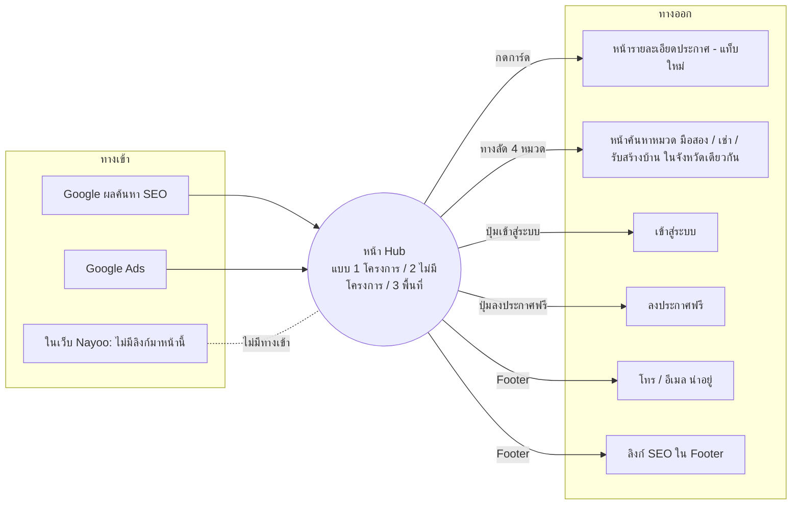

| รายการ | ค่า |
|--------|-----|
| เวอร์ชัน | v0.8 |
| อ้างอิง | [FRD.md](https://wiki.infonayoo.co/doc/frd-project-hub-Dw40PXWdyL) · [user-stories.md](https://wiki.infonayoo.co/doc/user-stories-project-hub-caojCMUDmj) |
| ขอบเขต | จากทางเข้า ผ่านหน้า project hub ไปทางออก (ไม่ลงรายละเอียดหน้าอื่น) |
| อัปเดต | 2026-11-27 |

> เส้นประหมายถึงสันนิษฐานหรือรอยืนยัน (อ้าง Q-xx ใน FRD §5)

## 1. ภาพรวม: จากทางเข้า ผ่านหน้า hub ไปทางออก



## 2. ภายในหน้า hub

```mermaid
flowchart TD
  S([เปิดหน้า]) --> TY{แบบหน้า - ทีม SEO เลือก}
  TY -- แบบ 1 --> P1[ส่วนข้อมูลโครงการ + แท็บ Highlight/ที่อยู่/รูป/รายละเอียด/สิ่งอำนวยความสะดวก] --> L{โหลดข้อมูล}
  TY -- แบบ 2 --> E0[หัวข้อ SEO + แท็บขาย/เช่าว่าง]
  TY -- แบบ 3 --> L
  L -- สำเร็จ มีประกาศขาย --> R[แสดงหัวข้อ + แท็บขาย เฉพาะมือ 2 + Tag 2 ตัว + การ์ดหน้า 1 - แก้]
  L -- ไม่มีประกาศขาย --> E[แท็บขายว่าง + ปุ่มดูโครงการใกล้เคียง - ใหม่]
  E -.->|ปลายทาง Q-20| X4([ออก: ?])
  L -.->|error (Q-13)| ER[Error state]

  R --> T{กดแท็บ}
  T -- ขาย --> R
  T -- เช่า --> RC{มีประกาศเช่าไหม}
  RC -- มี --> R2[การ์ดประกาศเช่าของโครงการ]
  RC -- ไม่มี --> E2[แท็บเช่า + ข้อความว่าง ไม่มีการ์ด - ใหม่]

  R --> SO[กดปุ่มเรียง: แนะนำ/ล่าสุด/ราคาน้อย-มาก/มาก-น้อย] --> RS[เรียงใหม่ กลับหน้า 1]
  RS --> R
  R --> F[กด Tag เลือกได้หลายตัว] --> RS
  R --> P[กดเลขหน้า / หน้าแรก / หน้าสุดท้าย] --> R
  R --> PV[เปลี่ยนจังหวัดใน Navbar] --> X0([ออก: หน้าค้นหาประกาศมือ 1 ของจังหวัดนั้น])

  R --> C[กดการ์ด] --> X1([ออก: หน้ารายละเอียด])
  R --> IC[กด Insert card - ใหม่] --> X5([ออก: ใบประกาศที่ Insert card ผูกไว้])
  R --> BR[กดการ์ดแบรนด์โครงการ / ดูทั้งหมด - ใหม่] --> X6([ออก: โปรไฟล์แบรนด์ / หน้ารวมแบรนด์จังหวัด Q-40])
  R --> BN[กด Banner คั่น - ใหม่] --> X7([ออก: ลิงก์ของแบนเนอร์ แท็บใหม่])
  R --> AR[กดการ์ดบทความ - ใหม่] --> X8([ออก: หน้าบทความ])
  R --> SC[ทางลัด 4 หมวด] --> X3([ออก: หน้ารวมหมวด])
  R -.->|แบบ 1 ฉบับ PO ไม่มี: Q-38| FAQ[กาง/พับ หัวข้อ SEO-FAQ] --> R
```

## Change log

| เวอร์ชัน | วันที่ | โดย | เปลี่ยนอะไร |
|----------|--------|-----|-------------|
| v0.1     | 2026-11-24 | Claude (ร่าง) | flow as-is 2 แผนภาพ |
| v0.2     | 2026-11-24 | Claude (ร่าง) / Johnny | ทางเข้าเหลือ Google SEO/Ads · แท็บเช่าว่างเปลี่ยนเป็นข้อความว่าง |
| v0.5     | 2026-11-24 | Claude (ร่าง) / Johnny | ตัด bookmark/วิดีโอ, ทางลัด, เปลี่ยนจังหวัด, เรียง, Tag, แท็บขายว่าง |
| v0.7     | 2026-11-24 | Claude (ร่าง) / Johnny | ปรับสำนวนให้อ่านง่าย (แผนภาพไม่เปลี่ยน) |
| v0.8     | 2026-11-27 | Claude (ร่าง) / Johnny | ตาม FRD v0.10: แท็บขายเฉพาะมือ 2 + Tag 2 ตัว · ทางออกใหม่จาก Insert card, แบรนด์โครงการ, Banner คั่น, บทความ · SEO-FAQ เส้นประ รอ Q-38 |