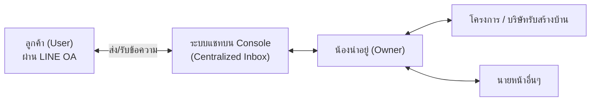

1\.กรอกข้อมุลรอบแรกแล้วกับรอบแรก คุยโครงการที่ 2-3 จะเป็นยังไงบ้าง ข้อมูลด้านกฎหมาย (โจทย์)

2\.ถ้าแชทแล้วมีชื่อเบอร์โทรทิ้งไว้ให้แล้วโครงการแฮปปี้อยู๋แล้ว

3\.ข้อความอยู่ที่ตรงรวบบ่อย

4. กระตุ้นลุกค้าครั้งแรกต่อคนใหม่
5. เฟดแรกระบบแชท ตุ่มนึงใน console มันคือหน้าแชทของ console 
6. scope off work : ถ้าทำแบบนี้ทำได้ทั้งหมดไหม 1.โครงการ 2. บริษัทรับสร้างบ้าน 3. นายหน้า
7. ยังไม่มี noticfication 
8. user Line oa  ที่แอดน้องน่าอยู๋ 1 คือมีไลน์จังหวัดทำแยกจังหวัด solution 

   
   1.  1 ใช้ตัวเดิมเขากับ user ยิงแตกต่างกัน 1 ฟังก์ชั่น
   2. อีกหน่อยควรเป้นไลน์ตัวเดียวกันไหม

* ระบบแชทบน console---→น้องน่าอยู่ (owner) โครงการและรับสร้างบ้าน / นายหน้าอื่นๆ , Line OA (user)    

เจ้าของทรัพย์ กับ นายหน้า  

# เอกสารความต้องการระบบ (Requirement Specification): ระบบแชท LINE OA & Console

**อ้างอิงจาก:** บันทึก `req ไลน์` (ฉบับอัปเดตครบ 8 ข้อ)\n**สถานะเอกสาร:** Draft (ฉบับร่างเพื่อทบทวนและสรุปประเด็น)

---

## 1. ภาพรวมระบบและผู้ใช้งาน (System Overview & Actors)

ระบบแชทเพื่อเชื่อมต่อการสื่อสารระหว่างลูกค้าผ่าน **LINE OA** เข้ากับหน้าจัดการแชทบน **Console** ของแพลตฟอร์ม โดยแบ่งฝั่งผู้ใช้งานดังนี้:

* **ฝั่งผู้ใช้งาน / ลูกค้า (User):** สนทนาผ่าน **LINE OA**
* **ฝั่งผู้ดูแล / ผู้ให้บริการ (Console):** ใช้งานผ่าน **ระบบแชทบน Console** ประกอบด้วย
  * **น้องน่าอยู่ (Owner / Admin กลาง)**
  * **โครงการ (Project / Developer)**
  * **บริษัทรับสร้างบ้าน (Home Builder)**
  * **นายหน้าอื่นๆ (Agent)**

---

## 2. ขอบเขตงานและแผนการพัฒนา (Scope of Work & Phasing)

### 2.1 เฟสแรก (Phase 1)

* **In-Scope:** พัฒนา **ระบบแชทเป็นปุ่ม/เมนูหนึ่งใน Console** เพื่อเปิดเข้าสู่หน้าแชทของ Console โดยตรง
* **Out-of-Scope (ข้อจำกัดเฟสแรก):** **ยังไม่มีระบบแจ้งเตือน (Notification)** ในเฟสแรก

### 2.2 กลุ่มเป้าหมายที่ต้องการรองรับ (Target Segments)

ต้องตรวจสอบและยืนยันว่ารูปแบบระบบแชทนี้สามารถรองรับการทำงานได้ครบทั้ง 3 กลุ่มหรือไม่:

1. **โครงการ (Project)**
2. **บริษัทรับสร้างบ้าน (Home Builder)**
3. **นายหน้า (Agent)**

---

## 3. รายละเอียดความต้องการ (Functional Requirements)

| รหัส | หัวข้อ | รายละเอียดความต้องการ |
|:-----|:-------|:----------------------|
| **FR-01** | **การจัดการข้อมูลลูกค้าข้ามโครงการ & กฎหมาย (Cross-Project Data & PDPA)** | กรณีลูกค้ากรอกข้อมูลติดต่อในรอบแรกแล้ว เมื่อลูกค้าทักคุยกับ **โครงการที่ 2 หรือ 3** ต้องกำหนด Flow การจัดการข้อมูลให้ชัดเจนว่าจะดึงข้อมูลเดิมมาใช้เลยหรือไม่ และต้องสอดคล้องกับ **ข้อกำหนดด้านกฎหมาย / PDPA** |
| **FR-02** | **การแสดงข้อมูลติดต่อในแชท (Lead Contact Capture)** | หากลูกค้ามีการแชทและทิ้ง **ชื่อ + เบอร์โทรศัพท์** ไว้ ระบบต้องแสดง/ส่งมอบข้อมูลนี้ให้โครงการเห็นได้ชัดเจน เพื่อให้โครงการนำไปติดต่อต่อได้ทันที |
| **FR-03** | **จุดรวมข้อความ (Centralized Message Hub)** | ออกแบบตำแหน่งและหน้าจอให้ข้อความถูกรวบรวมไว้ในจุดที่เข้าถึงง่ายและใช้งานได้บ่อย เพื่อลดปัญหาการพลาดข้อความ (โดยเฉพาะในเฟสแรกที่ยังไม่มี Notification) |
| **FR-04** | **การกระตุ้นลูกค้าใหม่ครั้งแรก (First-Time Engagement)** | มีกลไกหรือข้อความอัตโนมัติสำหรับ **กระตุ้นลูกค้าในการทักครั้งแรก** สำหรับลูกค้าคนใหม่ |
| **FR-05** | **หน้าแชทบน Console (Console Chat Entry)** | ในเฟสแรก เพิ่มปุ่ม/จุดเข้าใช้งานระบบแชทบนหน้า Console เพื่อเชื่อมไปยังหน้าแชทของ Console |
| **FR-06** | **การรองรับโครงสร้าง LINE OA (Multi-Province vs Unified OA)** | ปัจจุบันลูกค้าแอด LINE OA น้องน่าอยู่แบบ **แยกตามจังหวัด** ต้องออกแบบ Solution รองรับการเชื่อมต่อระหว่าง LINE OA กับระบบแชทบน Console |

---

## 4. โจทย์สถาปัตยกรรม LINE OA (LINE OA Architecture Options)

จากข้อ 8 ที่ปัจจุบันมี **LINE OA น้องน่าอยู่แบบแยกตามจังหวัด** มีแนวทาง (Solution) ที่ต้องพิจารณา 2 ระยะ/ทางเลือก:

1. **ระยะสั้น / แนวทางที่ 1 (ใช้ LINE OA ตัวเดิมแยกจังหวัด):**
   * ใช้ LINE OA ตัวเดิมที่ลูกค้าแอดอยู่แล้ว โดยเชื่อมต่อเข้ากับระบบและยิงฟังก์ชัน/ข้อความแยกตามเงื่อนไขที่แตกต่างกัน (เพิ่ม 1 ฟังก์ชันรองรับการแยกการทำงาน)
2. **ระยะยาว / แนวทางที่ 2 (รวมเป็น LINE OA ตัวเดียวกัน):**
   * พิจารณาว่าในอนาคต **ควรรวมเป็น LINE OA ตัวเดียวกันหรือไม่** เพื่อลดความซ้ำซ้อนในการดูแล, การทำ CRM/Broadcast และประสบการณ์ของลูกค้าที่อาจดูบ้านข้ามจังหวัด

---

## 5. ประเด็นที่ต้องสรุปเพิ่มเติม (Open Questions / Action Items)

> [!IMPORTANT] ประเด็นต่อไปนี้ควรสรุปให้ชัดเจนก่อนเข้าสู่ขั้นตอนออกแบบ UX/UI และพัฒนา:

1. **ข้อกฎหมายและ PDPA (ข้อ 1):**
   * เมื่อลูกค้ากรอกข้อมูลให้โครงการที่ 1 แล้ว หากทักโครงการที่ 2–3 ต้องขอ Consent ใหม่ทุกโครงการ หรือใช้ Consent กลางในการส่งต่อข้อมูล?
   * ข้อมูลที่เคยกรอกจะถูก Auto-fill ให้กดยืนยัน หรือส่งให้โครงการใหม่อัตโนมัติ?
2. **ขอบเขตและสิทธิ์การเข้าถึงแต่ละกลุ่ม (ข้อ 6):**
   * โครงสร้างหน้าแชทเดียวกันนี้รองรับ Flow ของ **โครงการ**, **บริษัทรับสร้างบ้าน**, และ **นายหน้า** ได้ทั้งหมดหรือไม่?
   * บทบาทของ **น้องน่าอยู่ (Owner)** ในแชทคือเห็นทุกห้องเป็นตัวกลาง หรือคอยตอบเบื้องต้นก่อนส่งต่อ?
3. **ผลกระทบจากการยังไม่มี Notification ในเฟสแรก (ข้อ 7):**
   * ควรมี Indicator แจ้งจำนวนข้อความยังไม่ได้อ่าน (Unread Badge) บนปุ่มแชทใน Console หรือไม่ เพื่อให้ผู้ดูแลสังเกตเห็นได้เมื่อเปิดหน้า Console
4. **การตัดสินใจเรื่อง LINE OA แยกจังหวัด vs ตัวเดียว (ข้อ 8):**
   * ยืนยันแนวทางสำหรับเฟสแรกว่าจะใช้ LINE OA ตัวเดิมแยกจังหวัดไปก่อนใช่หรือไม่ และมีแผน/เงื่อนไขในการยุบรวมเป็น LINE OA ตัวเดียวในอนาคตอย่างไร?