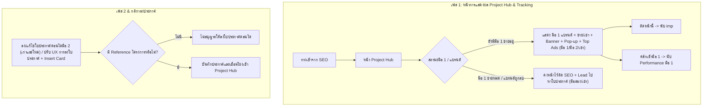

**1.หน้าใบประกาศขาย ใบประกาศมือสอง เช่า ในหน้า project hub มีเกณฑ์การคัดเลือกยังไงในการเข้าหน้า project hub**

2. **ถ้าคอนโดมือ 2 ไม่ referecne จะไม่สามารถลงใบประกาศคอนโดได้เลย ทำทั้งของเก่าและของใหม่**
3. **โปรเจคนี่สำคัญมาก สำหรับบบ้านพร้อม** 
4. **การเก็บ data จะเก็บข้อมูลยังไง ถ้ามันติดหน้านี่ นับ imp , ถ้าคลิ๊กเข้ามือ 1 ก็ได้ performance มือ 1 ก็นับ**

   
   1. ถ้าขายไปกทม จะสู้ได้ พวกโครงสร้างแบบ project hub
5. **แก้ ux การลงใบประกาศ  (เฟด 2)**

   
   1. insert card 
6. **ทำหน้าการแสดงผล (เฟด 1)**

   
   1. ทางเข้า อยู่ที่ SEO 
   2. banner 
   3. pop up
   4. top ads มือ 1 มือ 2 เช่า
7. **โฟกัสที่จังหวัด ขอนแก่น บุรีรัมย์ พิษณุโลก**

# Requirement: Project Hub

* **สถานะเอกสาร:** Draft (อัปเดตจาก Requirement Note ล่าสุดของผู้ใช้)
* **วันที่จัดทำ:** 2026-11-24
* **แหล่งที่มา:** ภาพบันทึก `Requirement project hub` และรายการอัปเดตเพิ่มเติม (เฟส 1 / เฟส 2)

---

## 1. วัตถุประสงค์และบริบททางธุรกิจ (Context & Business Objectives)

* **เป้าหมายหลัก:** พัฒนาโครงสร้างหน้า **Project Hub** เพื่อเป็นศูนย์กลางรวมข้อมูลระดับโครงการ (มือ 1 แบรนด์ + ใบประกาศขายมือสอง + ใบประกาศเช่า)
* **ความสำคัญทางธุรกิจ:**
  * มีความสำคัญมากสำหรับกลุ่ม **บ้านพร้อม**
  * รองรับการแข่งขันหากขาย/ขยายตลาดเข้าสู่พื้นที่ **กรุงเทพมหานคร (กทม.)** ซึ่งคู่แข่งใช้โครงสร้างแบบ Project Hub

---

## 2. แผนการแบ่งเฟสและขอบเขตงาน (Phasing & Scope)

### เฟส 1: ทำหน้าการแสดงผล (Display & Entry Points)

* **องค์ประกอบหลัก (Solution เบื้องต้น):** แสดงข้อมูลโครงการ **มือ 1 แบรนด์** ควบคู่กับใบประกาศ **ขาย และ เช่า**
* **ทางเข้า (Entry Point):** มาจาก **SEO , บนเว็บไซต์**
* **ส่วนแสดงผล / ช่องทางโฆษณาที่เกี่ยวข้องในหน้า:**
  * **Banner**
  * **Pop-up**
  * **Top Ads** (รองรับทั้ง **มือ 1**, **มือ 2**, **เช่า**)
* **กรณี Fallback / SEO Continuity:** หากใบประกาศ **มือ 1 ขายหมด** หรือ **แบรนด์นั้นถูกลบแล้ว** ให้ยังคงหน้าไว้เพื่อ **ติด SEO** และ **Lead ไปหาใบประกาศ** แทนได้

### เฟส 2: แก้ UX การลงใบประกาศ (Listing Creation UX)

* ปรับปรุง **UX การลงใบประกาศ**
* รองรับส่วน **Insert Card**
* *(รอระบุขอบเขตเพิ่ม: การบังคับ Reference คอนโดมือ 2 ของเก่า/ใหม่ จะเริ่มบังคับใช้ตั้งแต่เฟส 1 หรือเฟส 2)*

---

## 3. รายละเอียด Requirements (`REQ`)

| รหัส | เฟส | หัวข้อ | รายละเอียดเงื่อนไขและผลการทำงาน | สถานะ |
|:-----|:----|:-------|:--------------------------------|:------|
| **REQ-01** | Phase 1 | **เกณฑ์การคัดเลือกเข้าหน้า Project Hub** | ต้องกำหนดเกณฑ์ (Eligibility Criteria) ในการคัดเลือก **หน้าใบประกาศขาย, ใบประกาศมือสอง และใบประกาศเช่า** เพื่อเข้าสู่หน้า Project Hub | `Pending Decision` *(รอระบุเกณฑ์คัดเลือก)* |
| **REQ-02** | Phase 1 / 2 *(รอยืนยัน)* | **บังคับ Reference สำหรับคอนโดมือ 2** | หาก **คอนโดมือ 2 ไม่ Reference** โครงการ **จะไม่สามารถลงใบประกาศคอนโดได้เลย** โดยต้องทำครอบคลุม **ทั้งของเก่า (Existing) และของใหม่ (New)** | `Source Confirmed` *(รอวิธีจัดการของเก่าและเฟสที่เริ่มใช้)* |
| **REQ-03** | All | **รองรับกลุ่มบ้านพร้อมและการขยายตลาด กทม.** | โครงสร้างหน้าและข้อมูล Project Hub ต้องตอบโจทย์ **บ้านพร้อม** และมีโครงสร้างที่แข่งขันได้เมื่อขยายตลาดไป **กทม.** | `Source Confirmed` |
| **REQ-04** | Phase 1 | **การเก็บ Data: Impression & Performance มือ 1** | • หากรายการ/หน้าติดแสดงผลบนหน้า Project Hub → **นับ Impression (**`**imp**`**)** • หากผู้ใช้คลิกเข้าดูรายละเอียด**มือ 1** จากหน้านี้ → **นับเป็น Performance ของฝั่งมือ 1 ด้วย** | `Source Confirmed` *(รอระบุ Event/Attribution Schema)* |
| **REQ-05** | Phase 1 | **โครงสร้างหน้าการแสดงผล Project Hub และช่องทางเข้า** | ทำหน้าการแสดงผล Project Hub โดยมี: •**ทางเข้า:** อยู่ที่ **SEO** •**ข้อมูลหลัก:**มือ 1 แบรนด์, ขาย และ เช่า •**องค์ประกอบ/โฆษณา:** Banner, Pop-up และ Top Ads (มือ 1, มือ 2, เช่า) | `Source Confirmed` *(รอรายละเอียดตำแหน่ง/เงื่อนไขแต่ละ slot)* |
| **REQ-06** | Phase 1 | **กรณีมือ 1 ขายหมด หรือแบรนด์ถูกลบ (SEO + Lead)** | กรณี **ใบประกาศมือ 1 ขายหมด** หรือ **แบรนด์นั้นถูกลบแล้ว** ระบบยังคงรักษาการ **ติด SEO** และทำหน้าที่ **Lead ไปหาใบประกาศ** (เช่น มือสอง / เช่า) ได้ | `Source Confirmed` *(รอระบุเงื่อนไข UI/Soft Delete)* |
| **REQ-07** | Phase 2 | **แก้ UX การลงใบประกาศ (Insert Card)** | ปรับปรุง **UX การลงใบประกาศ** รวมถึงการจัดการ/แสดงผล **Insert Card** | `Source Confirmed` *(รอสโคปรายละเอียด UX และ Insert Card)* |

---

## 4. Flow การทำงานภาพรวม (High-Level Flow)

---

## 5. ประเด็นที่ต้องสรุปเพิ่มเติม (Open Questions & Pending Decisions)

| ID  | หัวข้อ | คำถาม / สิ่งที่ต้องตัดสินใจ | ผู้เกี่ยวข้อง (Suggested Owner) |
|:----|:-------|:----------------------------|:--------------------------------|
| **Q-01** | **เกณฑ์คัดเลือกเข้า Project Hub** (`REQ-01`) | • ใบประกาศขาย / มือสอง / เช่า ต้องมีเงื่อนไขใดบ้างจึงจะเข้าหน้า Project Hub (เช่น สถานะ Active, ต้อง Reference โครงการ, เกณฑ์ราคา/ความครบถ้วนของข้อมูล, การเรียงลำดับ)? | PO / BA                         |
| **Q-02** | **คอนโดมือ 2 ของเก่า & เฟสที่บังคับ** (`REQ-02`) | • การบังคับ Reference คอนโดมือ 2 (เก่าและใหม่) จะทำใน **เฟส 1** หรือ **เฟส 2**? • ประกาศคอนโดมือ 2 ของเก่าที่ไม่มี Reference จะจัดการอย่างไร (ซ่อนจนกว่าจะแก้, บังคับใส่ตอน Edit, หรือให้ทีม Ops จับคู่ให้)? • กรณีไม่มีชื่อโครงการในระบบ Reference จะให้ผู้ลงประกาศทำอย่างไร? | PO / Ops / BA                   |
| **Q-03** | **การเก็บ Data & Performance** (`REQ-04`) | • **Impression (**`**imp**`**):**นับระดับ Page view ของ Project Hub หรือนับระดับ Card/Listing ที่แสดงผล? •**Performance มือ 1:** นับรวมในยอด Performance เดิมของมือ 1 ทันทีหรือไม่ และต้องแยก Source `project_hub`หรือไม่? •**Banner / Pop-up / Top Ads (มือ 1/มือ 2/เช่า):** ต้องเก็บ Impression / Click แยกตาม Slot และประเภทด้วยหรือไม่? | Data / BA / Tech                |
| **Q-04** | **รายละเอียดหน้าแสดงผลเฟส 1** (`REQ-05`, `REQ-06`) | • ตำแหน่งและเงื่อนไขการแสดงผลของ **Banner**, **Pop-up**, และ **Top Ads (มือ 1, มือ 2, เช่า)**ในหน้า Project Hub เป็นอย่างไร (ใช้กติกาเดียวกับหน้าจังหวัด/หน้าอื่นหรือไม่)? • เมื่อมือ 1 ขายหมดหรือแบรนด์ถูกลบ (Soft Delete) หน้า UI จะปรับแสดงผลอย่างไรเพื่อไม่ให้เกิด Soft 404 และ Lead ไปหาใบประกาศได้อย่างมีประสิทธิภาพ? | PO / UX-UI / SEO / BA           |
| **Q-05** | **รายละเอียด UX การลงประกาศ & Insert Card เฟส 2** (`REQ-07`) | • **Insert Card** ในเฟส 2 หมายถึงการปรับ Insert Card ใน flow ลงใบประกาศอย่างไร หรือแทรกการ์ดระหว่างรายการประกาศในหน้าใด? | PO / UX-UI / BA                 |
| **Q-06** | **ขอบเขตประเภททรัพย์** (`REQ-03`, `REQ-05`) | • โครงสร้าง Project Hub นี้ครอบคลุมเฉพาะคอนโด หรือรวมบ้าน/ทาวน์โฮม (สำหรับ **บ้านพร้อม** และตลาด **กทม.**) ด้วย? | PO / BA                         |

**wireframe หน้า project hub anga**

* top banner 
* bracdcam
* ชื่อโครงการ 
* รายละเอียด
* กดแล้วเปลี่ยนแท็บได้ 
  * จุดเด่นของโครงการ (design หรือจุดเด่นต่างๆ)
  * สถานที่ใกล้เคียง
  * ข้อมุลโครงการ 
  * ส่วนกลางของโครงการ
* side bar เติม ads ของโครงการได้ ยังไม่เลือกของโครงการใดโครงการนึง จะแบ่งฝั่ง แบ่ง trffice ไปที่โครงการอื่นได้ง่ายขึ้น  
* มีแท็บแบ่งขายกับเช่า design คล้านพวกหน้าโปรไฟล์
* h2 ตัวเลขจำนวน 100 ใบประกาศโครงการ 
* อาจจะทำไฮไลท์ การ์ดใบประกาศมือ 1 
* การ์ดมือสอง ชื่อรูปแบบของห้องประกาศห้อง 
* คำนวณยอดผ่อน section คำนวณยอดผ่อน
* บทความในจังหวัดนั้นมาแสดง

 

**Solution by P pop (ทำเหมือนหน้าใบประกาศมือ 1X**

* solution link ไปตามแท็บมือ 1 ไม่เอามาปนกับทรัพย์
* มีแท็บขายกับเช่า เจอฟีลเตอร์ปรกติ  แสดงทรัพย์ต่างๆ
* logic การแสดง top ads และมี logic ของ  insert card ด้วย มี logic ของ banner ,logo brand, pop up , pop up , แถบสื่อสาร, แคมเปญ footer อยู่ที่ seo +  ทรัพย์ใกล้เคียง(บ้านและทาวน์โฮม  top ads กวาดเรเดียน) สไลด์ข้าง
* มองหน้าเหมือนหน้าเสิร์ช
* จบล่างสุด หลัง paginate design ได้ปรกติตาม seo 
* อยากทำ link จาก section refeerenc ไปหน้า project hub 
  * โครงการขายหมดแล้ user จะมาเจอสองกับเช่าได้ยังไง อาจจะมีหรือไม่มีเหมือนเดิมก็ได้
  * URL พวกแบบบบ้าน ถ้า redircet จะติดปัญหาพวกของขาย น่าอยู่รีวิว บทความ vr360 
  * link กลับไปหน้า hub optional อยู่ที่ ทีม solution 
  * ชายหมด redirct ไปหน้าที่ project hub 
  * เข้าใบประกาศมือ 2 ไปหน้าprojec hub  เฟด 2 
    * link กับไปหน้าใบประกาศ กรณีเหลือขาย
    * link กลับไปหน้า project hub 
* ใบประกาศที่ขายหมดแล้ว แสดงบนหน้าเว้บ หาข้อมูลเพิ่ม
  * จะแสดง ใบประกาศคอนโดที่ใกล้เคียงขึ้นมา
* ใบประกาศที่ไม่มี link จะแสดงใบประกาศใกล้เคียง หาข้อมูลเพิ่ม

  \

# หน้า project hub

1. มี link ไปใบประกาศมือ 1 

   
   1. มีข้อมูลไปหน้าใบประกาศ
2. ไม่มี link ไปใบประกาศ 

   
   1. ถ้ามีข้อมูลมันก้จะแสดง ถ้าไม่มีก็จะกดแล้วไม่แสดง

โครงการข้อมูล