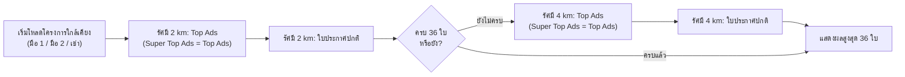

# Requirement: การแสดงผล Super Top Ads (ปรับ Logic การแสดงผลรายหน้า)

| หัวข้อ | รายละเอียด |
|:-------|:-----------|
| **ลิงก์เอกสารปลายทาง** | <https://wiki.infonayoo.co/doc/requirement-super-top-ads-IzIKFDdEdk> |
| **วันที่จัดทำ** | 23 พฤศจิกายน 2569 |
| **ขอบเขต** | การปรับ Logic การแสดงผล Super Top Ads ในกลุ่มหน้าที่แสดงเป็นการ์ด Top Ads ปกติ (โครงการแนะนำ, หน้าสินเชื่อจังหวัด, ดีเทลบทความจังหวัด และโครงการใกล้เคียง 3 หมวด) |
| **สถานะเอกสาร** | Draft / รอ Dev ประเมินความเป็นไปได้ (Feasibility) ในส่วนโครงการใกล้เคียง |
| **แหล่งอ้างอิง** | 1\. บันทึก Requirement จาก BA (ภาพแนบวันที่ 23 พ.ย. 2569) 2. Google Sheet[Product list 101](https://docs.google.com/spreadsheets/d/1zj_T0RGodLUPJm1LMNPM2xACTgplUG7P5g4Z5UOqmxk/edit) (แท็บ `การแสดงผล`, แก้ไขล่าสุด `2026-10-15`) |

---

## 1. วัตถุประสงค์ (Objective)

ปรับรูปแบบและ Logic การจัดลำดับของ **Super Top Ads** ในหน้าที่แสดงผลเป็น **การ์ด Top Ads ปกติ** ให้สอดคล้องกัน ลดความซับซ้อนในการล็อกตำแหน่งเดิม และให้ทีม Dev ทดลองจำลองการดึงข้อมูลแบบ **ขยายรัศมี (Radius 2 km ➔ 4 km)** สำหรับ Section โครงการใกล้เคียงทั้ง 3 หมวด (มือ 1, มือ 2, เช่า)

---

## 2. สรุปข้อกำหนด (Functional Requirements)

### 2.1 กลุ่มหน้า Shuffle ร่วมกับ Top Ads ปกติ (`user_confirmed`)

| Rule ID | หน้าการแสดงผล | เงื่อนไข ➔ การทำงาน ➔ ผลลัพธ์ | รูปแบบการ์ด | สถานะ |
|:--------|:--------------|:------------------------------|:------------|:------|
| **STA-01** | **โครงการแนะนำ** *(หน้าใบประกาศมือ 2)* | เมื่อดึงรายการโฆษณาในส่วนโครงการแนะนำ ➔ นำใบประกาศ **Super Top Ads มา Shuffle ร่วมกับ Top Ads ปกติ** ในกลุ่มเดียวกัน ➔ แสดงผลเรียงตามผล Shuffle *(ยกเลิกการล็อก Super ตำแหน่งที่ 1 เดิม)* | การ์ด Top Ads ปกติ | `user_confirmed` |
| **STA-02** | **หน้าสินเชื่อจังหวัด** *(หน้าคำนวณสินเชื่อจังหวัด)* | เมื่อดึงรายการโฆษณาในหน้าคำนวณสินเชื่อจังหวัด ➔ นำใบประกาศ **Super Top Ads มา Shuffle ร่วมกับ Top Ads ปกติ** ในกลุ่มเดียวกัน ➔ แสดงผลเรียงตามผล Shuffle | การ์ด Top Ads ปกติ | `user_confirmed` |
| **STA-03** | **ดีเทลบทความ จังหวัด** *(หน้ารายละเอียดบทความ)* | เมื่อดึงรายการโฆษณาในหน้ารายละเอียดบทความระดับจังหวัด ➔ นำใบประกาศ **Super Top Ads มา Shuffle ร่วมกับ Top Ads ปกติ** ในกลุ่มเดียวกัน ➔ แสดงผลเรียงตามผล Shuffle *(ยกเลิกการล็อก Super ตำแหน่งที่ 1 เดิม)* | การ์ด Top Ads ปกติ | `user_confirmed` |

---

### 2.2 โครงการใกล้เคียง — จำลองรัศมี (Radius Simulation) (`proposal` / `pending_decision`)

| Rule ID | หัวข้อ | เงื่อนไข ➔ การทำงาน ➔ ผลลัพธ์ | สถานะ |
|:--------|:-------|:------------------------------|:------|
| **STA-04** | **ขอบเขตหมวด & สิทธิ์ Ads** | ใช้ร่วมกันทั้ง **3 หมวด: มือ 1, มือ 2 และเช่า** โดยกำหนดให้สิทธิ์ `Super Top Ads = Top Ads` (นับรวมเป็นกลุ่ม Top Ads เดียวกัน ไม่แยกชนชั้น) | `user_confirmed` |
| **STA-05** | **การกวาดรัศมี 3 km แรก** *(0 – 3 km)* | เมื่อโหลด Section โครงการใกล้เคียง ➔ กวาดหา **Top Ads (รวม Super Top Ads)** ภายในรัศมี **0 – 3 km** ขึ้นแสดงก่อน ➔ จากนั้นแสดง **ใบประกาศปกติ** ภายในรัศมี **0 – 3 km** ตามลำดับปกติ *(หยุดทันทีหากครบ 36 ใบ)* | `proposal` *(ให้ Dev จำลอง)* |
| **STA-06** | **การขยายรัศมีจาก 3 km ถัดไป** *(เพิ่มทีละ +1 km/รอบ)* | เมื่อแสดงรายการในรัศมีรอบก่อนหน้าครบแล้ว *(เริ่มหลังจบ 3 km แรก)* แต่ยังไม่ครบเพดาน **36 ใบ** ➔ ขยายรัศมีเพิ่ม **+1 km** เป็นช่วงวงถัดไป *(เช่น >3–4 km, >4–5 km)* ➔ กวาดหา **Top Ads (รวม Super Top Ads)** เฉพาะในช่วงรัศมีรอบนั้น *(ไม่ซ้ำรอบก่อน)* ขึ้นแสดงก่อน ➔ จากนั้นแสดง **ใบประกาศปกติ** ในช่วงรัศมีรอบเดียวกันตามลำดับปกติ ➔ **วนขยายทีละ +1 km ซ้ำ** จนครบเพดาน | `proposal` *(ให้ Dev จำลอง)* |
| **STA-07** | **เพดานจำนวนรวม** | เติมรายการตามลำดับช่วงรัศมีข้างต้น *(Top Ads ➔ ใบประกาศปกติ ทีละช่วงวง)* ให้ครบ **สูงสุด 36 ใบ** *(หยุดกวาดทันทีเมื่อครบ 36 ใบ)* | `user_confirmed` |

 

## 3. ตารางเปรียบเทียบ Logic เดิม (Product list 101) vs Requirement ใหม่

| หน้าการแสดงผล | Logic เดิม (Product list 101) | Requirement ใหม่ (23 พ.ย. 2569) |
|:--------------|:------------------------------|:--------------------------------|
| **โครงการแนะนำ (หน้ามือ 2)** | ล็อก Super ตำแหน่งที่ 1 เสมอ (มี 2 ใบสลับ 1, 2) ที่เหลือ Top Ads (Ranking Model) | **Super Top Ads Shuffle ร่วมกับ Top Ads ปกติ** |
| **หน้าสินเชื่อจังหวัด** | Ranking Model ไม่จำกัด Slot แสดงผลแบบหน้าเสิร์ชมือ 1 | **Super Top Ads Shuffle ร่วมกับ Top Ads ปกติ** |
| **ดีเทลบทความ จังหวัด** | ล็อก Super ตำแหน่งที่ 1 เสมอ (สูงสุด 12 Slots, Ranking Model) | **Super Top Ads Shuffle ร่วมกับ Top Ads ปกติ** |
| **โครงการใกล้เคียง** | กรองประเภททรัพย์ในอำเภอเดียวกัน • Slot 1 Super, Slot 2–3/17/32 Top Ads, Insert Card 6 ตำแหน่ง | **ให้ Dev จำลอง Radius 2 km ➔ 4 km** (ใช้กับมือ 1, มือ 2, เช่า) โดย `Super Top Ads = Top Ads` กวาด Top Ads ➔ ปกติ ทีละวงรัศมีให้ครบ **36 ใบ** |

---

## 4. ประเด็นที่ต้องสอบถาม Dev / รอตัดสินใจ (Open Questions)

| รหัส | คำถาม / ประเด็น | ผู้รับผิดชอบ | สถานะ |
|:-----|:----------------|:-------------|:------|
| **OQ-01** | โครงสร้างการกวาดรัศมี 2 km ➔ 4 km แบบนี้ **Dev สามารถ Maintain ได้หรือไม่** โดยเฉพาะกรณี **แยกประเภททรัพย์** (เช่น คอนโดใกล้เคียง แยกเฉพาะคอนโด) | Dev          | `pending_decision` |
| **OQ-02** | กรณีรวมรัศมี 2 km + 4 km แล้วยังได้ใบประกาศ **ไม่ครบ 36 ใบ** ให้หยุดแสดงเท่าที่มี หรือขยายรัศมีต่อ (เช่น 6 km / ทั้งอำเภอ)? | BA / PO / Dev | `pending_decision` |
| **OQ-03** | ลำดับการเรียงภายในกลุ่ม `Top Ads` ของแต่ละวงรัศมี (2 km / 4 km) ให้ใช้ **Shuffle** หรือเรียงตาม **ระยะทางใกล้ ➔ ไกล**? | BA / Dev     | `pending_decision` |
| **OQ-04** | หน้า **ดีเทลบทความ จังหวัด** ใน Requirement ใหม่นี้ครอบคลุมถึง **หน้ารายละเอียดรีวิว** ด้วยหรือไม่ (เนื่องจากในชีท Product list 101 รวมไว้เป็น `หน้ารายละเอียดบทความ+รีวิว`)? | BA / PO      | `pending_decision` |